# AI 빌더랩 1기 목표 모델 · 예시 서비스

[](https://github.com/ghnam7312-droid/aibuilderlab-samples/actions/workflows/test.yml)    

[AI 빌더랩](https://aibuilderlab.kr) 트랙을 수료할 때 **이 정도는 만들어 배포한다**는 목표를 실제로 동작하는 서비스로 보여 주는 저장소입니다.
가상의 수강생 20명(커리어 6 · 창업 9 · 직장인 AX 5)이 8~10주 동안 만드는 프로젝트 3개씩, 서비스 60개를 담았습니다. 모든 서비스는 브라우저에서 바로 열어 써 볼 수 있습니다.

> 1기 목표 모델 예시입니다. 등장하는 사람·회사·학원과 숫자는 모두 가상이며, 수료생 실적이 아닙니다.
> 서비스는 샘플 데이터로 시작합니다. AI 기능은 [공용 서버](server)를 거쳐 Claude API로 동작하고, AI를 쓸 수 없을 때는 브라우저 규칙으로 바꿔 처리합니다. 어느 쪽으로 분석했는지는 화면에 항상 표시됩니다.

## 커리어 트랙 · 새벽기획자

AI 포트폴리오가 없던 취업 준비생이 8주 동안 기획 → 자동화 → 웹 서비스 순서로 만든 3개.

| | 서비스 | 하는 일 | 열어 보기 |
|---|---|---|---|
|  | **[한마디함](career-guestbook)** | 행사 익명 피드백을 받는 즉시 칭찬·개선 요청·질문으로 나눠 보여 주는 피드백 보드 | [데모](https://aibuilderlab.kr/demo/career-guestbook/index.html) |
|  | **[회의끝](career-meeting)** | 회의록에서 결정사항과 할 일(담당자·마감)을 찾아 업무판에 올리는 도구 | [데모](https://aibuilderlab.kr/demo/career-meeting/index.html) |
|  | **[하루치](career-study-prd)** | 오늘 할 몫만 보여 주는 AI 공부 코치 — 기획서 · 프로토타입 · 프롬프트 평가표 | [데모](https://aibuilderlab.kr/demo/career-study-prd/index.html) |

## 직장인 AX 트랙 · 엑셀탈출

매주 반복되는 사무 업무를 자동화해 월 24시간을 돌려받은 직장인의 3개.

| | 서비스 | 하는 일 | 열어 보기 |
|---|---|---|---|
|  | **[한장](ax-sales-merge)** | 10개 부서 실적 엑셀을 한 장으로 합치고, 보고 합계와 대조해 검산까지 | [데모](https://aibuilderlab.kr/demo/ax-sales-merge/index.html) |
|  | **[견적함](ax-quote-mail)** | 거래처 메일을 분류함에 나누고 견적 요청만 진행표로 정리 | [데모](https://aibuilderlab.kr/demo/ax-quote-mail/index.html) |
|  | **[금요보고](ax-weekly-report)** | 일별 숫자로 핵심 지표·차트·요약·메일 본문까지 A4 한 장 보고서 생성 | [데모](https://aibuilderlab.kr/demo/ax-weekly-report/index.html) |

## 창업 트랙 · 린스타터

학원 현장 인터뷰에서 출발해 유료 구독 서비스까지 간 예비 창업자의 3개.

| | 서비스 | 하는 일 | 열어 보기 |
|---|---|---|---|
|  | **[다음주](startup-academy-report)** | 단원 평가 결과를 학부모가 카카오톡으로 읽는 리포트로 바꾸는 학원용 SaaS | [데모](https://aibuilderlab.kr/demo/startup-academy-report/index.html) |
|  | **[오답지도](startup-wrong-answer)** | 학생 답만 넣으면 반 전체 오답을 지도로 칠하고 유형을 나누는 도구 | [데모](https://aibuilderlab.kr/demo/startup-wrong-answer/index.html) |
|  | **[들어보니](startup-interview-board)** | 인터뷰 근거를 태그하면 가설이 검증됨·반증됨으로 바뀌는 고객 인터뷰 보드 | [데모](https://aibuilderlab.kr/demo/startup-interview-board/index.html) |

## 직무·분야별 포트폴리오 (17명 × 3개)

홈페이지 [빌더 갤러리](https://aibuilderlab.kr/home/gallery.html)의 가상 수강생 17명이 만드는 서비스입니다. 이름을 누르면 그 사람의 포트폴리오가 열립니다.

### 커리어 트랙

**[전환율장인](https://aibuilderlab.kr/home/portfolio.html?p=marketer)** · 마케팅 · 경영학 · 퍼포먼스 마케터 지원

| | 서비스 | 하는 일 | 열어 보기 |
|---|---|---|---|
| 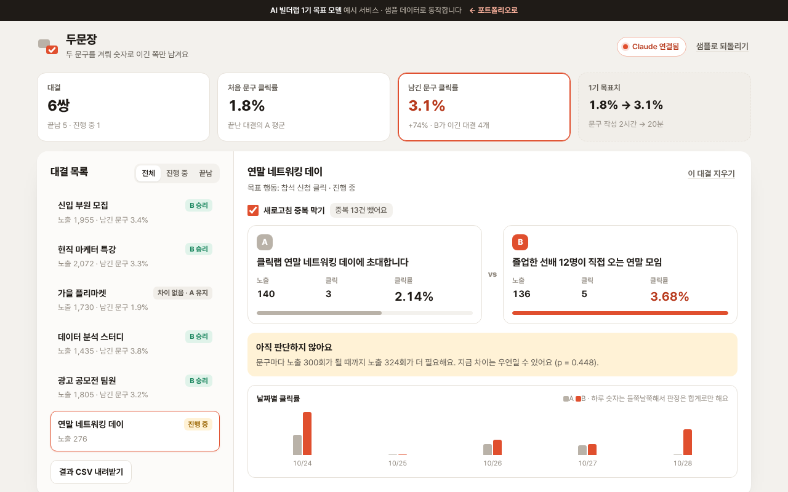 | **[두문장](career-ab-copy)** | 두 문구를 겨뤄 숫자로 이긴 쪽만 남겨요 | [데모](https://aibuilderlab.kr/demo/career-ab-copy/index.html) |
| 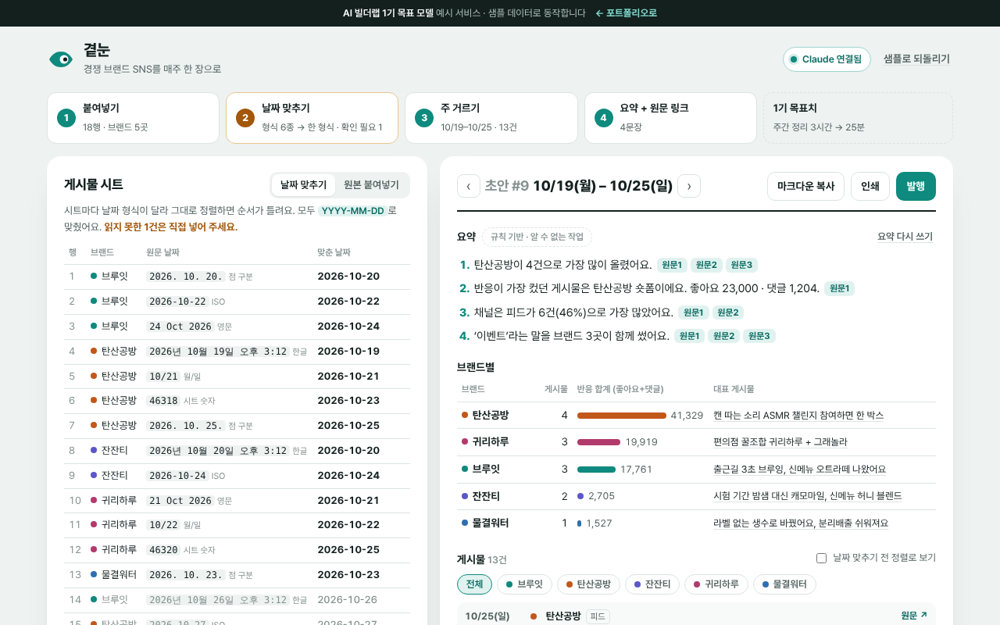 | **[곁눈](career-sns-report)** | 경쟁 브랜드 SNS를 매주 한 장으로 | [데모](https://aibuilderlab.kr/demo/career-sns-report/index.html) |
| 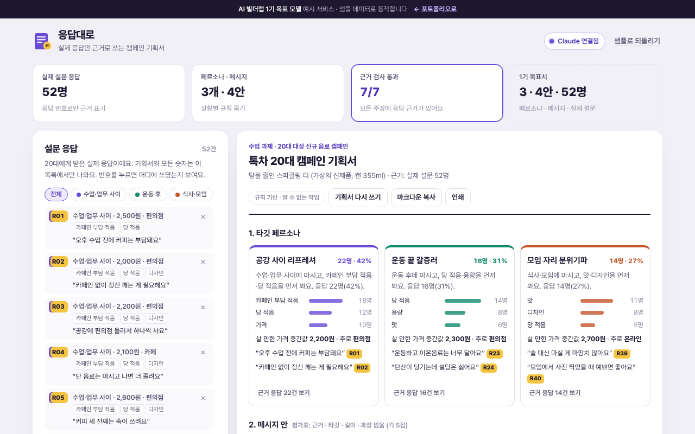 | **[응답대로](career-campaign-plan)** | 실제 응답만 근거로 쓰는 캠페인 기획서 | [데모](https://aibuilderlab.kr/demo/career-campaign-plan/index.html) |

**[숫자읽는사람](https://aibuilderlab.kr/home/portfolio.html?p=data-analyst)** · 데이터 분석 · 통계학 · 데이터 분석가 지원

| | 서비스 | 하는 일 | 열어 보기 |
|---|---|---|---|
| 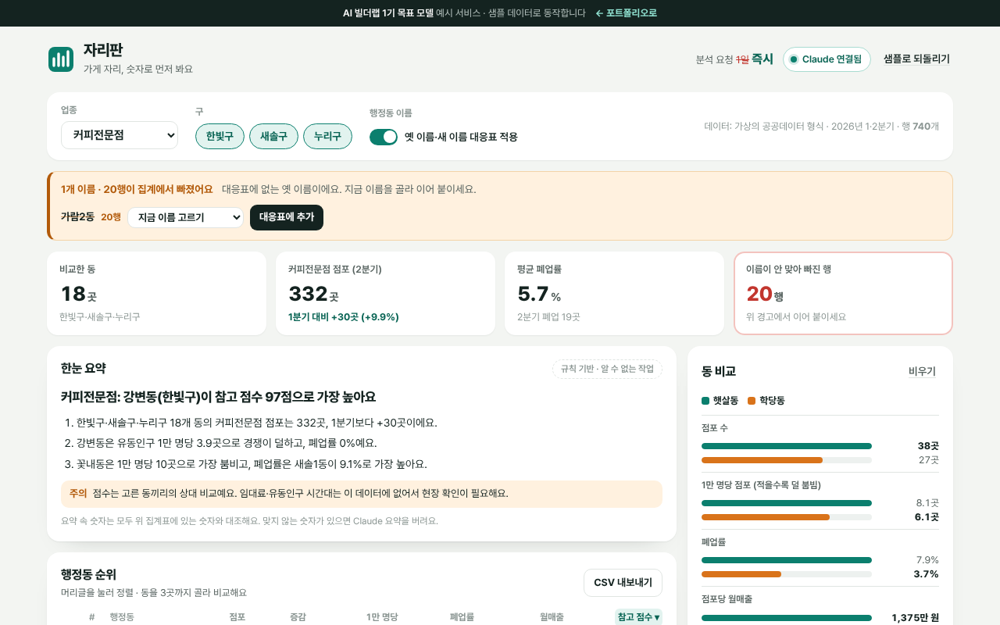 | **[자리판](career-district-dash)** | 가게 자리, 숫자로 먼저 봐요 | [데모](https://aibuilderlab.kr/demo/career-district-dash/index.html) |
| 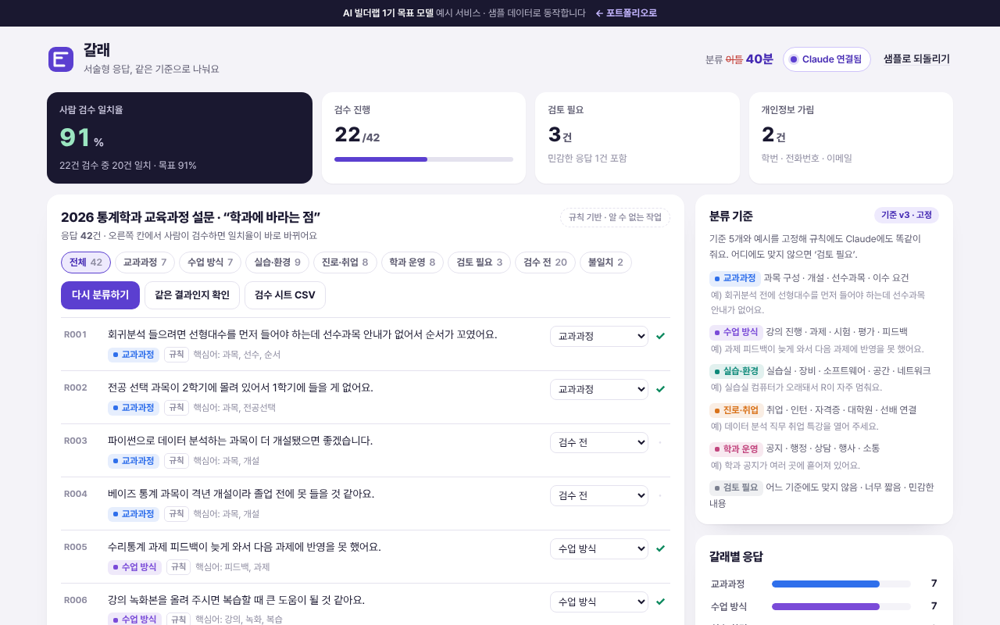 | **[갈래](career-survey-sort)** | 서술형 응답, 같은 기준으로 나눠요 | [데모](https://aibuilderlab.kr/demo/career-survey-sort/index.html) |
| 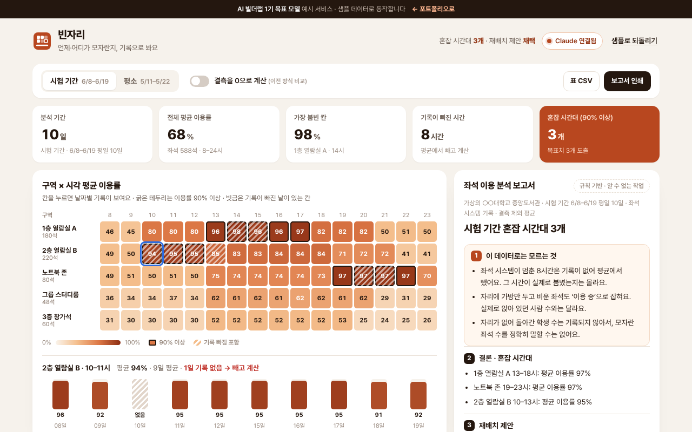 | **[빈자리](career-library-seat)** | 언제·어디가 모자란지, 기록으로 봐요 | [데모](https://aibuilderlab.kr/demo/career-library-seat/index.html) |

**[픽셀산책](https://aibuilderlab.kr/home/portfolio.html?p=ux-designer)** · UX·UI 디자인 · 시각디자인 · UX/UI 디자이너 지원

| | 서비스 | 하는 일 | 열어 보기 |
|---|---|---|---|
| 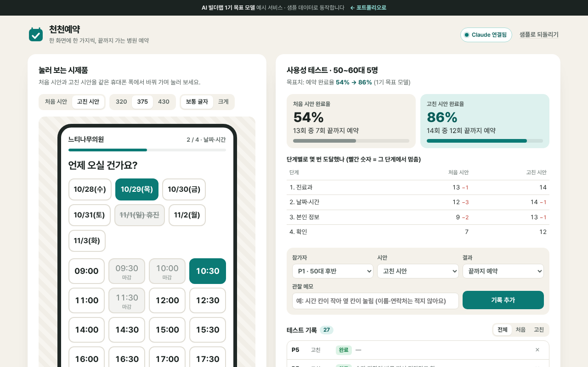 | **[천천예약](career-clinic-booking)** | 한 화면에 한 가지씩, 끝까지 가는 병원 예약 | [데모](https://aibuilderlab.kr/demo/career-clinic-booking/index.html) |
| 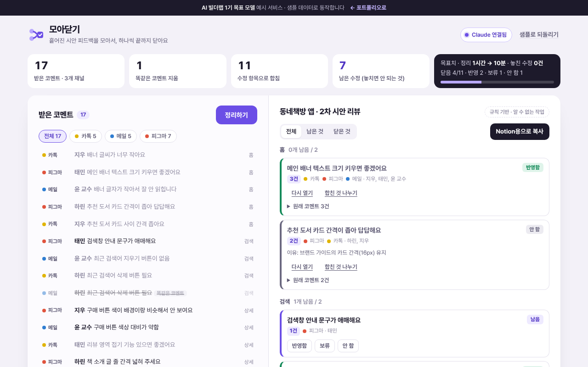 | **[모아닫기](career-design-review)** | 흩어진 시안 피드백을 모아서, 하나씩 끝까지 닫아요 | [데모](https://aibuilderlab.kr/demo/career-design-review/index.html) |
|  | **[또렷](career-kiosk-a11y)** | 키오스크 접근성 점검과 개선 제안서 | [데모](https://aibuilderlab.kr/demo/career-kiosk-a11y/index.html) |

**[배움설계자](https://aibuilderlab.kr/home/portfolio.html?p=edu-content)** · 교육 콘텐츠 기획 · 교육학 · 에듀테크 콘텐츠 기획자 지원

| | 서비스 | 하는 일 | 열어 보기 |
|---|---|---|---|
| 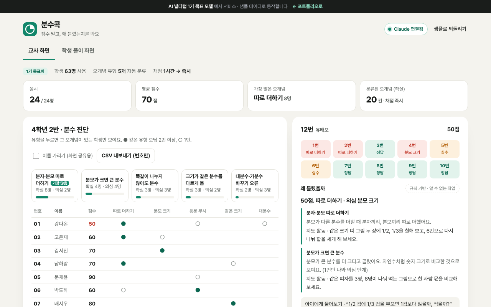 | **[분수콕](career-fraction-quiz)** | 점수 말고, 왜 틀렸는지를 봐요 | [데모](https://aibuilderlab.kr/demo/career-fraction-quiz/index.html) |
| 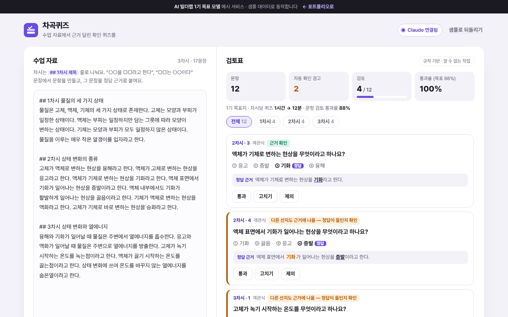 | **[차곡퀴즈](career-quiz-maker)** | 수업 자료에서 근거 달린 확인 퀴즈를 | [데모](https://aibuilderlab.kr/demo/career-quiz-maker/index.html) |
| 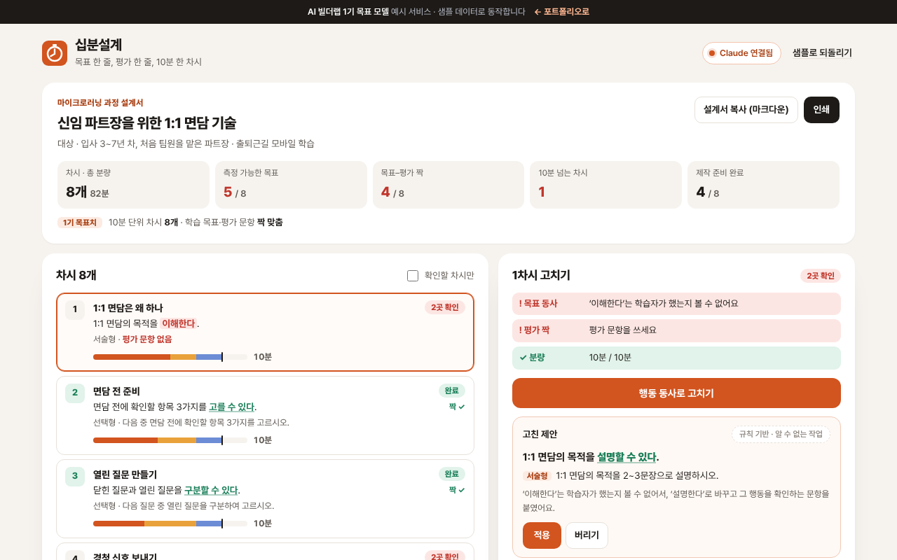 | **[십분설계](career-microlearning)** | 목표 한 줄, 평가 한 줄, 10분 한 차시 | [데모](https://aibuilderlab.kr/demo/career-microlearning/index.html) |

**[커밋하는곰](https://aibuilderlab.kr/home/portfolio.html?p=junior-dev)** · 주니어 개발 · 기계공학 · 주니어 웹 개발자 지원

| | 서비스 | 하는 일 | 열어 보기 |
|---|---|---|---|
| 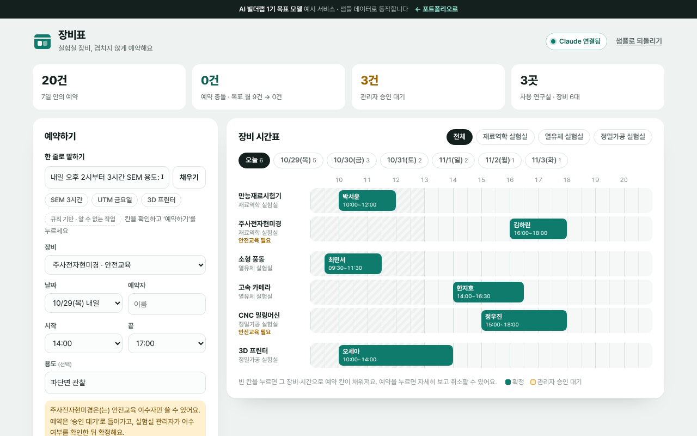 | **[장비표](career-lab-booking)** | 실험실 장비, 겹치지 않게 예약해요 | [데모](https://aibuilderlab.kr/demo/career-lab-booking/index.html) |
| 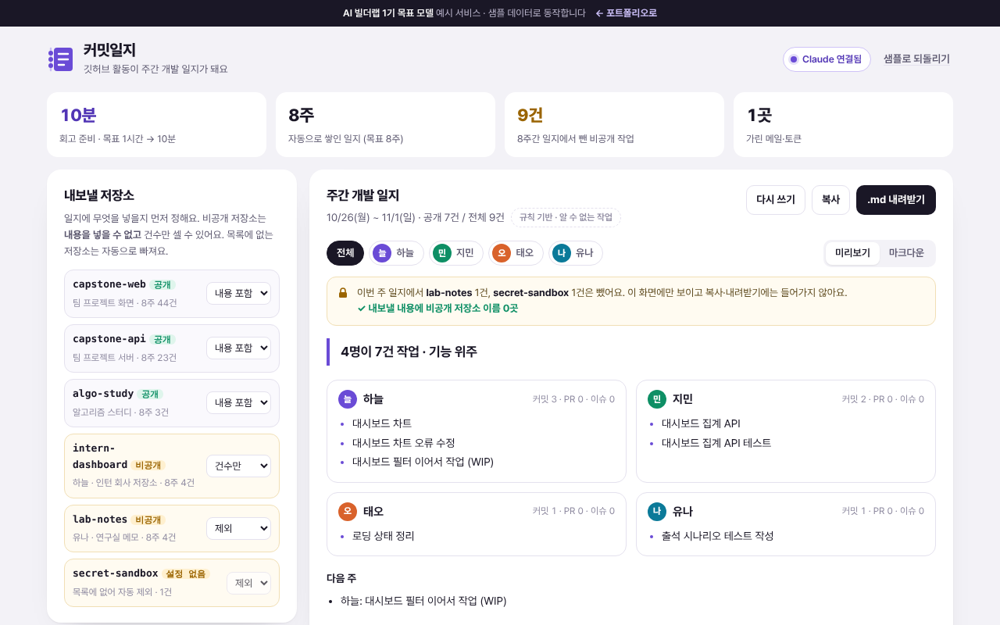 | **[커밋일지](career-devlog)** | 깃허브 활동이 주간 개발 일지가 돼요 | [데모](https://aibuilderlab.kr/demo/career-devlog/index.html) |
|  | **[뼈대](career-tech-spec)** | 화면부터 말고, 화면이 쓰는 데이터부터 | [데모](https://aibuilderlab.kr/demo/career-tech-spec/index.html) |

### 창업 트랙

**[스피킹메이트](https://aibuilderlab.kr/home/portfolio.html?p=english-tutor)** · 외국어 튜터링 · 영어 회화 튜터 6년 차

| | 서비스 | 하는 일 | 열어 보기 |
|---|---|---|---|
| 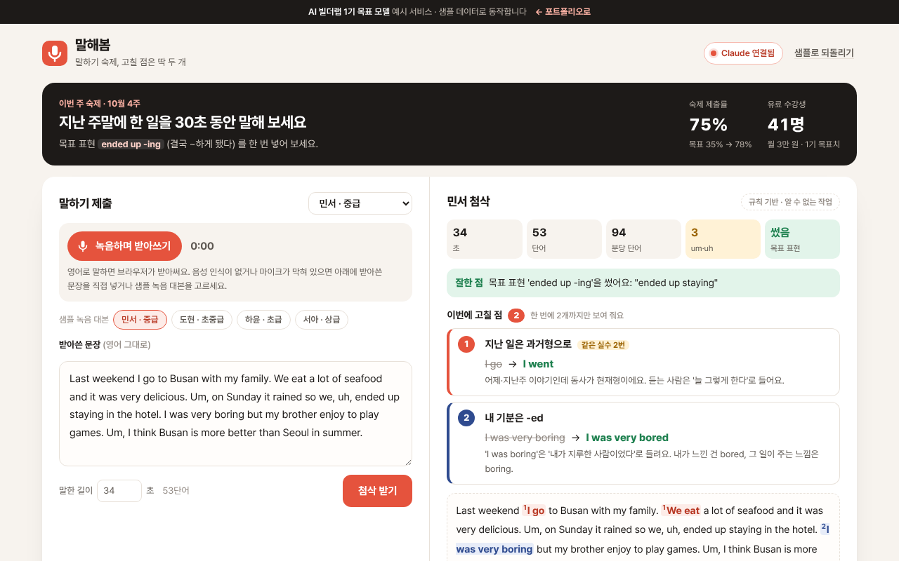 | **[말해봄](startup-speaking-coach)** | 말하기 숙제, 고칠 점은 딱 두 개 | [데모](https://aibuilderlab.kr/demo/startup-speaking-coach/index.html) |
| 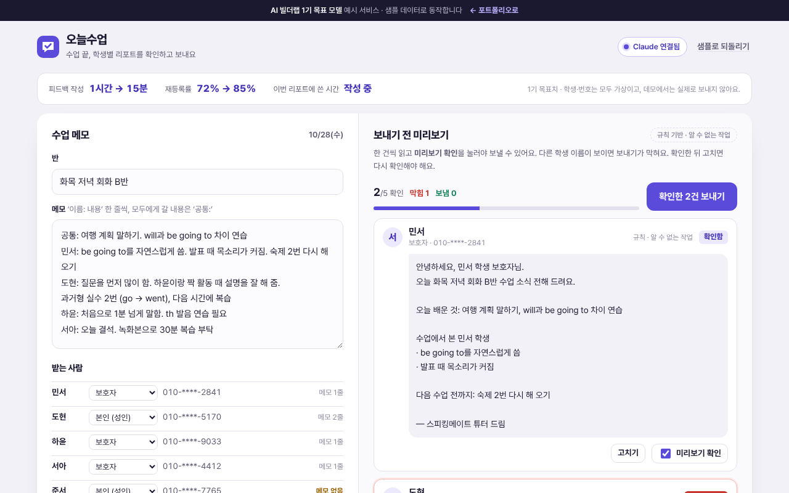 | **[오늘수업](startup-lesson-report)** | 수업 끝, 학생별 리포트를 확인하고 보내요 | [데모](https://aibuilderlab.kr/demo/startup-lesson-report/index.html) |
| 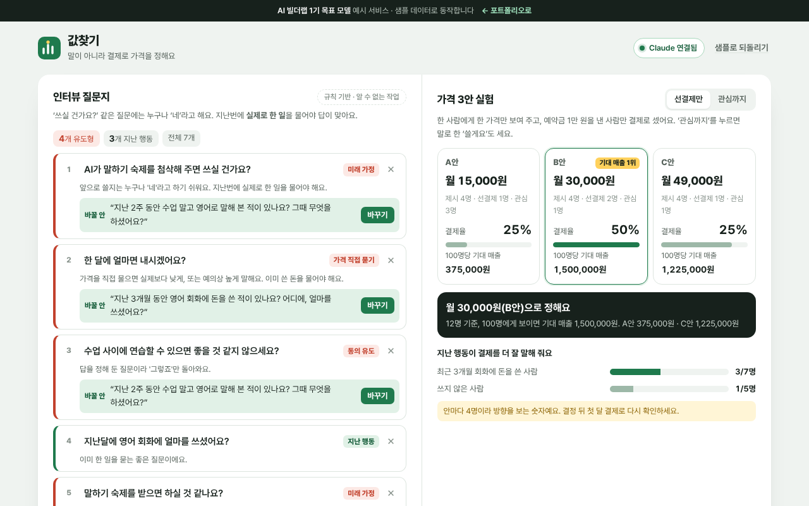 | **[값찾기](startup-price-test)** | 말이 아니라 결제로 가격을 정해요 | [데모](https://aibuilderlab.kr/demo/startup-price-test/index.html) |

**[이직나침반](https://aibuilderlab.kr/home/portfolio.html?p=career-coach)** · 커리어 코칭 · 전 HR 담당자 · 커리어 코치

| | 서비스 | 하는 일 | 열어 보기 |
|---|---|---|---|
|  | **[미리봄](startup-coach-brief)** | 상담 전 10분이면 고객이 보여요 | [데모](https://aibuilderlab.kr/demo/startup-coach-brief/index.html) |
| 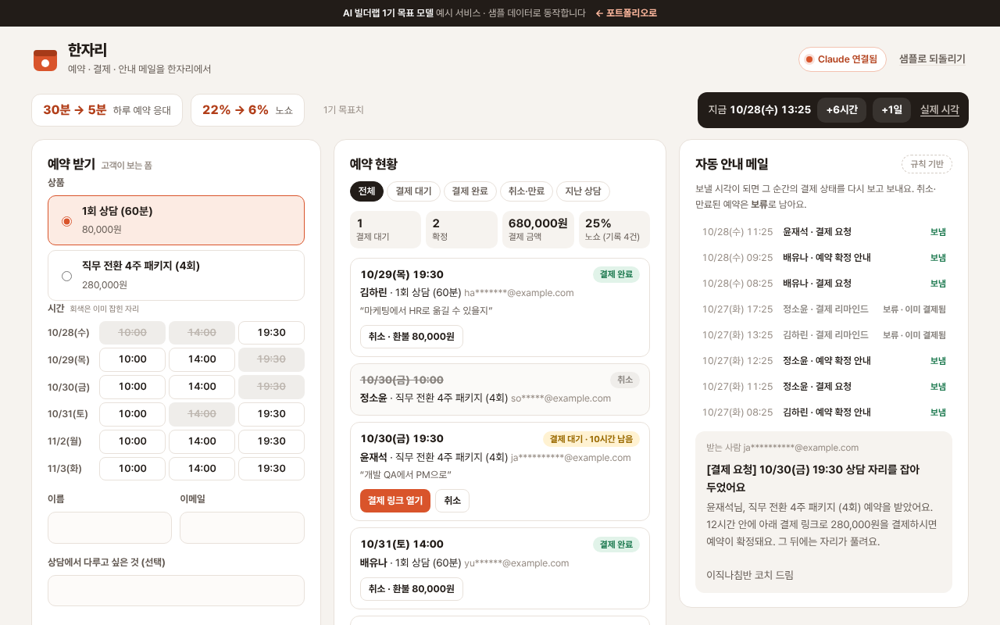 | **[한자리](startup-coach-booking)** | 예약 · 결제 · 안내 메일을 한자리에서 | [데모](https://aibuilderlab.kr/demo/startup-coach-booking/index.html) |
| 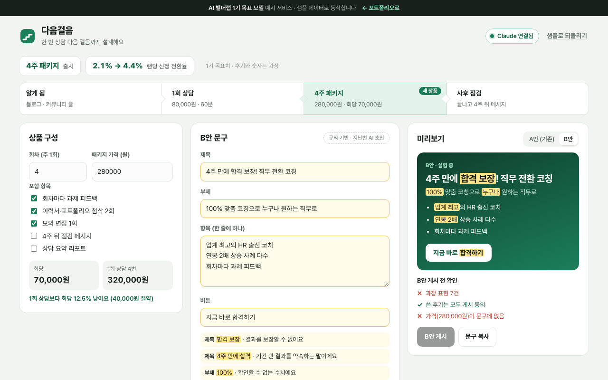 | **[다음걸음](startup-coach-landing)** | 한 번 상담 다음 걸음까지 설계해요 | [데모](https://aibuilderlab.kr/demo/startup-coach-landing/index.html) |

**[그림한스푼](https://aibuilderlab.kr/home/portfolio.html?p=online-class)** · 온라인 클래스 · 일러스트 작가 · 온라인 클래스 운영

| | 서비스 | 하는 일 | 열어 보기 |
|---|---|---|---|
| 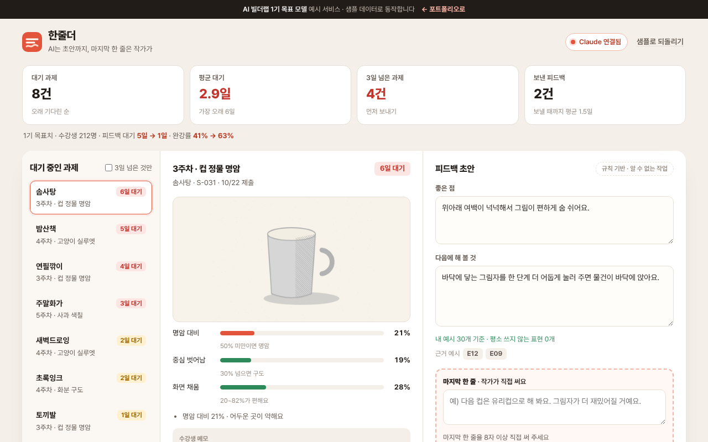 | **[한줄더](startup-class-feedback)** | AI는 초안까지, 마지막 한 줄은 작가가 | [데모](https://aibuilderlab.kr/demo/startup-class-feedback/index.html) |
| 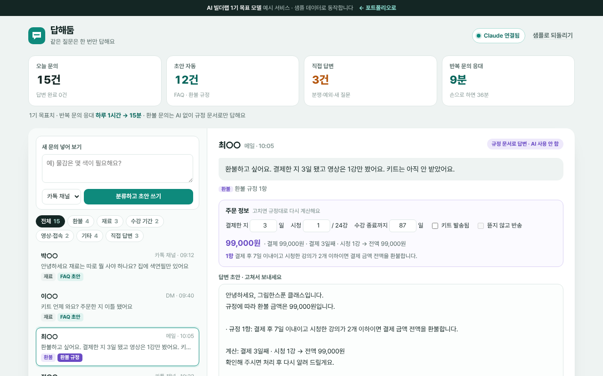 | **[답해둠](startup-class-faq)** | 같은 질문은 한 번만 답해요 | [데모](https://aibuilderlab.kr/demo/startup-class-faq/index.html) |
| 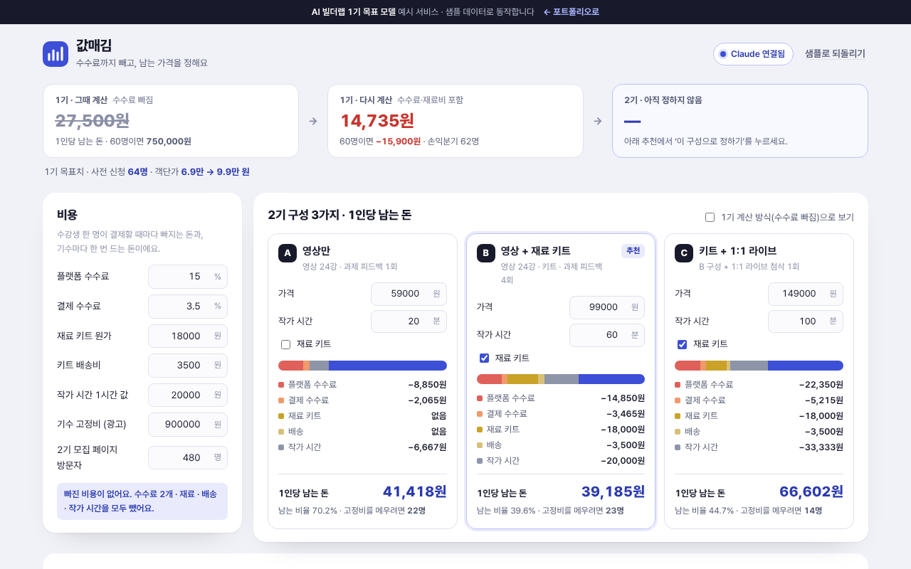 | **[값매김](startup-class-pricing)** | 수수료까지 빼고, 남는 가격을 정해요 | [데모](https://aibuilderlab.kr/demo/startup-class-pricing/index.html) |

**[노무한눈](https://aibuilderlab.kr/home/portfolio.html?p=labor-office)** · 전문 서비스 · 공인노무사 · 1인 사무소 개업 준비

| | 서비스 | 하는 일 | 열어 보기 |
|---|---|---|---|
| 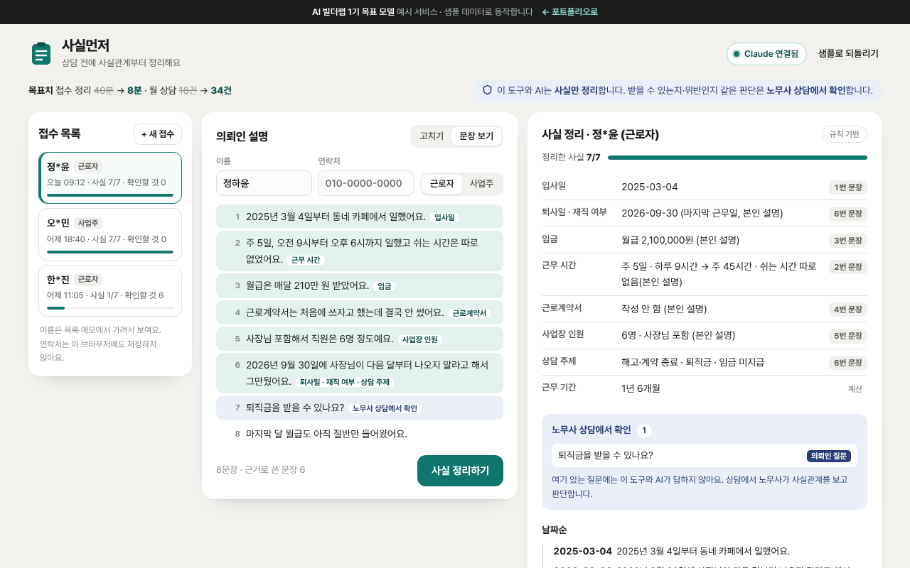 | **[사실먼저](startup-labor-intake)** | 상담 전에 사실관계부터 정리해요 | [데모](https://aibuilderlab.kr/demo/startup-labor-intake/index.html) |
| 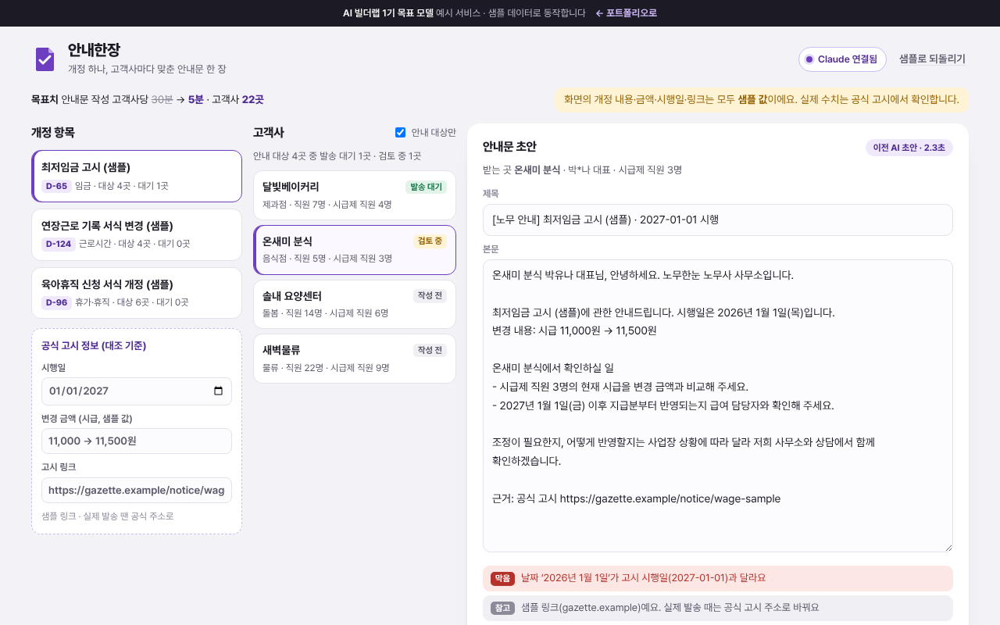 | **[안내한장](startup-labor-notice)** | 개정 하나, 고객사마다 맞춘 안내문 한 장 | [데모](https://aibuilderlab.kr/demo/startup-labor-notice/index.html) |
| 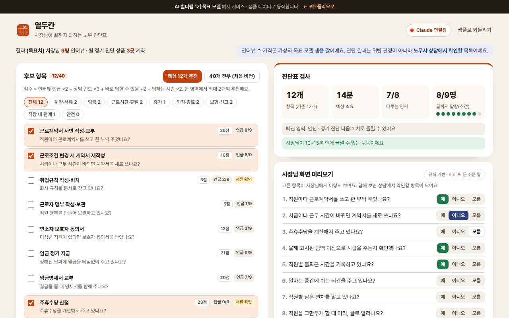 | **[열두칸](startup-labor-check)** | 사장님이 끝까지 답하는 노무 진단표 | [데모](https://aibuilderlab.kr/demo/startup-labor-check/index.html) |

**[업계한장](https://aibuilderlab.kr/home/portfolio.html?p=newsletter)** · 콘텐츠·뉴스레터 · 물류 업계 7년 차 · 뉴스레터 운영

| | 서비스 | 하는 일 | 열어 보기 |
|---|---|---|---|
| 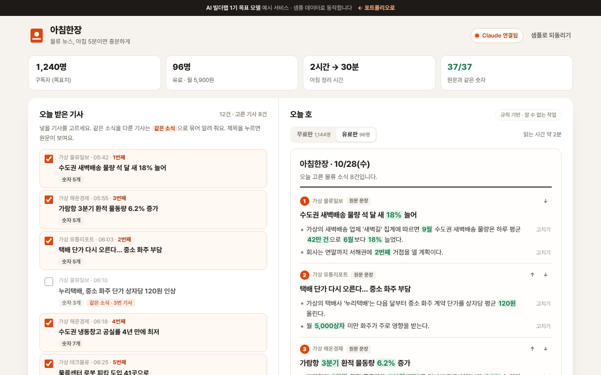 | **[아침한장](startup-news-digest)** | 물류 뉴스, 아침 5분이면 충분하게 | [데모](https://aibuilderlab.kr/demo/startup-news-digest/index.html) |
| 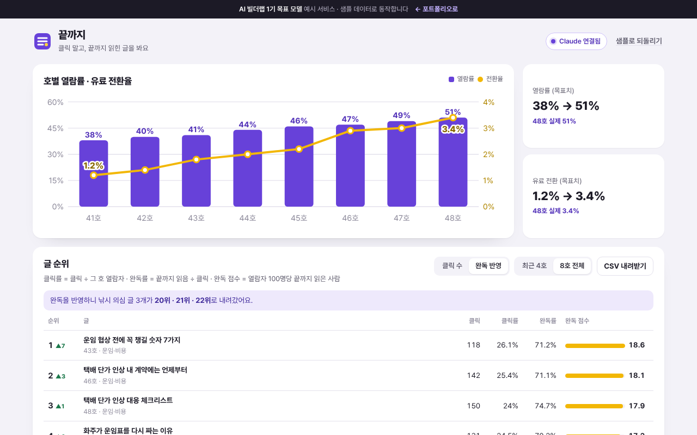 | **[끝까지](startup-news-insight)** | 클릭 말고, 끝까지 읽힌 글을 봐요 | [데모](https://aibuilderlab.kr/demo/startup-news-insight/index.html) |
| 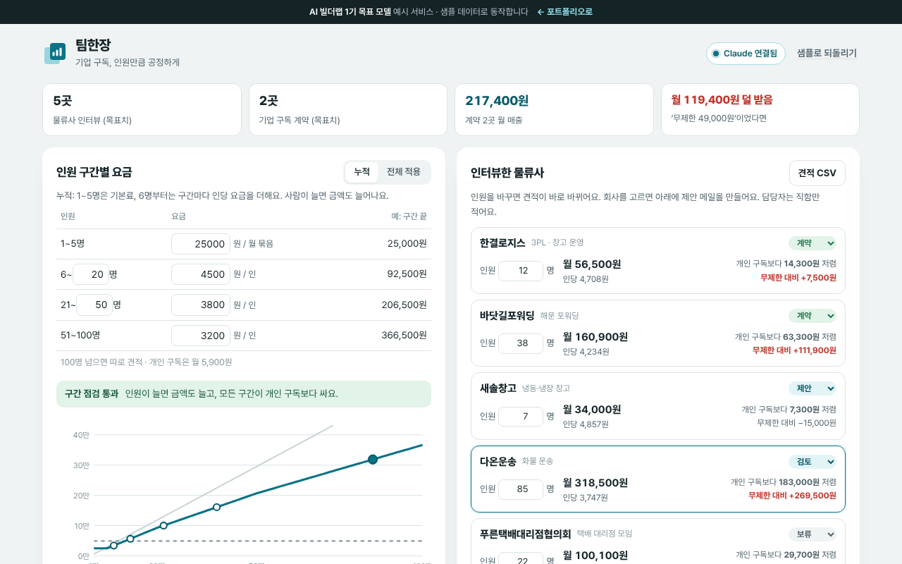 | **[팀한장](startup-news-b2b)** | 기업 구독, 인원만큼 공정하게 | [데모](https://aibuilderlab.kr/demo/startup-news-b2b/index.html) |

**[한걸음부모](https://aibuilderlab.kr/home/portfolio.html?p=parenting-edu)** · 부모 교육 · 유아교육 전공 · 부모 교육 강사

| | 서비스 | 하는 일 | 열어 보기 |
|---|---|---|---|
| 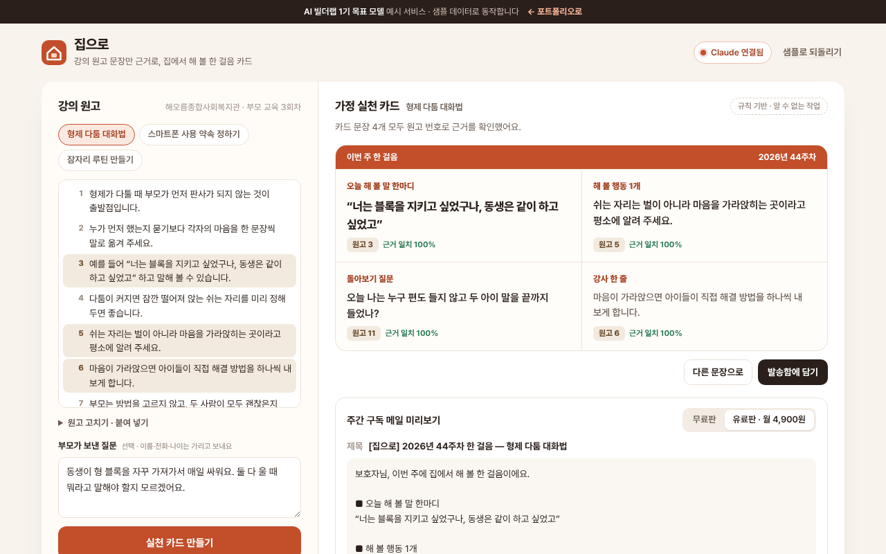 | **[집으로](startup-parent-cards)** | 강의 원고 문장만 근거로, 집에서 해 볼 한 걸음 카드 | [데모](https://aibuilderlab.kr/demo/startup-parent-cards/index.html) |
|  | **[자리있음](startup-parent-signup)** | 강의 신청 정리부터 안내 문자까지 | [데모](https://aibuilderlab.kr/demo/startup-parent-signup/index.html) |
|  | **[효과먼저](startup-parent-proposal)** | 강사 소개 말고, 기관이 얻는 것부터 | [데모](https://aibuilderlab.kr/demo/startup-parent-proposal/index.html) |

**[공간한컷](https://aibuilderlab.kr/home/portfolio.html?p=interior)** · 디자인 스튜디오 · 인테리어 디자이너 · 1인 스튜디오

| | 서비스 | 하는 일 | 열어 보기 |
|---|---|---|---|
|  | **[첫그림](startup-moodboard-quote)** | 상담한 날, 무드보드와 견적 초안을 같이 보내요 | [데모](https://aibuilderlab.kr/demo/startup-moodboard-quote/index.html) |
| 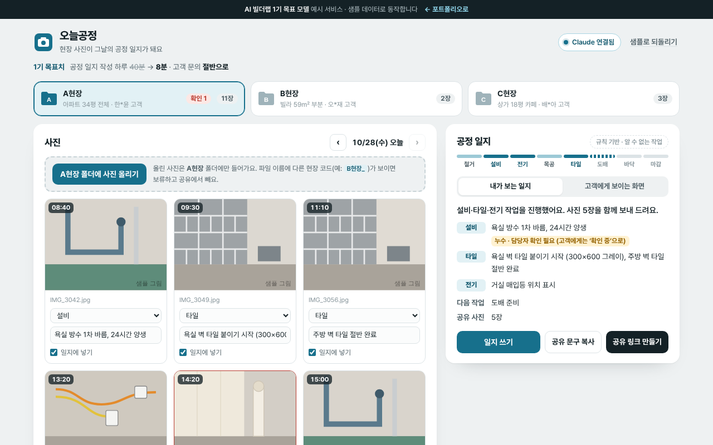 | **[오늘공정](startup-site-log)** | 현장 사진이 그날의 공정 일지가 돼요 | [데모](https://aibuilderlab.kr/demo/startup-site-log/index.html) |
| 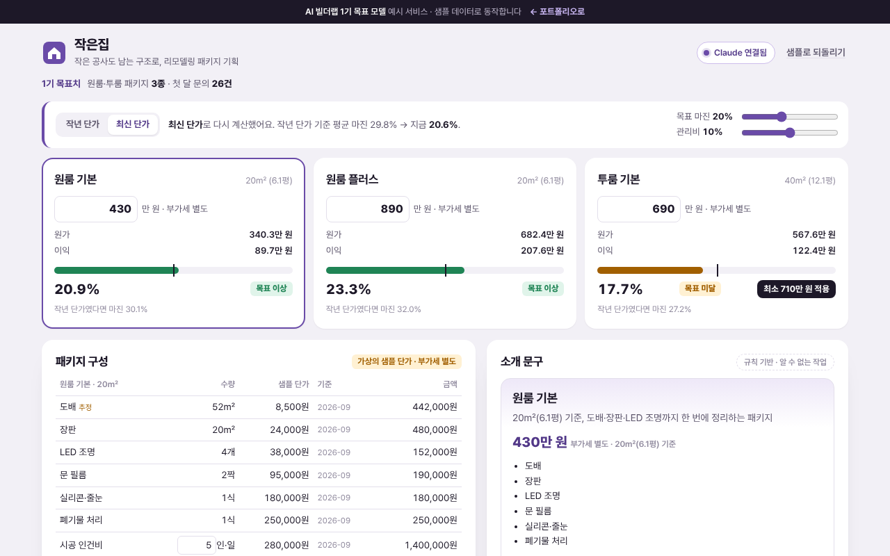 | **[작은집](startup-small-package)** | 작은 공사도 남는 구조로, 리모델링 패키지 기획 | [데모](https://aibuilderlab.kr/demo/startup-small-package/index.html) |

**[교육효과측정소](https://aibuilderlab.kr/home/portfolio.html?p=corp-trainer)** · 기업 교육 · 기업교육 강사 10년 차

| | 서비스 | 하는 일 | 열어 보기 |
|---|---|---|---|
| 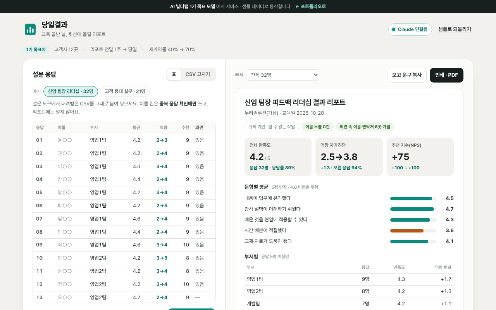 | **[당일결과](startup-training-report)** | 교육 끝난 날, 윗선에 올릴 리포트 | [데모](https://aibuilderlab.kr/demo/startup-training-report/index.html) |
| 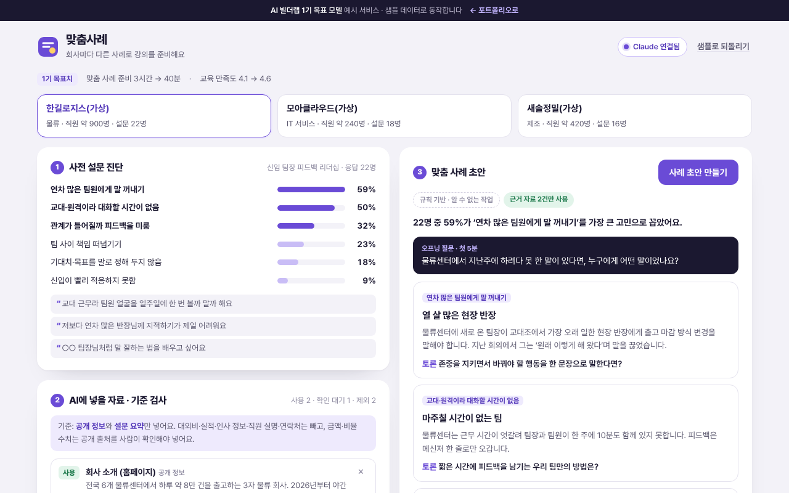 | **[맞춤사례](startup-training-prep)** | 회사마다 다른 사례로 강의를 준비해요 | [데모](https://aibuilderlab.kr/demo/startup-training-prep/index.html) |
| 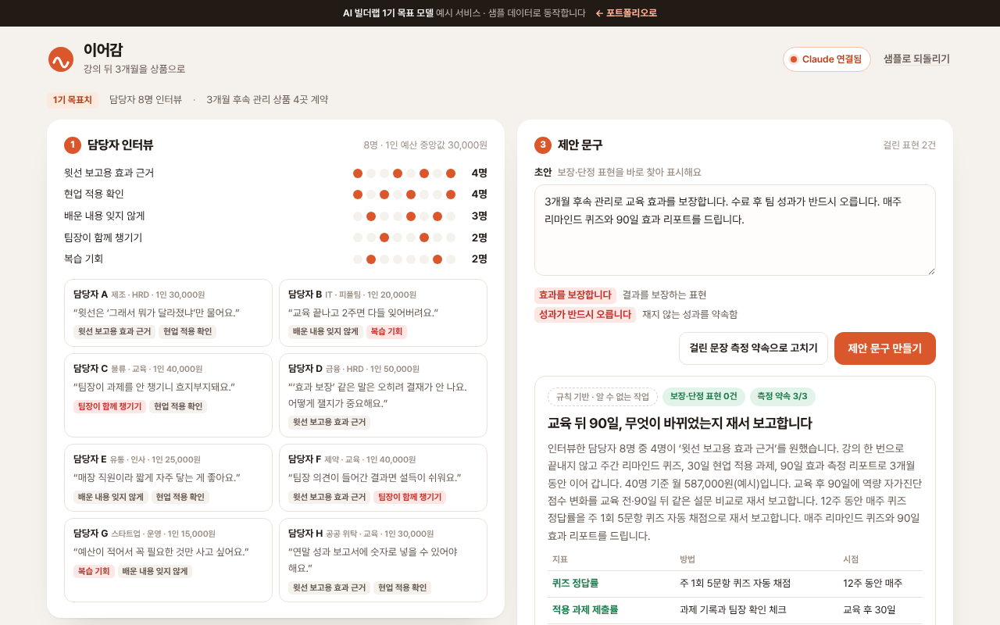 | **[이어감](startup-training-followup)** | 강의 뒤 3개월을 상품으로 | [데모](https://aibuilderlab.kr/demo/startup-training-followup/index.html) |

### 직장인 AX 트랙

**[미팅기록왕](https://aibuilderlab.kr/home/portfolio.html?p=sales)** · 영업 · 영업팀 과장

| | 서비스 | 하는 일 | 열어 보기 |
|---|---|---|---|
|  | **[적어줌](ax-meeting-crm)** | 미팅 메모를 붙여 넣으면 CRM 칸이 채워져요 | [데모](https://aibuilderlab.kr/demo/ax-meeting-crm/index.html) |
| 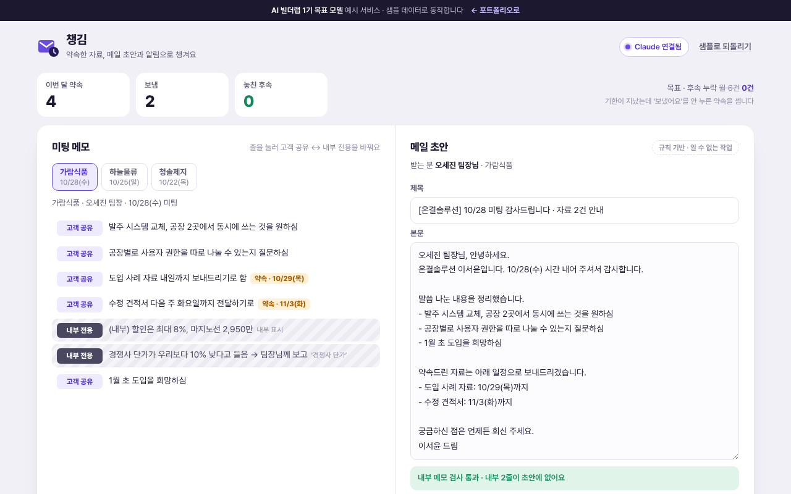 | **[챙김](ax-followup-mail)** | 약속한 자료, 메일 초안과 알림으로 챙겨요 | [데모](https://aibuilderlab.kr/demo/ax-followup-mail/index.html) |
| 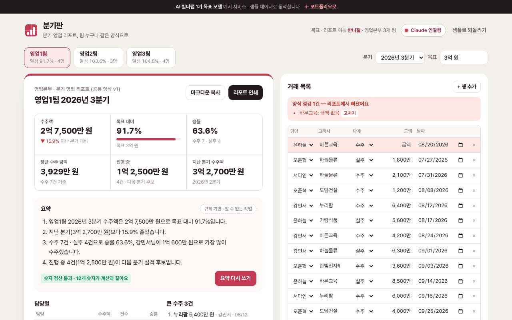 | **[분기판](ax-sales-quarterly)** | 분기 영업 리포트, 팀 누구나 같은 양식으로 | [데모](https://aibuilderlab.kr/demo/ax-sales-quarterly/index.html) |

**[보고서는자동](https://aibuilderlab.kr/home/portfolio.html?p=marketing-team)** · 마케팅 · 마케팅팀 주임

| | 서비스 | 하는 일 | 열어 보기 |
|---|---|---|---|
| 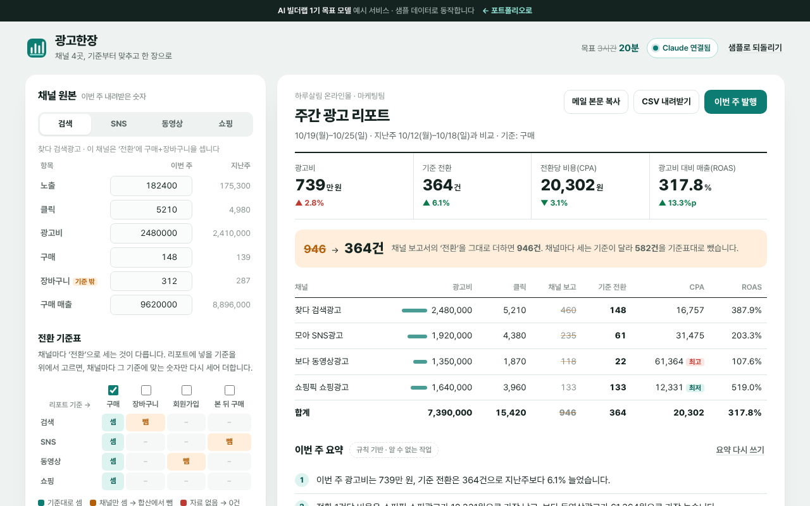 | **[광고한장](ax-ad-weekly)** | 채널 4곳, 기준부터 맞추고 한 장으로 | [데모](https://aibuilderlab.kr/demo/ax-ad-weekly/index.html) |
| 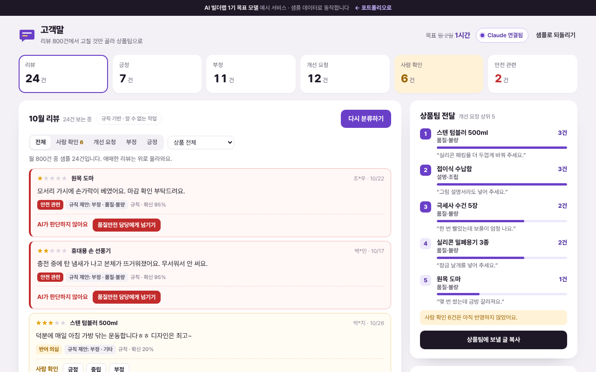 | **[고객말](ax-review-sort)** | 리뷰 800건에서 고칠 것만 골라 상품팀으로 | [데모](https://aibuilderlab.kr/demo/ax-review-sort/index.html) |
| 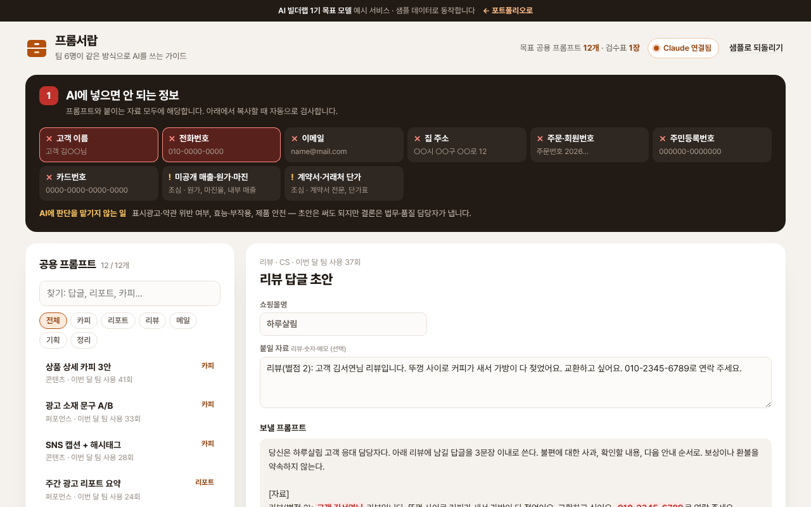 | **[프롬서랍](ax-ai-guide)** | 팀 6명이 같은 방식으로 AI를 쓰는 가이드 | [데모](https://aibuilderlab.kr/demo/ax-ai-guide/index.html) |

**[문의정리반](https://aibuilderlab.kr/home/portfolio.html?p=cs-team)** · 고객지원 · 고객지원팀 매니저

| | 서비스 | 하는 일 | 열어 보기 |
|---|---|---|---|
| 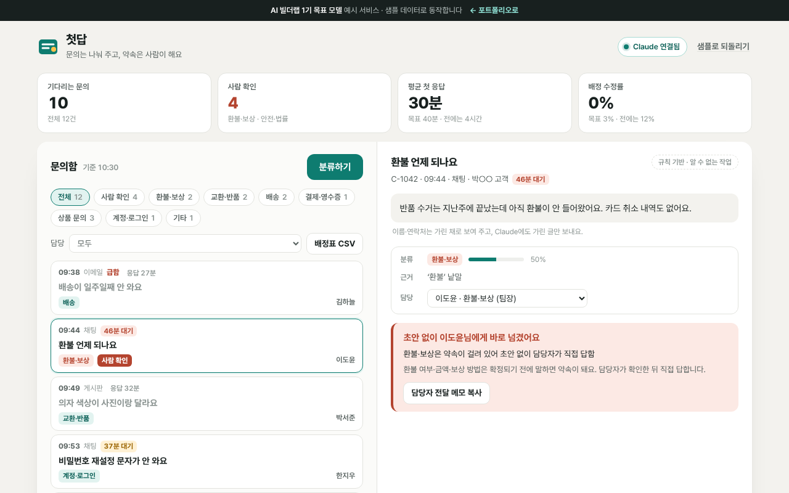 | **[첫답](ax-ticket-triage)** | 문의는 나눠 주고, 약속은 사람이 해요 | [데모](https://aibuilderlab.kr/demo/ax-ticket-triage/index.html) |
|  | **[같은말](ax-voc-weekly)** | 되풀이되는 불만을 매주 상품팀에 | [데모](https://aibuilderlab.kr/demo/ax-voc-weekly/index.html) |
| 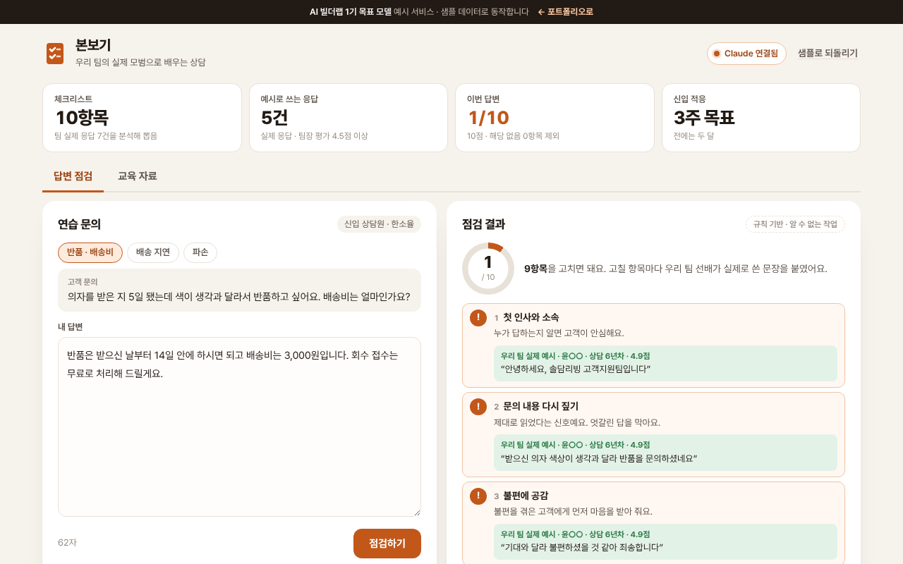 | **[본보기](ax-cs-checklist)** | 우리 팀의 실제 모범으로 배우는 상담 | [데모](https://aibuilderlab.kr/demo/ax-cs-checklist/index.html) |

**[출결은알아서](https://aibuilderlab.kr/home/portfolio.html?p=hr-edu)** · 인사·교육 · 인사팀 교육 담당 사원

| | 서비스 | 하는 일 | 열어 보기 |
|---|---|---|---|
| 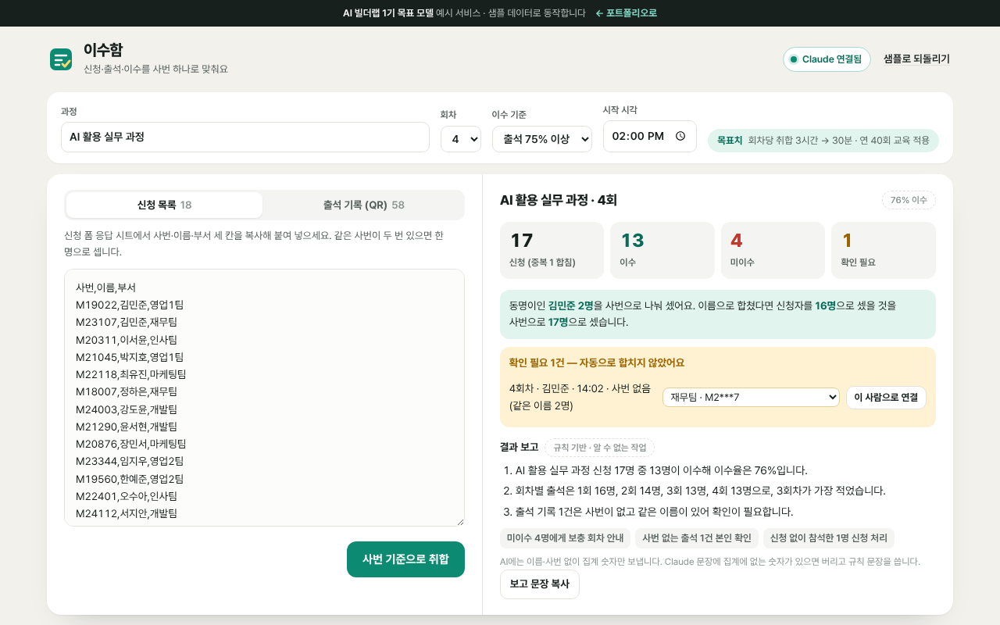 | **[이수함](ax-training-attend)** | 신청·출석·이수를 사번 하나로 맞춰요 | [데모](https://aibuilderlab.kr/demo/ax-training-attend/index.html) |
| 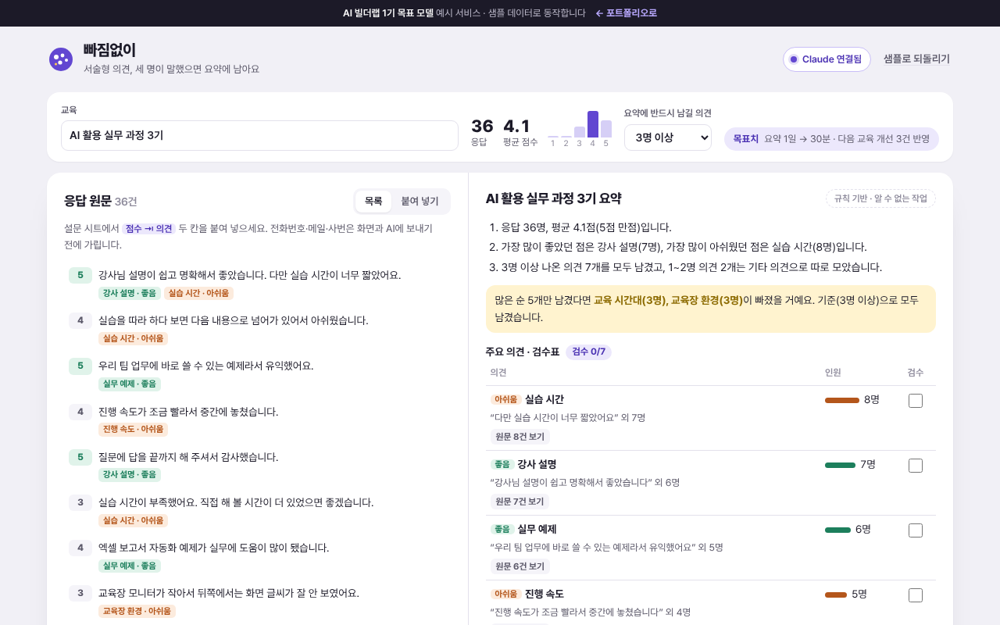 | **[빠짐없이](ax-survey-summary)** | 서술형 의견, 세 명이 말했으면 요약에 남아요 | [데모](https://aibuilderlab.kr/demo/ax-survey-summary/index.html) |
| 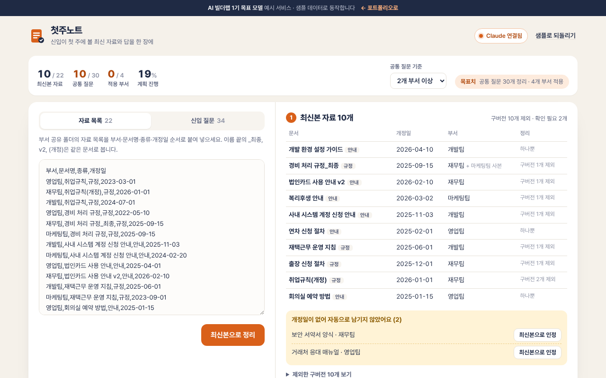 | **[첫주노트](ax-onboarding-kit)** | 신입이 첫 주에 볼 최신 자료와 답을 한 장에 | [데모](https://aibuilderlab.kr/demo/ax-onboarding-kit/index.html) |

## 결과물만이 아니라 과정까지

8주 동안 어떻게 만들었는지가 저장소에 그대로 남아 있습니다. 서비스 폴더마다 같은 구성입니다.

| 무엇을 | 어디에서 |
|---|---|
| 주차별로 만든 것, 막힌 문제, 쓴 프롬프트, 고친 방법 | `docs/DEVLOG.md` |
| 개발할 때 쓴 프롬프트와, 서비스가 실제로 Claude에 보내는 지시문 | `docs/PROMPTS.md` |
| 화면 ↔ 서버 ↔ Claude 흐름과 AI가 멈췄을 때의 대체 경로 | `docs/ARCHITECTURE.md` |
| 버전별 변경 기록 | `CHANGELOG.md` |
| 핵심 로직 자동 테스트 (서비스당 10~18개, 총 769개) | `tests/` → push마다 GitHub Actions가 실행 |

## 써 볼 만한 장면

- **한마디함**: '행사 진행 모드'의 QR을 휴대폰으로 찍어 한마디를 남기면, 몇 초 안에 화면 벽에 붙습니다.
- **다음주**: '학부모 링크 만들기'의 QR을 찍으면 학부모가 받는 리포트가 내 휴대폰에서 열립니다.
- **견적함**: 키보드 J/K로 메일을 넘기고 1~4로 분류하고, R로 견적 회신 초안을 씁니다.
- **금요보고**: AI가 쓴 요약 문장 속 숫자를 원본 데이터와 하나씩 대조해 ✓/✗를 붙입니다.
- **들어보니**: 유도 질문을 입력하면 '지난달 실제 행동'을 묻는 질문으로 고쳐 줍니다.

## 구조와 실행

폴더 하나가 서비스 하나이고, 각 폴더는 다른 폴더에 기대지 않고 혼자 실행됩니다.

```
<서비스 폴더>/
├── index.html     화면 구조
├── style.css      그 서비스만의 디자인
├── app.js         화면 동작
├── logic.js       계산·분류·검증 같은 핵심 로직 (화면과 분리해 테스트)
├── ai-client.js   공용 AI 서버 호출, 실패하면 규칙으로 대체
├── tests/         node:test 자동 테스트
├── docs/          개발 일지 · 프롬프트 · 구조
├── CHANGELOG.md
├── README.md
└── screenshot.png
```

- 바로 보기: 폴더의 `index.html`을 브라우저로 엽니다.
- 로컬 서버: 저장소 최상위에서 `python3 -m http.server 8000` 실행 후 `http://localhost:8000/<서비스 폴더>/` 접속.
- 테스트: 서비스 폴더에서 `npm test` (설치할 패키지 없음, Node 22).
- 빌드 도구는 없습니다. 글꼴, QR, 엑셀 읽기(SheetJS)만 CDN에서 불러옵니다.

## 수료 때 실제 버전

수료 프로젝트에서는 같은 문제를 실제 기술로 만들어 배포합니다. 예: 웹 서비스는 Next.js · Supabase · Claude API, 업무 자동화는 엑셀·메일·Notion 연동. 각 폴더 README의 '기술 스택'에 데모와 실제 버전을 나눠 적었습니다.

---

미림미디어랩 주식회사 · AI 빌더랩 · [aibuilderlab.kr](https://aibuilderlab.kr) · MIT License
