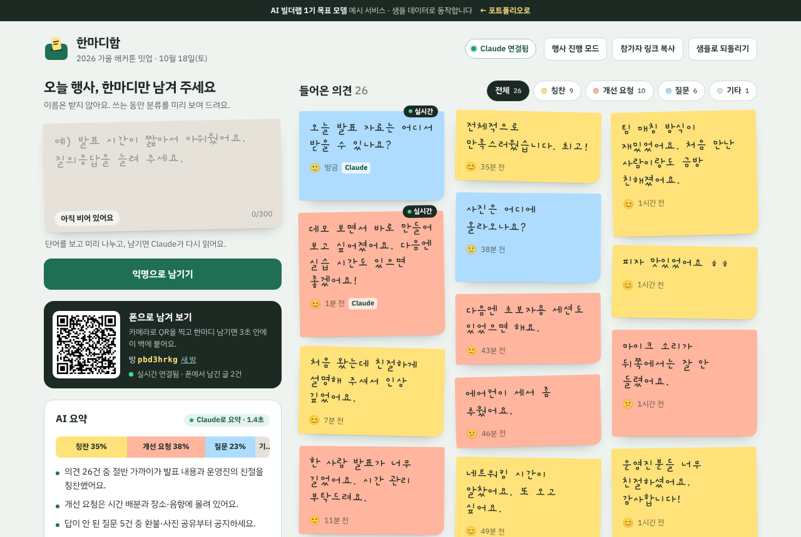
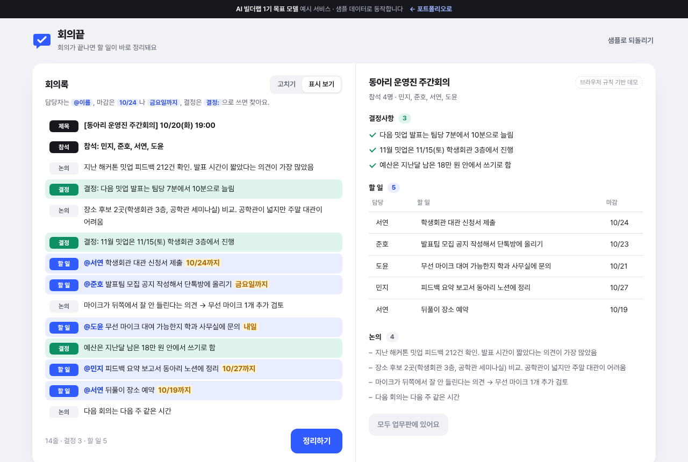
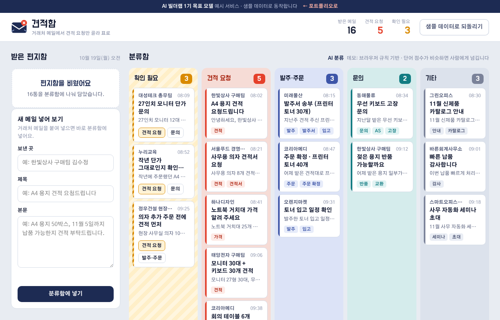
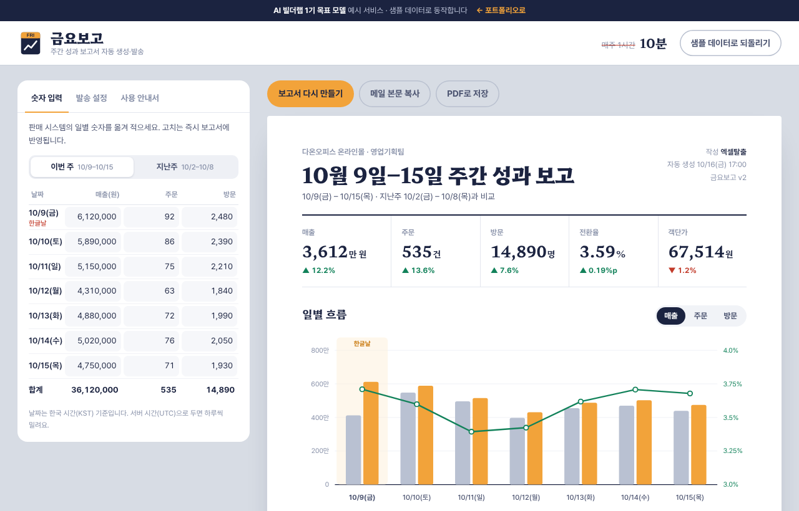
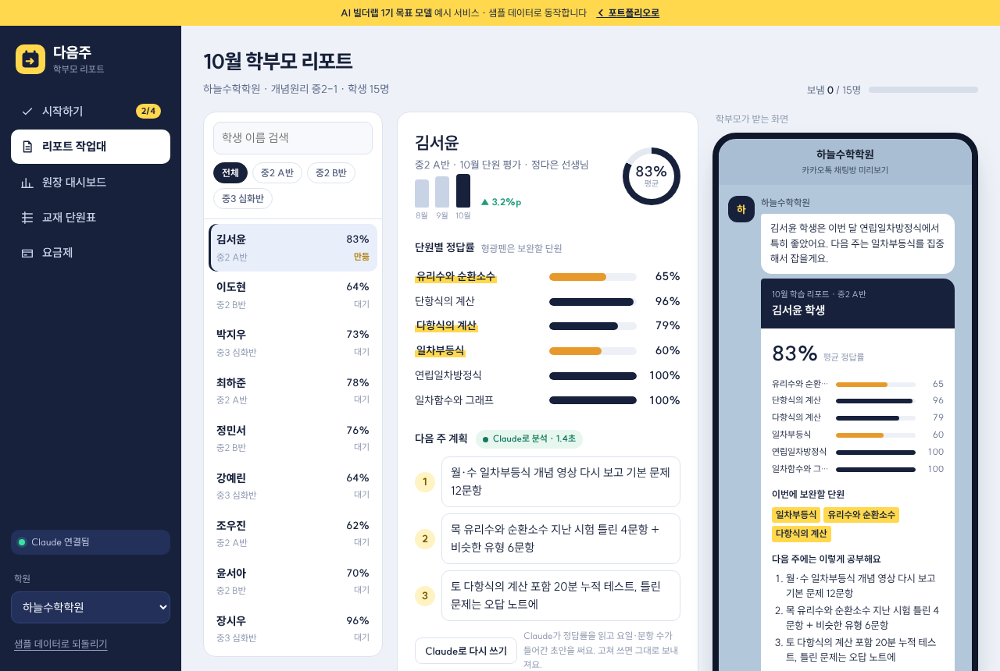
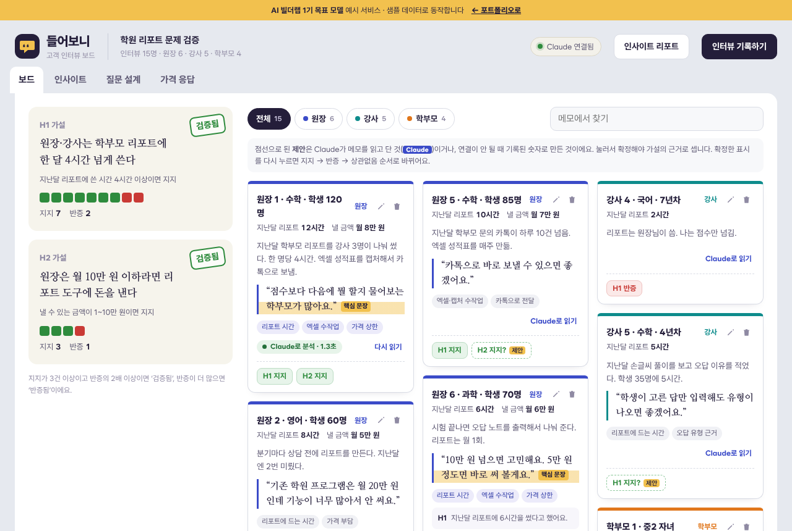

# AI 빌더랩 1기 목표 모델 · 예시 서비스

[AI 빌더랩](https://aibuilderlab.kr) 트랙을 수료할 때 **이 정도는 만들어 배포한다**는 목표를 실제로 동작하는 서비스로 보여 주는 저장소입니다.
트랙마다 가상의 수강생 한 명이 8~10주 동안 만드는 프로젝트 3개를 담았습니다. 모든 서비스는 브라우저에서 바로 열어 써 볼 수 있습니다.

> 1기 목표 모델 예시입니다. 등장하는 사람·회사·학원과 숫자는 모두 가상이며, 수료생 실적이 아닙니다.
> 서비스는 샘플 데이터로 동작하고, 화면 속 'AI' 기능은 외부 API 없이 브라우저 안의 규칙으로 흉내 냅니다(각 화면에 표시).

## 커리어 트랙 · 새벽기획자

AI 포트폴리오가 없던 취업 준비생이 8주 동안 기획 → 자동화 → 웹 서비스 순서로 만든 3개.

| | 서비스 | 하는 일 | 열어 보기 |
|---|---|---|---|
|  | **[한마디함](career-guestbook)** | 행사 익명 피드백을 받는 즉시 칭찬·개선 요청·질문으로 나눠 보여 주는 피드백 보드 | [데모](https://aibuilderlab.kr/demo/career-guestbook/index.html) |
|  | **[회의끝](career-meeting)** | 회의록에서 결정사항과 할 일(담당자·마감)을 찾아 업무판에 올리는 도구 | [데모](https://aibuilderlab.kr/demo/career-meeting/index.html) |
|  | **[하루치](career-study-prd)** | 오늘 할 몫만 보여 주는 AI 공부 코치 — 기획서 · 프로토타입 · 프롬프트 평가표 | [데모](https://aibuilderlab.kr/demo/career-study-prd/index.html) |

## 직장인 AX 트랙 · 엑셀탈출

매주 반복되는 사무 업무를 자동화해 월 24시간을 돌려받은 직장인의 3개.

| | 서비스 | 하는 일 | 열어 보기 |
|---|---|---|---|
|  | **[한장](ax-sales-merge)** | 10개 부서 실적 엑셀을 한 장으로 합치고, 보고 합계와 대조해 검산까지 | [데모](https://aibuilderlab.kr/demo/ax-sales-merge/index.html) |
|  | **[견적함](ax-quote-mail)** | 거래처 메일을 분류함에 나누고 견적 요청만 진행표로 정리 | [데모](https://aibuilderlab.kr/demo/ax-quote-mail/index.html) |
|  | **[금요보고](ax-weekly-report)** | 일별 숫자로 핵심 지표·차트·요약·메일 본문까지 A4 한 장 보고서 생성 | [데모](https://aibuilderlab.kr/demo/ax-weekly-report/index.html) |

## 창업 트랙 · 린스타터

학원 현장 인터뷰에서 출발해 유료 구독 서비스까지 간 예비 창업자의 3개.

| | 서비스 | 하는 일 | 열어 보기 |
|---|---|---|---|
|  | **[다음주](startup-academy-report)** | 단원 평가 결과를 학부모가 카카오톡으로 읽는 리포트로 바꾸는 학원용 SaaS | [데모](https://aibuilderlab.kr/demo/startup-academy-report/index.html) |
|  | **[오답지도](startup-wrong-answer)** | 학생 답만 넣으면 반 전체 오답을 지도로 칠하고 유형을 나누는 도구 | [데모](https://aibuilderlab.kr/demo/startup-wrong-answer/index.html) |
|  | **[들어보니](startup-interview-board)** | 인터뷰 근거를 태그하면 가설이 검증됨·반증됨으로 바뀌는 고객 인터뷰 보드 | [데모](https://aibuilderlab.kr/demo/startup-interview-board/index.html) |

## 구조와 실행

폴더 하나가 서비스 하나이고, 각 폴더는 다른 폴더에 기대지 않고 혼자 실행됩니다.

```
<서비스 폴더>/
├── index.html     화면 구조
├── style.css      그 서비스만의 디자인
├── app.js         동작 (샘플 데이터 · 규칙 기반 분석 · localStorage 저장)
├── README.md      문제 → 해결, 기능, 화면 구성, AI 활용 기록
└── screenshot.png
```

- 바로 보기: 폴더의 `index.html`을 브라우저로 엽니다.
- 로컬 서버: 저장소 최상위에서 `python3 -m http.server 8000` 실행 후 `http://localhost:8000/<서비스 폴더>/` 접속.
- 빌드 도구나 설치할 패키지는 없습니다. 글꼴과 엑셀 읽기(SheetJS)만 CDN에서 불러옵니다.

## 수료 때 실제 버전

수료 프로젝트에서는 같은 문제를 실제 기술로 만들어 배포합니다. 예: 웹 서비스는 Next.js · Supabase · Claude API, 업무 자동화는 엑셀·메일·Notion 연동. 각 폴더 README의 '기술 스택'에 데모와 실제 버전을 나눠 적었습니다.

---

미림미디어랩 주식회사 · AI 빌더랩 · [aibuilderlab.kr](https://aibuilderlab.kr) · MIT License
