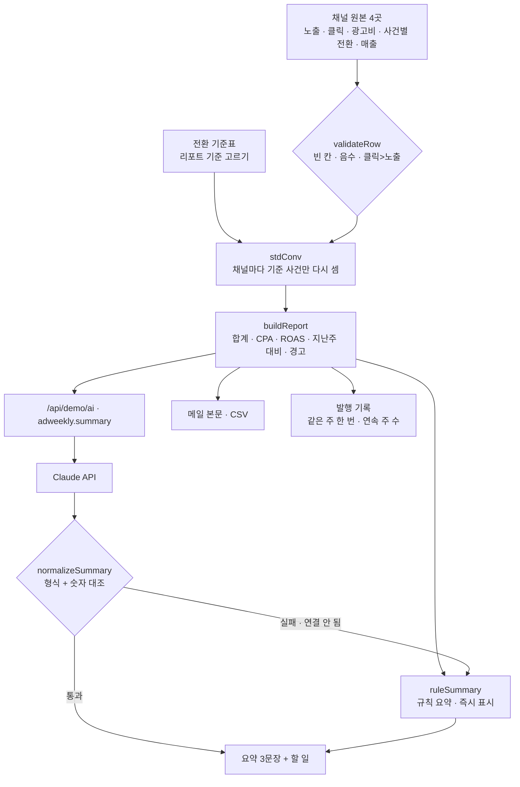

# 구조

## 전환 기준 맞추기 (`stdConv`, `standardTable`)

| 채널 | 채널이 ‘전환’에 넣는 것 |
|---|---|
| 찾다 검색광고 | 구매 + 장바구니 |
| 모아 SNS광고 | 구매 + 본 뒤 구매(클릭 없이 7일 안) |
| 보다 동영상광고 | 구매 + 회원가입 |
| 쇼핑픽 쇼핑광고 | 구매 |

1. 리포트 기준(기본: 구매)을 정한다.
2. 채널마다 기준에 있는 사건만 더한다. 채널만 세는 사건은 **뺌**, 기준엔 있는데 채널 파일에 없는 사건은 **자료 없음 → 0건 + 경고**.
3. 채널 보고 합계(그대로 더한 값)와 기준 합계를 나란히 보여 차이를 드러낸다.

## AI · 규칙 분기

- 숫자가 바뀔 때마다 리포트는 다시 계산되고, 요약은 규칙으로 바뀐다(`runToken`을 올려 기다리던 Claude 응답도 버린다).
- ‘요약 다시 쓰기’를 누르면 규칙 요약을 먼저 보여 주고 Claude를 기다린다.
- Claude 응답은 `normalizeSummary`가 형식을 보고, `unknownNumbers`가 문장 속 숫자를 리포트 숫자(원 · 만 원 · 소수 1자리)와 대조한다. 하나라도 없으면 버린다.

## 파일

| 파일 | 하는 일 | DOM |
|---|---|---|
| `logic.js` | 샘플, 원본 검사, 전환 기준, 합산, 규칙 요약, 응답 검사, 메일·CSV, 발행 기록 | 없음 |
| `ai-client.js` | `/api/demo/ai` 호출, 실패하면 `null` | 없음 |
| `app.js` | 채널 원본 · 기준표 · 리포트 · 발행 기록 화면, localStorage(`ax-ad-weekly-v1`) | 있음 |
| `tests/logic.test.js` | `node --test` 13개 | — |
