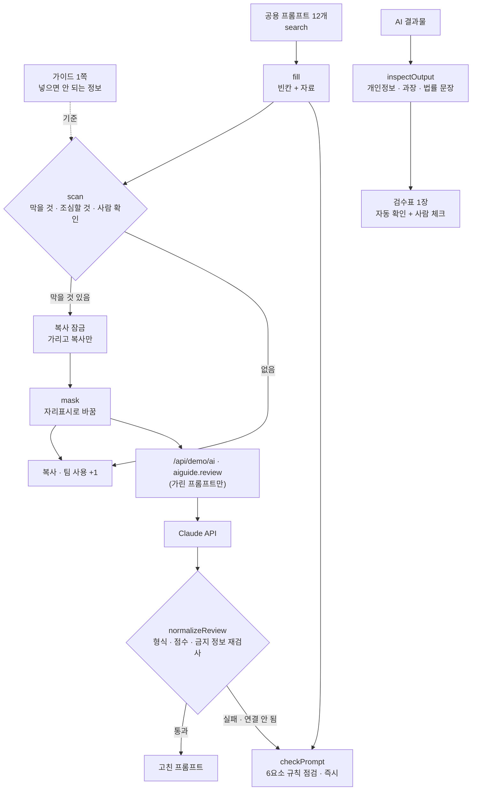

# 구조

## 검사 규칙 (`scan`)

| 종류 | 항목 | 화면 |
|---|---|---|
| 막을 것 | 고객 이름(고객/회원/주문자 + 이름 + 님) · 전화번호 · 이메일 · 집 주소 · 주문/회원/송장번호 · 주민등록번호 · 카드번호 | 빨강, 복사 잠금 |
| 조심할 것 | 원가 · 마진 · 내부 매출 · 대외비, 계약서 · 단가표 | 노랑, 팀장 확인 안내 |
| 사람 확인 | 위반 여부 · 약관 · 표시광고 · 효능 · 부작용 · 안전성 | AI 답을 근거로 쓰지 않는다는 안내 |

AI에는 언제나 `mask()`를 거친 프롬프트만 보냅니다. 돌아온 고친 프롬프트도 다시 `scan()` 해서 금지 정보가 있으면 버립니다.

## 파일

| 파일 | 하는 일 | DOM |
|---|---|---|
| `logic.js` | 금지 목록, 검사 · 가리기, 빈칸 채우기, 규칙 점검, 응답 검사, 결과물 검수, 공용 프롬프트 12개 | 없음 |
| `ai-client.js` | `/api/demo/ai` 호출, 실패하면 `null` | 없음 |
| `app.js` | 금지 목록 · 목록 · 작업대 · 검수표 화면, localStorage(`ax-ai-guide-v1`) | 있음 |
| `tests/logic.test.js` | `node --test` 12개 | — |
