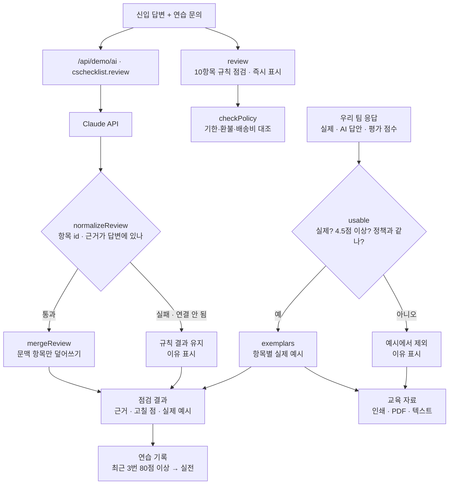

# 구조

## AI / 규칙 분기

| 항목 | 규칙 | Claude |
|---|---|---|
| 인사 · 다시 짚기 · 공감 · 시점 · 다음 단계 · 창구 · 마무리 | 표현 찾기 | 판단으로 덮어씀 (근거는 답변에 있는 문장만) |
| 회사 정책 | `checkPolicy` 숫자 대조 | 덮어쓰지 않음 |
| 약속 없음 · 쉬운 말 | 금지 표현 · 사내 말 목록 | 덮어쓰지 않음 |
| 해당 없음 (공감 · 정책) | 문의 내용으로 결정 | 덮어쓰지 않음 |
| 예시 | 실제 우수 응답에서만 고름 | 쓰지 않음 |

## 파일

| 파일 | 하는 일 | DOM |
|---|---|---|
| `logic.js` | 정책, 체크리스트 10항목, 점검, 정책 대조, 예시 고르기, 응답 검사, 연습 기록, 교육 자료 텍스트 | 없음 |
| `ai-client.js` | `/api/demo/ai` 호출, 실패하면 `null` (공통 파일, 수정 안 함) | 없음 |
| `app.js` | 샘플 응답·연습 문의, 답변 점검 · 연습 기록 · 교육 자료 탭 | 있음 |
| `tests/logic.test.js` | `node --test` 11개 | — |
| `docs/ai-task.json` | 서버 작업 목록에 넣을 `cschecklist.review` 정의 | — |
