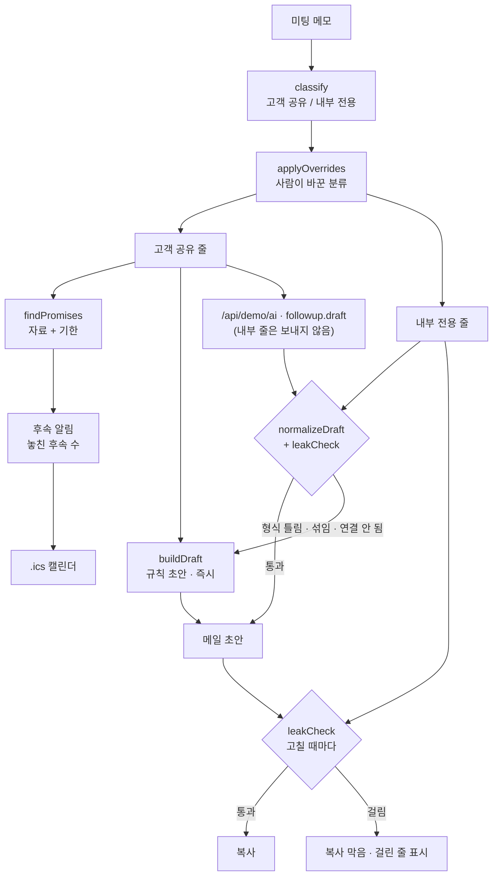

# 구조

## 내부 메모가 밖으로 나가지 않게 (세 겹)

1. **입구** — 메모를 줄마다 나눕니다. `(내부)`·`[사내]`·`우리끼리:` 표시나 ‘마지노선·원가·할인 한도·경쟁사 단가·팀장님께’ 같은 낱말이 있으면 내부 전용. 사람이 눌러 바꿀 수 있습니다.
2. **AI 입력** — Claude에는 고객 공유 줄만 보냅니다. 내부 줄은 처음부터 AI에 가지 않습니다.
3. **출구** — 초안(규칙이든 Claude든, 사람이 고친 것이든)을 내부 줄과 다시 대조합니다(`leakCheck`).
   - 민감 낱말이 그대로 있는가
   - 내부 줄의 금액·%가 초안에 있는가 (예: `2,950만`, `8%`)
   - 내부 줄과 두 글자 조각이 60% 넘게 겹치는 문장이 있는가
   걸리면 복사 버튼을 잠그고 어느 줄 때문인지 보여 줍니다. Claude 초안이 걸리면 버리고 규칙 초안을 씁니다.

## 기다리지 않게

미팅을 고르면 규칙 초안이 바로 나오고, Claude를 기다리는 동안 입력을 잠급니다. 그 사이 다른 미팅을 고르면 앞의 결과는 버립니다(`runToken`).

## 파일

| 파일 | 하는 일 | DOM |
|---|---|---|
| `logic.js` | 기한 읽기, 분류, 약속 찾기, 규칙 초안, 섞임 검사, 응답 검사, 알림 상태, .ics | 없음 |
| `ai-client.js` | `/api/demo/ai` 호출, 실패하면 `null` (공통 파일) | 없음 |
| `app.js` | 메모 줄 · 초안 · 후속 알림 화면 | 있음 |
| `tests/logic.test.js` | `node --test` 12개 | — |
| `docs/ai-task.json` | 서버에 넣을 작업 정의 | — |
