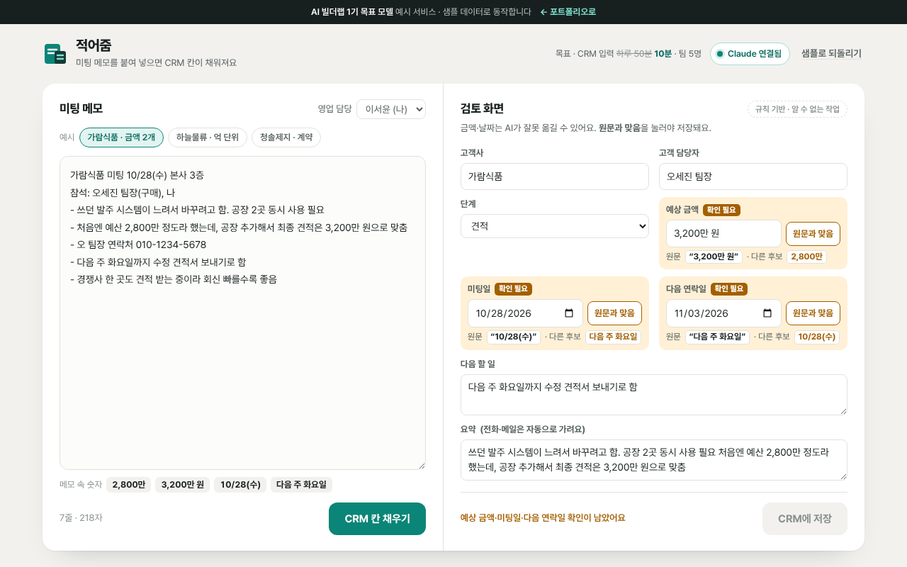

# 적어줌

> 미팅 메모를 붙여 넣으면 CRM 칸(고객사·단계·금액·날짜·다음 할 일)이 채워지고, **금액과 날짜는 사람이 원문과 대조해야 저장되는** 도구

   



**데모** · https://aibuilderlab.kr/demo/ax-meeting-crm/index.html

> **알림** AI 빌더랩 직장인 AX 트랙 **1기 목표 모델(가상의 수강생 ‘미팅기록왕’)** 의 예시 프로젝트입니다. 등장하는 회사와 사람은 모두 가상이고, 결과 숫자는 1기 목표치입니다.

## 문제 → 해결

| 문제 | 해결 |
|---|---|
| 하루 4~5건 미팅 내용을 CRM에 옮기는 데 50분, 바쁘면 아예 못 적음 | 메모를 붙여 넣고 ‘CRM 칸 채우기’ → **하루 50분 → 10분** (목표치) |
| 칸마다 메모를 다시 읽으며 옮겨 적음 | Claude가 고객사·단계·금액·날짜·다음 할 일을 한 번에 채움 |
| AI가 금액·날짜를 잘못 옮김 | **숫자 칸은 사람이 ‘원문과 맞음’을 눌러야 저장**. 메모에 없는 숫자는 빨갛게 표시하고 확인 버튼을 잠금 |
| 팀원마다 적는 방식이 달라 모아 보기 어려움 | 같은 검토 화면 · 같은 고객 목록 · CSV 내보내기 (**팀 5명 사용**, 목표치) |

## 주요 기능

- **기다리지 않는 채우기** — 규칙 결과가 즉시 나오고, Claude 결과가 오면 칸을 덮어씁니다.
- **숫자 확인 관문** — 예상 금액·미팅일·다음 연락일은 ‘확인 필요’로 시작합니다. 원문 버튼을 누르면 메모에서 그 글자가 선택되고, 금액이 여러 개면 ‘다른 후보’로 바로 바꿉니다.
- **원문 대조** — Claude가 준 숫자가 메모에 없으면 ‘원문에 없음’으로 표시하고, 고치기 전에는 확인할 수 없습니다.
- **고객 목록(CRM)** — 단계·담당·검색 거르기, 같은 고객사·같은 미팅일은 고쳐 쓰기, 지우기 + 되돌리기, 지난 연락일 표시.
- **CSV 내보내기** — 엑셀용 BOM, 수식 방지, 고객 연락처 제외.
- **개인정보 가림** — 메모 속 전화·메일은 AI에 보내기 전에 가리고, 저장·내보내기에도 남기지 않습니다.

## AI는 이렇게 동작합니다

| 상황 | 동작 | 화면 표시 |
|---|---|---|
| Claude 연결됨 | `meetingcrm.extract` → 형식 검사 → 숫자 원문 대조 → 사람 확인 | `Claude로 정리 · 2.1초` |
| AI 키 없음 · 한도 초과 · 네트워크 오류 · 알 수 없는 작업 | 금액·날짜·단계 낱말을 읽는 규칙으로 채움 | `규칙 기반 · (이유)` |
| 응답 형식이 틀림 | 버리고 규칙 결과 유지 | `규칙 기반 · 응답 형식이 맞지 않음` |

어느 경우든 숫자 칸은 사람이 확인해야 저장됩니다. 자세한 흐름은 [docs/ARCHITECTURE.md](docs/ARCHITECTURE.md), 지시문 원문은 [docs/PROMPTS.md](docs/PROMPTS.md), 서버 작업 정의는 [docs/ai-task.json](docs/ai-task.json).

## 기술 스택

| 구분 | 사용 |
|---|---|
| 화면 | HTML · CSS · JavaScript (프레임워크·빌드 없음) |
| AI | Claude API — 서버 `aibuilderlab.kr/api/demo/ai`가 호출 |
| CRM | 브라우저 안의 고객 목록(localStorage). 외부 CRM 연동 없음 |
| 내보내기 | CSV(UTF-8 BOM · CRLF) |
| 테스트 | Node 내장 `node:test` |

## 폴더 구조

```
ax-meeting-crm/
├── index.html
├── style.css
├── logic.js          금액·날짜 읽기 · 규칙 채우기 · 응답 검사 · 원문 대조 · 저장 관문 · CSV (DOM 없음)
├── ai-client.js      /api/demo/ai 호출, 실패하면 null
├── app.js            메모 · 검토 화면 · 고객 목록
├── tests/logic.test.js
├── docs/ (ARCHITECTURE · DEVLOG · PROMPTS · ai-task.json)
├── CHANGELOG.md
└── package.json
```

## 실행 · 테스트

```bash
python3 -m http.server 8000   # http://localhost:8000
npm test                      # = node --test, 13개
```

## AI 활용 기록 (COVI 기록 요약)

| 프롬프트 | 디버깅 | 걸린 시간 |
|---|---|---|
| 34회 | 5회 | 6시간 |

- **막혔던 문제** — 금액·날짜를 AI가 잘못 옮김 → 숫자 항목은 사람이 확인해야 저장되게 함
- **결과 (1기 목표치)** — 입력 하루 50분 → 10분, 팀 5명 사용
- **리드 빌더 코멘트** — “숫자만은 사람이 확인하게 한 설계가 영업 데이터를 지켰습니다.”
- 주차별 기록: [docs/DEVLOG.md](docs/DEVLOG.md)
