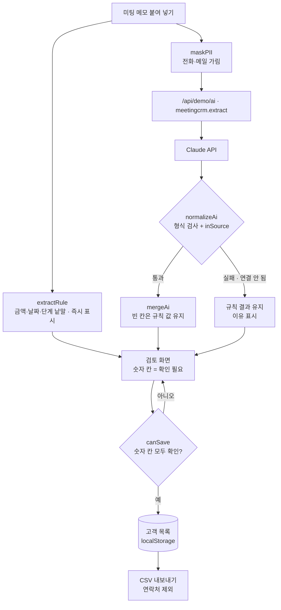

# 구조

## 숫자는 사람이 확인한다

AI가 금액·날짜를 잘못 옮기는 일이 실제로 있었습니다(‘2,800만’을 ‘3,800만’으로, ‘다음 주 화요일’을 이번 주로). 그래서 두 겹으로 막습니다.

1. **원문 대조(`inSource`)** — Claude가 돌려준 금액·날짜를 메모에서 다시 찾습니다. 메모에 없는 숫자면 칸이 빨갛게 바뀌고 ‘원문과 맞음’ 버튼이 잠깁니다. 사람이 고쳐야 풀립니다.
2. **저장 관문(`canSave`)** — 값이 있는 숫자 칸(예상 금액·미팅일·다음 연락일)은 모두 ‘원문과 맞음’을 누르거나 직접 고쳐야 저장 버튼이 열립니다. 규칙 결과여도 마찬가지입니다.

원문 버튼을 누르면 메모에서 그 글자가 선택되어, 눈으로 바로 대조할 수 있습니다.

## 기다리지 않게

‘CRM 칸 채우기’를 누르면 규칙 결과가 바로 나오고, Claude를 기다리는 동안에는 입력을 잠급니다. 그 사이 다시 누르면 앞의 결과는 버립니다(`runToken`).

## 파일

| 파일 | 하는 일 | DOM |
|---|---|---|
| `logic.js` | 금액·날짜 읽기, 규칙 채우기, 응답 검사·원문 대조, 저장 관문, 고쳐 쓰기, 거르기, CSV | 없음 |
| `ai-client.js` | `/api/demo/ai` 호출, 실패하면 `null` (공통 파일) | 없음 |
| `app.js` | 메모 · 검토 화면 · 고객 목록 | 있음 |
| `tests/logic.test.js` | `node --test` 13개 | — |
| `docs/ai-task.json` | 서버에 넣을 작업 정의 | — |
