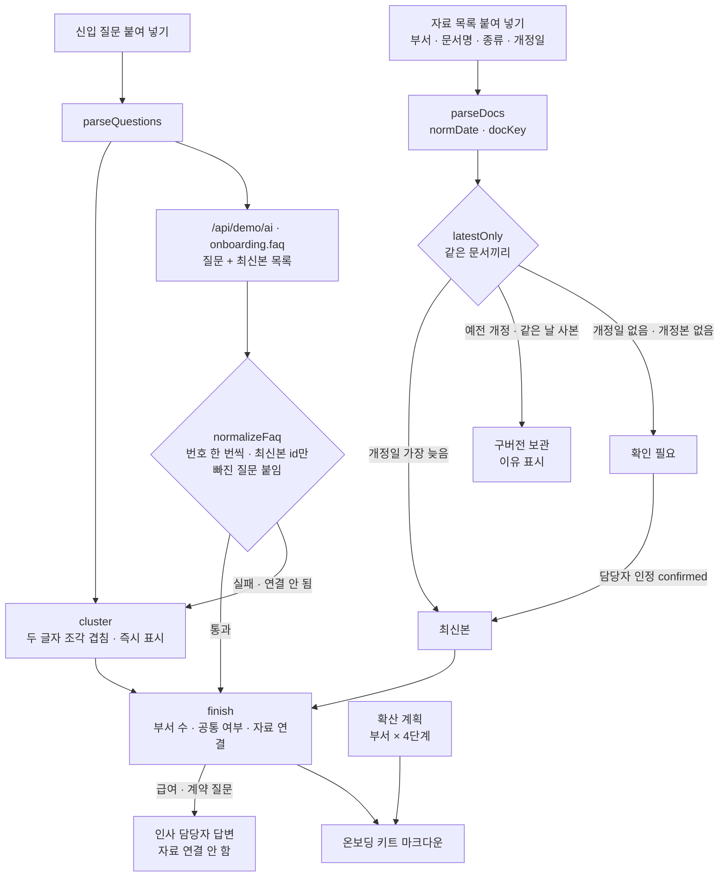

# 구조

## 최신본 고르기 (`latestOnly`)

1. 문서 이름에서 괄호 꼬리표, `_최종`, `v2`, 공백을 지운 `docKey`로 같은 문서를 묶는다.
2. 개정일이 있는 것 중 가장 늦은 것을 남긴다. 같은 날짜가 다른 부서에도 있으면 ‘사본’으로 표시하고 하나만 남긴다.
3. 개정일 없는 문서는 같은 문서의 개정본이 있으면 구버전으로, 없으면 ‘확인 필요’로 둔다. 자동으로 최신본이 되지 않는다.
4. 담당자가 인정한 문서(`confirmed`)만 개정일 없이도 최신본이 된다.

## 질문 묶기와 자료 연결

- 규칙: 기호·어미·조사와 흔한 낱말(‘신청’)을 지우고 두 글자 조각의 Dice 계수 0.4 이상이면 같은 질문.
- 자료 연결은 **최신본 목록 안에서만** 한다. 문서 이름 조각이 질문에 절반 이상 들어 있으면 연결.
- 급여·근로계약·징계 등 낱말이 있으면 `sensitive` — AI가 무엇을 골랐든 자료를 비우고 인사 담당자에게 넘긴다.
- Claude 묶음은 질문 번호가 한 번씩만 쓰이게 정리하고, 어느 묶음에도 없는 질문은 한 개짜리 묶음으로 붙인다(질문이 사라지지 않게).

## 파일

| 파일 | 하는 일 | DOM |
|---|---|---|
| `logic.js` | 개정일 읽기, 같은 문서 판단, 최신본, 질문 묶기, 자료 연결, 응답 검사, 확산 계획, 키트 | 없음 |
| `ai-client.js` | `/api/demo/ai` 호출, 실패하면 `null` | 없음 |
| `app.js` | 원본 탭 · 최신본 자료 · 공통 질문 · 확산 계획 · 키트 복사 | 있음 |
| `tests/logic.test.js` | `node --test` 12개 | — |
