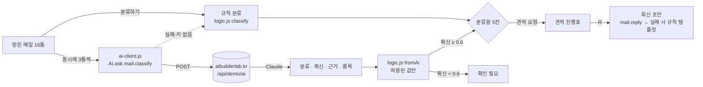

# 구조

> 1기 목표 모델 예시 · 견적함 v1.0

## 데이터 흐름



## 판단의 우선순위

```
사람이 정한 분류  >  Claude 분류(확신 ≥ 0.6)  >  규칙 분류
```

- 사람이 한 번 정한 메일은 AI 결과가 나중에 와도 바뀌지 않는다.
- 규칙이 찾은 품목이 있으면 그대로 쓰고, 규칙이 못 찾았을 때만 Claude가 뽑은 품목을 쓴다. 사람이 고친 칸은 건드리지 않는다.

## 모듈

| 파일 | 하는 일 | DOM |
|---|---|---|
| `logic.js` | 분류 규칙, AI 응답 검증, 품목·납기 추출, D-day, 회신 템플릿, CSV | 없음 (Node에서 테스트) |
| `ai-client.js` | 서버 호출, 시간 초과(20초), 실패하면 `null`, 연결 상태 알림 | 없음 |
| `app.js` | 그리기, FLIP 카드 이동, 키보드 분류, 서랍, 진행표, 되돌리기 | 있음 |

## 상태 (localStorage `gyeonjeokham:v3`)

```js
{ mails: [{ id, co, person, email, at, subj, body,
            final,            // 사람이 정한 분류 (없으면 null)
            ai,               // {cat, need, confidence, reason, items, ms}
            reply,            // {subject, body, mode: "ai"|"rule"}
            items, due, status }],
  sorted, lane, cur }
```

## 실패해도 멈추지 않게

| 상황 | 동작 |
|---|---|
| 서버에 AI 키 없음 | 처음 상태 확인에서 `규칙 모드`, 이후 AI를 부르지 않음 |
| 사용량 한도 초과 · 시간 초과 · 네트워크 오류 | 그 메일만 규칙 결과 유지, 상태 표시에 이유 |
| AI가 이상한 JSON | `fromAi()`가 버림 → 규칙 결과 유지 |
| localStorage 막힘 | 저장만 안 되고 화면은 동작 |
