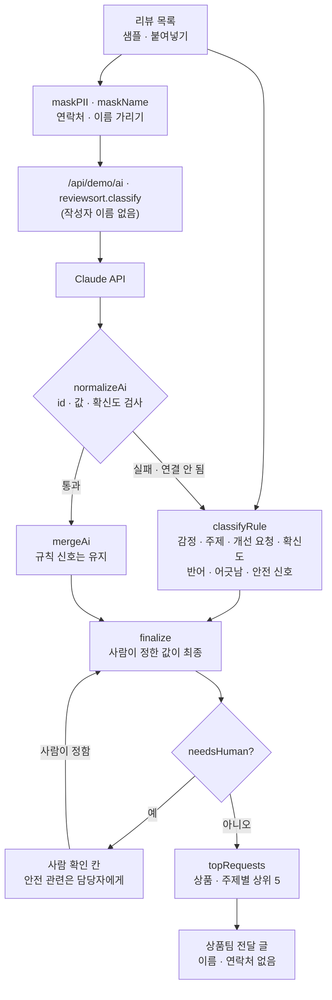

# 구조

## ‘사람 확인’으로 보내는 조건

| 신호 | 예 | 판단 |
|---|---|---|
| 반어 의심 | `^^`, `ㅎㅎ`, `기가 막히`, `덕분에`, `하나는` + 불만 말 | 규칙 |
| 별점 · 글 어긋남 | 별점 5인데 불만 말이 더 많음 | 규칙 |
| 확신도 60% 미만 | 짧은 리뷰, 칭찬 · 불만이 반반 | 규칙 또는 Claude |
| 안전 관련 | 베였 · 화상 · 탄 냄새 · 뜨거워졌 | 규칙 (판단하지 않고 담당자에게) |

규칙이 잡은 반어 · 어긋남 · 안전 신호는 Claude가 확신도 높게 돌려줘도 지워지지 않습니다(`mergeAi`). 사람 확인 칸은 사람만 비울 수 있습니다.

## 파일

| 파일 | 하는 일 | DOM |
|---|---|---|
| `logic.js` | 샘플, 규칙 분류, 개인정보 가리기, 응답 검사 · 합치기, 집계, 전달 글, 붙여넣기 해석 | 없음 |
| `ai-client.js` | `/api/demo/ai` 호출, 실패하면 `null` | 없음 |
| `app.js` | 숫자 · 목록 · 사람 확인 · 상품팀 전달 화면, localStorage(`ax-review-sort-v1`) | 있음 |
| `tests/logic.test.js` | `node --test` 13개 | — |
