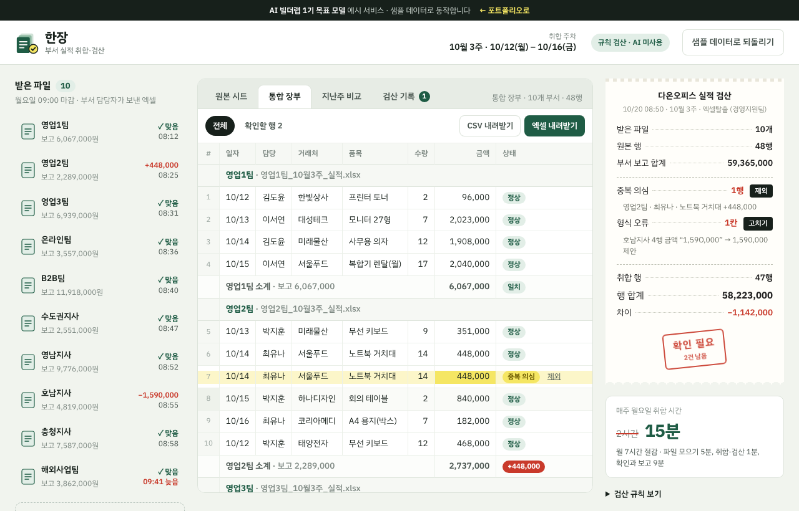

# 한장 — 부서 실적 취합·검산

> 10개 부서가 보낸 실적 엑셀을 **한 장으로 합치고, 부서가 보고한 합계와 대조해 검산까지** 끝내는 도구. 누가 무엇을 고쳤는지 모두 남는다.

 -2E7A5D) -7C8781) 



**데모** https://aibuilderlab.kr/demo/ax-sales-merge/index.html

> AI 빌더랩 직장인 AX 트랙 **1기 목표 모델 예시**입니다. 가상의 회사 ‘다온오피스(주)’ 10개 부서의 2주치 실적으로 동작합니다.

## 문제 → 해결

| 전에는 | 이제는 |
|---|---|
| 매주 월요일 10개 부서 엑셀을 손으로 복사해 합침 (**2시간**) | 파일 10개를 한꺼번에 끌어다 놓고 취합 (**15분**) |
| 합계가 지난주보다 30% 튀었는데 이유를 몰랐음 | 부서별 **보고 합계 ↔ 행 합계** 대조 → 중복 행을 바로 찾음 |
| 부서마다 양식(열 이름)이 다름 | **열 이름 맞추기** — 비슷한 이름은 짐작하고 사람이 확인, 다음부터는 기억 |
| 고친 내용이 남지 않음 | **검산 기록** — 시각·확인자·한 일·전→후를 엑셀 시트로 |
| 지난주와 비교하려면 파일을 또 열어야 함 | **지난주 비교** — ±15% 넘게 움직인 부서와 원인 품목·거래처 |

## 왜 AI를 쓰지 않았나

실적 합계는 한 원도 틀리면 안 됩니다. 그래서 숫자는 **정해 둔 규칙으로만** 계산하고, 결과를 사람이 확인하게 했습니다. AI는 만들 때(코드·테스트 작성) 썼고, 서비스 안에서는 쓰지 않습니다.

- 오타("1,59O,000")는 **고칠 값을 제안만** 하고, 사람이 눌러야 바뀝니다.
- ‘이상치 설명’도 규칙입니다: 부서 증감을 품목별로 쪼개 가장 크게 움직인 품목과 거래처를 찾습니다.

## 주요 기능

- **여러 파일 한꺼번에** — 엑셀·CSV 여러 개를 화면 어디에든 끌어다 놓기. 같은 부서 파일은 수정본으로 교체
- **열 이름 맞추기** — `매출일 · 영업 담당 · 상품명칭 · 판매 금액(VAT 포함)` 같은 다른 양식도 읽음. 짐작한 열은 ‘추측’ 표시, 같은 양식은 다음부터 묻지 않음
- **취합하고 검산하기** — 파일이 장부로 빨려 들어가고, 계산기 영수증 같은 검산 테이프가 한 줄씩 찍힘
- **검산** — 중복 의심(같은 부서·날짜·담당·거래처·품목·수량·금액), 형식 오류(숫자 칸의 글자), 부서별 보고 합계 대조, 차이 0이면 ‘검산 통과’ 도장
- **오타 고치기 제안** — 영문 O→0, 소문자 l→1, 전각 숫자, 마침표 천 단위
- **지난주 비교** — 부서별 증감 막대, 살펴볼 부서 강조, 규칙 기반 이상치 설명
- **검산 기록** — 확인자 이름, 모든 변경과 되돌리기 기록, CSV
- **엑셀 내려받기** — `통합 · 부서별 검산 · 지난주 비교 · 검산 기록` 4개 시트. 이 파일을 다시 올리면 부서별로 나눠 읽음 (왕복)

## 기술 스택

| 이 데모 | 실제 업무 버전 |
|---|---|
| HTML · CSS · JavaScript (빌드 없음) | 엑셀 · 매크로 · 검산 체크 |
| SheetJS (필요할 때만 CDN에서 불러옴, 실패하면 CSV) | 공유 드라이브 폴더 감시 |
| localStorage 저장, Web Animations | |
| `node --test` 단위 테스트 15개 | |

## 폴더 구조

```
ax-sales-merge/
├── index.html          화면 뼈대 (열 맞추기 창 포함)
├── style.css           장부 종이 · 영수증 테이프 스타일
├── logic.js            CSV 읽기, 열 이름 짐작, 오타 제안, 검산, 지난주 비교, 이상치 설명, 샘플 (순수 함수)
├── app.js              화면: 파일 트레이, 시트 4개, 검산 테이프, 검산 기록, 엑셀 내보내기
├── tests/logic.test.js 단위 테스트
├── docs/               개발 일지 · 프롬프트 기록 · 구조
├── CHANGELOG.md
└── package.json        npm test
```

## 실행 · 테스트

```bash
python3 -m http.server 8000   # → http://localhost:8000/
npm test                      # 또는 node --test
```

‘다른 양식 파일로 시험해 보기’를 누르면 열 이름이 다른 제휴몰팀 파일로 열 맞추기를 바로 볼 수 있어요.

## 문서

- [개발 일지](docs/DEVLOG.md) · [프롬프트 기록](docs/PROMPTS.md) · [구조](docs/ARCHITECTURE.md) · [변경 기록](CHANGELOG.md)

## AI 활용 기록 (COVI 기록 요약)

| 프롬프트 | 디버깅 | 걸린 시간 |
|---|---|---|
| 36 | 5 | 7시간 |

- **해결한 문제** — 합계가 30% 튐 → 중복 행 발견, 원본 대조 단계 추가
- **결과** — 매주 2시간 → 15분 (월 7시간 절감)
- **리드 빌더 코멘트** — “검산 단계를 스스로 넣은 게 가장 좋았어요. 팀장님이 믿고 쓸 수 있는 자동화입니다.”

---
AI 빌더랩 직장인 AX 트랙 · 엑셀탈출 1기 목표 모델 예시 · MIT License
