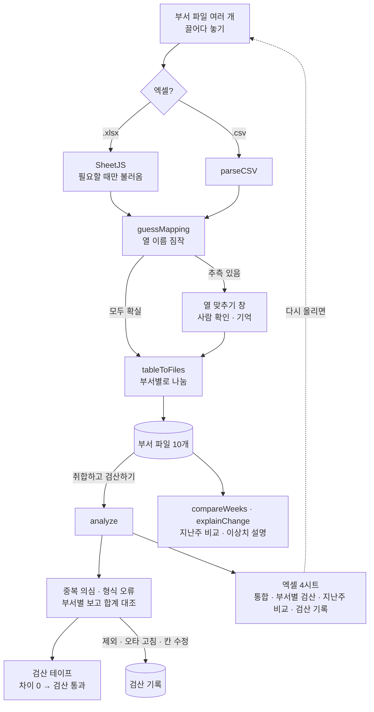

# 구조

> 1기 목표 모델 예시 · 한장 v1.0

## 데이터 흐름



## 검산의 원리

같은 돈을 **두 경로**로 센다.

```
경로 1: 부서 담당자가 보고한 합계            (부서 파일의 '합계' 줄)
경로 2: 부서 파일의 행을 하나하나 더한 합계   (한장이 계산)

경로 2 − 경로 1 = 0   → 일치
              > 0   → 같은 행이 두 번 들어갔을 가능성 (중복)
              < 0   → 숫자로 읽히지 않아 빠진 칸 (형식 오류)
```

## 모듈

| 파일 | 하는 일 | DOM |
|---|---|---|
| `logic.js` | CSV, 열 이름 짐작, 표 → 파일, 오타 제안, 검산, 지난주 비교, 이상치 설명, 샘플 | 없음 (Node에서 테스트) |
| `app.js` | 파일 트레이·드래그, 열 맞추기 창, 시트 4개, 검산 테이프, 검산 기록, 엑셀 내보내기 | 있음 |

## 상태 (localStorage `hanjang:v3`)

```js
{ files: [{ id, dept, name, at, declared, rows: [{id, date, owner, client, item, qty, amount}] }],
  last: [...],          // 지난주 파일 (비교용)
  excluded: [rowId],    // 제외한 행
  audit: [{ t, who, act, where, before, after }],
  mappings: { 머리글모양: [필드…] },   // 기억한 양식
  who, merged, current }
```
