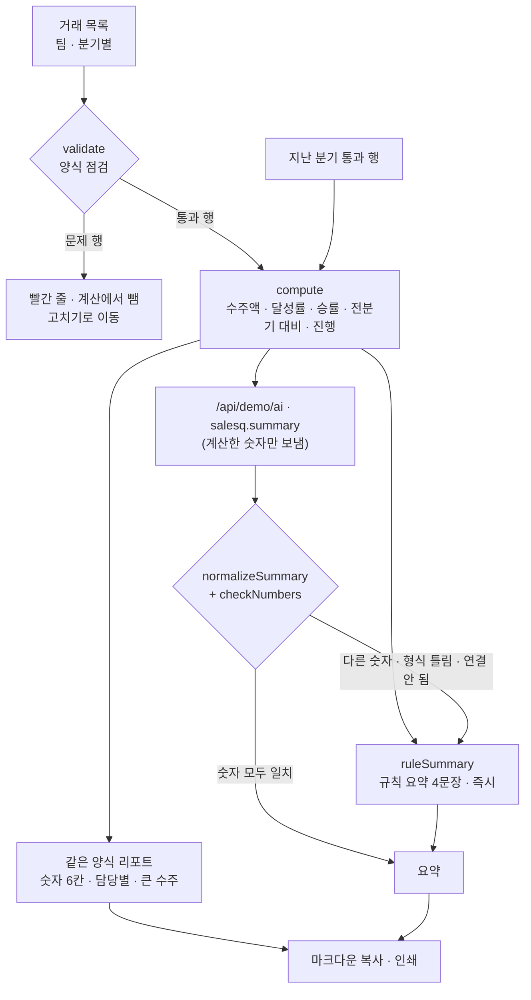

# 구조

## 숫자는 계산이 정한다

- 리포트의 숫자는 모두 `compute()`가 정합니다. Claude는 문장만 씁니다.
- Claude에는 계산한 숫자(표기 그대로)만 보내고, 거래 행이나 거래처 이름은 보내지 않습니다.
- 돌아온 문장 속 숫자를 모두 읽어(`numbersIn`: ‘3억 2,000만 원’, ‘91.7%’, ‘7건’) 리포트 숫자(`facts`)와 대조합니다. 금액은 표기 반올림 1%까지, 나머지는 0.1까지 허용. 하나라도 다르면 문장을 버립니다.
- 팀 이름(‘영업1팀’) 속 숫자는 대조하지 않습니다.
- 거래나 목표를 고치면 숫자가 바뀌므로, 그 전에 받은 Claude 요약은 버리고 규칙 요약으로 돌아갑니다.

## 팀 표준이 되게

- 세 팀이 같은 양식·같은 점검·같은 계산을 씁니다. 위의 팀 버튼에 팀별 달성률이 함께 보입니다.
- 처음 쓰는 팀원은 아래 **1장 가이드**(화면을 줄여 그린 캡처 4장)를 따라 합니다. ‘가이드만 인쇄’로 종이 한 장이 됩니다.

## 파일

| 파일 | 하는 일 | DOM |
|---|---|---|
| `logic.js` | 분기 계산, 금액 읽기, 양식 점검, 분기 숫자, 규칙 요약, 숫자 검산, 마크다운, 샘플 데이터 | 없음 |
| `ai-client.js` | `/api/demo/ai` 호출, 실패하면 `null` (공통 파일) | 없음 |
| `app.js` | 팀·분기 · 리포트 · 거래 목록 · 가이드 화면 | 있음 |
| `tests/logic.test.js` | `node --test` 12개 | — |
| `docs/ai-task.json` | 서버에 넣을 작업 정의 | — |
