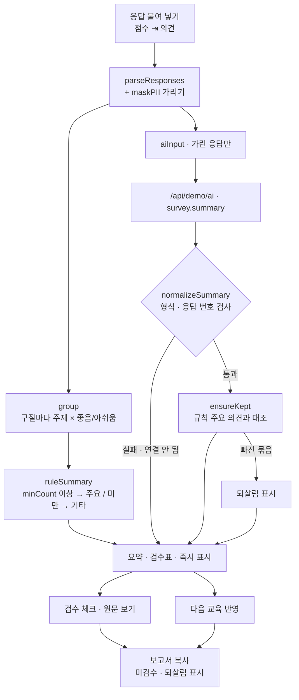

# 구조

## 소수 의견 지키기 (`ensureKept`)

1. 규칙으로 만든 주요 의견(기준 이상 묶음)을 하나씩 본다.
2. Claude 묶음 중 **같은 결**이면서 그 묶음 응답의 **절반 이상**을 담은 것이 있으면 ‘들어 있다’고 본다(이름이 ‘실습 시간’ ↔ ‘실습 부족’처럼 달라도 됨).
3. 없으면 규칙 묶음을 `restored: true`로 붙인다. 화면에서는 노란 줄과 ‘되살림’.
4. Claude 묶음 중 기준 미만은 ‘기타 의견’으로 내린다. 기타로 간 묶음도 지우지 않는다.

## 규칙 묶기

- 응답을 구절로 나눈다(문장부호, ‘~지만’, ‘~는데’ 등).
- 구절마다 주제 사전(`TOPICS`) 낱말과 결 낱말(`NEG`/`POS`)을 본다. ‘~있으면 좋겠다’ 같은 요청은 아쉬움.
- 구절에 결 낱말이 없으면 응답 전체의 결을 따른다.
- 어느 주제에도 안 걸리면 ‘분류 안 됨’ — 사람이 직접 읽는다.

## 파일

| 파일 | 하는 일 | DOM |
|---|---|---|
| `logic.js` | 가리기, 읽기, 구절·결 판단, 묶기, 규칙 요약, 응답 검사, 소수 의견 지키기, 보고서 | 없음 |
| `ai-client.js` | `/api/demo/ai` 호출, 실패하면 `null` | 없음 |
| `app.js` | 점수 분포 · 응답 원문 · 요약 · 검수표 · 반영 체크 | 있음 |
| `tests/logic.test.js` | `node --test` 13개 | — |
