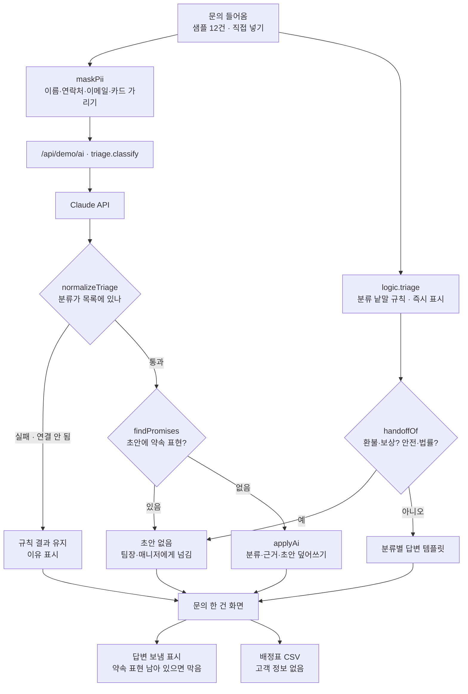

# 구조

## AI / 규칙 분기

| 단계 | 규칙 (항상) | Claude (열어 본 문의 한 건) |
|---|---|---|
| 분류 | 낱말 점수, 제목 2배, 환불·보상 낱말 우선 | `category`가 목록에 있을 때만 씀 |
| 사람에게 넘기기 | 환불·보상, 안전·법률 낱말 | 규칙이 넘긴 건 되돌리지 않음. 초안에 약속 표현 → 넘김 추가 |
| 담당 | 분류 담당표 (수동 배정이 우선) | 바뀐 분류의 담당 |
| 초안 | 분류별 템플릿 | Claude 초안 (약속 표현 없을 때만) |

- 모든 문의는 규칙으로 바로 분류해 둔다. Claude는 **열어 본 문의 한 건**에만 묻고, 결과는 화면을 연 동안 기억한다(`aiCache`). ‘분류하기’를 누르면 기억을 지우고 다시 묻는다.
- Claude에게는 가린 제목·본문과 분류 목록만 보낸다.

## 파일

| 파일 | 하는 일 | DOM |
|---|---|---|
| `logic.js` | 분류, 넘기기, 약속 표현, 응답 검사, 개인정보 가리기, 첫 응답 시간, 통계, CSV | 없음 |
| `ai-client.js` | `/api/demo/ai` 호출, 실패하면 `null` (공통 파일, 수정 안 함) | 없음 |
| `app.js` | 목표치 · 문의함 · 문의 한 건 · 새 문의 넣기 | 있음 |
| `tests/logic.test.js` | `node --test` 14개 | — |
| `docs/ai-task.json` | 서버 작업 목록에 넣을 `triage.classify` 정의 | — |
