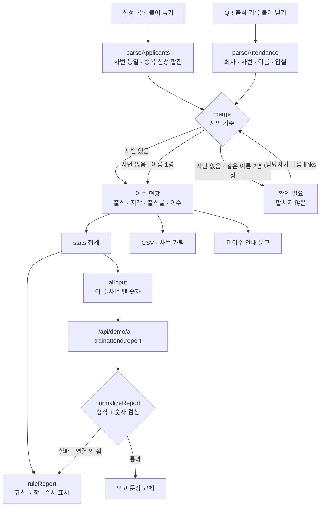

# 구조

## 사번 기준 합치기 (`merge`)

1. 신청자를 사번으로 등록한다. 같은 사번이 또 나오면 중복 신청으로 센다.
2. 출석 한 줄마다 사번으로 사람을 찾는다. 신청자에 없는 사번이면 ‘신청 없이 참석’으로 추가한다.
3. 사번이 비었으면 이름으로 찾는다. **같은 이름이 정확히 한 명일 때만** 연결하고 `사번 없이 이름으로 연결` 표시를 남긴다. 둘 이상이면 `unresolved`(확인 필요)로 빼고 아무에게도 넣지 않는다.
4. 같은 사람 같은 회차가 이미 있으면 두 번 찍힘으로 세고 무시한다.
5. 입실이 시작 + 10분보다 늦으면 지각(`L`). 출석으로는 센다.

확인 필요는 담당자가 화면에서 고르고, 그 선택(`links`: 출석 줄 → 사번)을 넣어 다시 합친다. 후보 중 그 회차에 이미 출석한 사람은 뒤로 보내고 표시한다.

## AI와 규칙

- 누가 출석·이수했는지는 **규칙만** 판단한다. AI는 보고 문장만 쓴다.
- AI에는 `aiInput()`으로 이름·사번을 뺀 집계 숫자만 보낸다.
- `normalizeReport()`는 문장 속 숫자가 입력 숫자(회차 번호 포함)에 모두 있는지 본다. 하나라도 없으면 응답 전체를 버린다.
- 규칙 문장이 먼저 나오고, AI 응답이 오면 덮어쓴다. 그 사이 다시 취합하면 앞 응답은 버린다(`token`).

## 파일

| 파일 | 하는 일 | DOM |
|---|---|---|
| `logic.js` | 읽기, 사번 통일, 합치기, 동명이인, 집계, 규칙 문장, 숫자 검산, CSV, 안내 문구 | 없음 |
| `ai-client.js` | `/api/demo/ai` 호출, 실패하면 `null` | 없음 |
| `app.js` | 원본 탭 · 결과 · 확인 필요 연결 · 이수 현황 표 · 내보내기 | 있음 |
| `tests/logic.test.js` | `node --test` 14개 | — |
