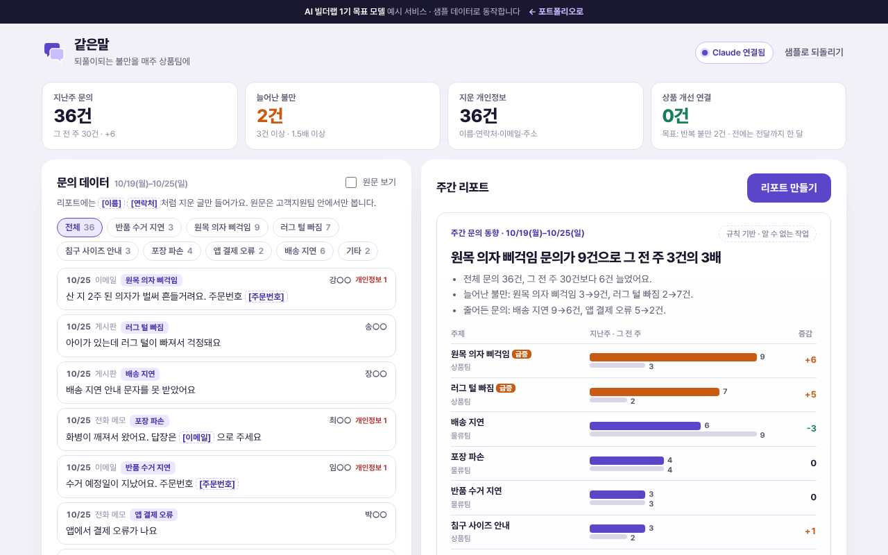

# 같은말

> 한 주 동안 들어온 고객 문의를 주제별로 세어 **늘어난 불만**을 찾고, 고객 이름·연락처를 **지운** 리포트를 매주 월요일 상품팀에 보내는 도구

   



**데모** · https://aibuilderlab.kr/demo/ax-voc-weekly/index.html

> **알림** AI 빌더랩 직장인 AX 트랙 **1기 목표 모델(가상의 수강생 ‘문의정리반’)** 의 예시 프로젝트입니다. 가상의 쇼핑몰 ‘솔담리빙’의 2주치 문의 66건으로 동작하며, 고객 이름·연락처·주소는 모두 지어낸 것입니다. 결과 숫자는 1기 목표치입니다.

## 문제 → 해결

| 문제 | 해결 |
|---|---|
| 같은 불만이 늘어도 상품팀에 전달되는 데 **한 달** | 매주 월요일 09:00, 지난주 vs 그 전 주를 비교한 리포트를 자동 발송 |
| 무엇이 ‘늘었는지’ 사람이 감으로 판단 | 3건 이상 · 2건 이상 증가 · 1.5배 이상이면 **급증**, 담당 팀에 요청 문장까지 |
| 리포트에 **고객 이름·연락처가 그대로** 들어감 | 문의 글에서 이름·연락처·이메일·주소·주문번호를 지우고, 보내기 직전에 메일 전체를 **한 번 더 검사** |
| 전달한 뒤 어떻게 됐는지 모름 | 요청마다 ‘전달 → 개선 확정’ 단계, 확정 건수를 위에 표시 (목표: 반복 불만 **2건** 상품 개선) |

## 주요 기능

- **주간 리포트** — 제목 한 줄, 요약 문장, 주제별 막대(지난주 · 그 전 주), 급증 주제의 고객 말(지운 글), 상품팀 요청.
- **개인정보 지우기** — 글 속 이름·휴대폰·이메일·주소·주문번호를 `[연락처]`처럼 바꿉니다. ‘원문 보기’를 켜면 무엇을 지우는지 빨간색으로 보입니다.
- **보내기 전 검사** — 메일 제목·본문에 개인정보가 하나라도 남으면 ‘지금 보내기’와 ‘복사’를 막습니다.
- **상품 개선 연결** — 요청 옆 버튼으로 전달 전 → 전달 → 개선 확정. 되돌리기 가능.
- **주제 거르기 · 문의 넣어 보기** — 주제별로 문의를 보고, 한 건을 넣으면 리포트가 다시 만들어집니다.
- **내보내기** — 메일 본문 복사, 주제별 건수 CSV(고객 글 없음).

## AI는 이렇게 동작합니다

| 상황 | 동작 | 화면 표시 |
|---|---|---|
| Claude 연결됨 | `vocweekly.summary` → 형식·숫자·개인정보 검사 → 문장 덮어쓰기 | `Claude로 요약 · 2.3초` |
| AI 키 없음 · 한도 초과 · 네트워크 오류 | 숫자로 규칙 문장을 만든다 | `규칙 기반 · (이유)` |
| 응답에 개인정보가 섞임 | 응답을 통째로 버리고 규칙 문장 유지 | `규칙 기반 · 응답에 개인정보·없는 숫자가 있거나 형식이 틀림` |
| 응답 문장에 집계에 없는 숫자 | 그 문장만 뺀다 (남는 문장이 없으면 버림) | 같음 |

Claude에는 **지운 글과 숫자만** 보냅니다. 자세한 흐름은 [docs/ARCHITECTURE.md](docs/ARCHITECTURE.md), 지시문 원문은 [docs/PROMPTS.md](docs/PROMPTS.md), 서버에 넣을 작업 정의는 [docs/ai-task.json](docs/ai-task.json).

## 기술 스택

| 구분 | 사용 |
|---|---|
| 화면 | HTML · CSS · JavaScript (프레임워크·빌드 없음) |
| AI | Claude API — 서버 `aibuilderlab.kr/api/demo/ai`가 호출 (작업 `vocweekly.summary`) |
| 문의 데이터 | 실제 버전은 고객센터 문의 내보내기, 데모는 2주치 샘플 + 직접 넣기 |
| 메일 | 실제 버전은 사내 메일 예약 발송, 데모는 발송 기록만 남김 |
| 테스트 | Node 내장 `node:test` |

## 폴더 구조

```
ax-voc-weekly/
├── index.html
├── style.css
├── logic.js          주제 · 개인정보 찾기/지우기 · 주간 집계 · 규칙 리포트 · 응답 검사 · 메일 · CSV (DOM 없음)
├── ai-client.js      /api/demo/ai 호출, 실패하면 null
├── app.js            목표치 · 문의 데이터 · 리포트 · 발송 화면
├── tests/logic.test.js
├── docs/ (ARCHITECTURE · DEVLOG · PROMPTS · ai-task.json)
├── CHANGELOG.md
└── package.json
```

## 실행 · 테스트

```bash
python3 -m http.server 8000   # http://localhost:8000
npm test                      # = node --test, 12개
```

## AI 활용 기록 (COVI 기록 요약)

| 프롬프트 | 디버깅 | 걸린 시간 |
|---|---|---|
| 22회 | 2회 | 3시간 |

- **막혔던 문제** — 고객 이름·연락처가 리포트에 포함 → 내용만 요약하고 개인정보는 지움
- **결과 (1기 목표치)** — 주간 리포트 자동 발송, 반복 불만 2건 상품 개선으로 연결
- 주차별 기록: [docs/DEVLOG.md](docs/DEVLOG.md)
