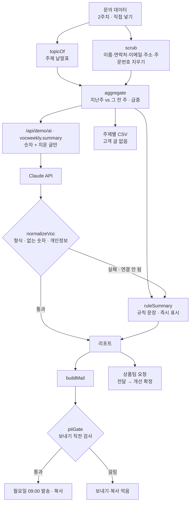

# 구조

## AI / 규칙 분기

| 단계 | 규칙 (항상) | Claude |
|---|---|---|
| 주제 나누기 · 건수 · 급증 | 낱말표 + 기준 (화면이 센다) | 하지 않음 |
| 제목 · 요약 문장 | 숫자로 만든 문장 | 다듬은 문장 (집계에 있는 숫자만) |
| 상품팀 요청 | 급증 주제마다 고정 문장 | 주제에 맞춘 요청 (주제 이름이 맞을 때만) |
| 개인정보 | `scrub` 지우기, `piiGate` 마지막 검사 | 응답에 섞이면 통째로 버림 |

- 숫자는 Claude가 세지 않는다. Claude는 화면이 센 숫자로 문장만 쓴다.
- ‘리포트 만들기’를 다시 누르면 앞의 Claude 응답은 버린다(`runToken`).

## 파일

| 파일 | 하는 일 | DOM |
|---|---|---|
| `logic.js` | 날짜, 주제, 개인정보 찾기·지우기, 집계, 규칙 문장, 응답 검사, 메일, 개선 단계, CSV | 없음 |
| `ai-client.js` | `/api/demo/ai` 호출, 실패하면 `null` (공통 파일, 수정 안 함) | 없음 |
| `app.js` | 샘플 데이터 생성 · 목표치 · 문의 데이터 · 리포트 · 발송 | 있음 |
| `tests/logic.test.js` | `node --test` 12개 | — |
| `docs/ai-task.json` | 서버 작업 목록에 넣을 `vocweekly.summary` 정의 | — |
