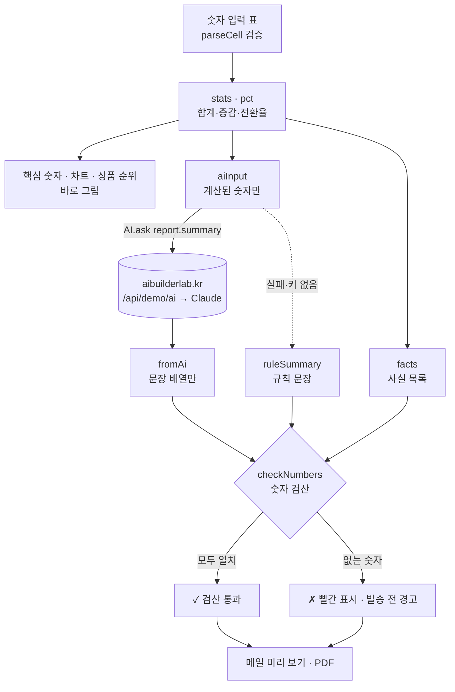

# 구조

> 1기 목표 모델 예시 · 금요보고 v1.0

## 데이터 흐름



## 숫자 검산

1. `facts()` — 보고서에 쓸 수 있는 숫자를 단위와 함께 모은다 (주간 합계, 일별 값, 증감률, 차이, 상품 수량·매출, 날짜의 월·일 …).
2. `numbersIn()` — 문장에서 `3,612만 원`, `12.2%`, `0.19%p`, `535건`, `10/9` 를 뽑는다.
3. `checkNumbers()` — 같은 단위의 사실과 비교한다. 허용 오차는 **문장에 적힌 자릿수의 반**(12.2% → ±0.05, 12% → ±0.5).

한계: 숫자가 데이터에 **있는지**만 본다. 그래서 보내기 전에 사람이 한 번 읽는 단계(메일 미리 보기)를 남겼다.

## 모듈

| 파일 | 하는 일 | DOM |
|---|---|---|
| `logic.js` | KST 날짜, 통계, 입력 검증, 규칙 요약, 사실 목록, 숫자 검산, AI 입력·응답 | 없음 (Node에서 테스트) |
| `ai-client.js` | 서버 호출, 시간 초과, 실패하면 `null` | 없음 |
| `app.js` | 입력 표, SVG 차트, 보고서 조립 애니메이션, 메일 미리 보기, 발송 기록 | 있음 |

## 상태 (localStorage `geumyobogo:v3`)

```js
{ weeks: { now: [{sales, orders, visits} × 7], last: [...] },
  top: { now: [[상품, 수량, 매출] × 5], last: [...] },
  summary: { mode: "ai"|"rule", lines: [..], ms, stale },
  to: [이메일], sched, log: [{title, n, at, warn, by}], generated }
```
