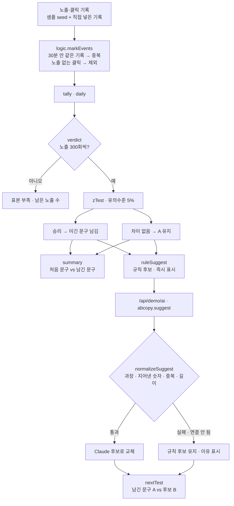

# 구조

## 중복 막기 (`markEvents`)

기록을 시간순으로 놓고 `방문자|문구|종류` 열쇠마다 마지막으로 센 시각을 기억합니다.

1. 같은 열쇠가 30분 안에 또 오면 `dup` — 새로고침으로 같은 기록이 다시 들어온 경우.
2. 그 방문자가 그 문구를 본(노출) 기록이 없는데 클릭이 오면 `orphan`.
3. 나머지만 셉니다. `dedupe=false`는 고치기 전 방식(모두 셈)으로, 화면의 비교 스위치에만 씁니다.

## AI와 규칙의 경계

- **판정은 숫자만** — 승패·남길 문구는 `verdict()`가 정합니다. AI는 다음 후보를 ‘제안’만 합니다.
- **후보는 바로 쓰지 않는다** — 후보는 `nextTest()`로 새 대결의 B가 되어 다시 숫자로 검증받습니다.
- **사실은 입력에서만** — 규칙 후보는 `facts`를 다시 배치할 뿐이고, Claude 후보도 `inventedNumbers()`로 입력에 없는 숫자가 있으면 버립니다.

## 파일

| 파일 | 하는 일 | DOM |
|---|---|---|
| `logic.js` | 샘플 기록 생성, 중복 막기, 집계, z검정, 판정, 후보 검사, CSV | 없음 |
| `ai-client.js` | `/api/demo/ai` 호출, 실패하면 `null` | 없음 |
| `app.js` | 요약 · 목록 · 상세 · 눌러 보기 · 후보 화면, localStorage(`career-ab-copy-v1`) | 있음 |
| `tests/logic.test.js` | `node --test` 14개 | — |
