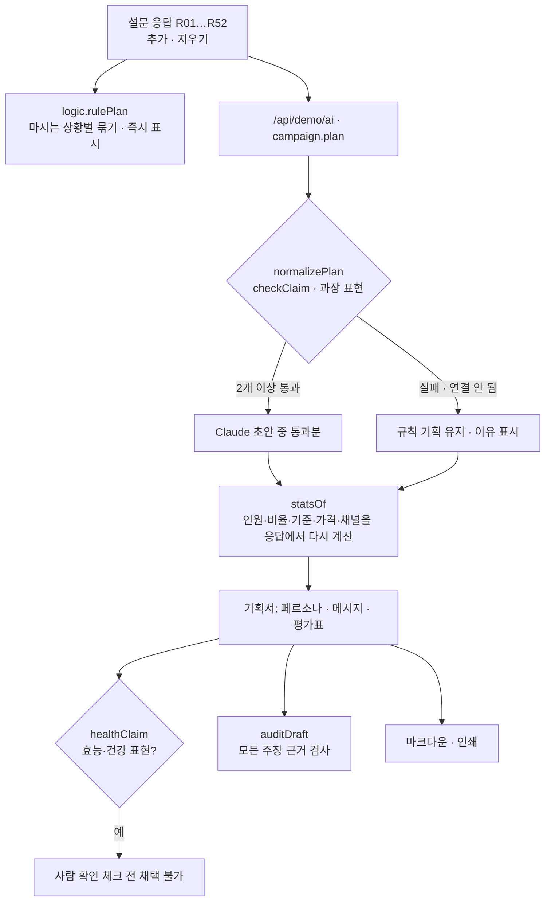

# 구조

## 근거 검사 (`checkClaim`)

주장 하나 = 문장 + 근거 응답 번호 목록.

1. 없는 응답 번호(R88 등)는 지우고 ‘없는 응답 번호’로 표시합니다.
2. 남은 근거가 없으면 ‘근거 응답 없음’.
3. 문장 속 `N%`는 `근거 수 ÷ 전체 응답 수`와 1%p 넘게 다르면 걸립니다.
4. 문장 속 `N명`은 근거 수나 전체 응답 수와 같아야 합니다(예: ‘설문 300명’은 걸림).

AI가 쓴 페르소나라도 화면의 숫자(인원·비율·가격·채널)는 AI 문장에서 가져오지 않고 `statsOf(refs)`로 다시 계산합니다.

## 사람에게 넘기는 것

음료의 효능·건강 표현(다이어트, 체지방, 면역, 피로 회복, 혈당 등)은 광고 규정과 얽혀 있어 도구가 맞다 틀리다 판단하지 않습니다. 해당 메시지는 노란 줄로 표시하고, ‘담당 교수·법무와 확인했어요’를 체크하기 전에는 채택 버튼이 잠깁니다.

## 파일

| 파일 | 하는 일 | DOM |
|---|---|---|
| `logic.js` | 샘플 응답, 통계, 규칙 기획, 근거 검사, 평가표, 응답 검사, 첫 초안 검사, 마크다운 | 없음 |
| `ai-client.js` | `/api/demo/ai` 호출, 실패하면 `null` | 없음 |
| `app.js` | 응답 목록 · 기획서 · 근거 검사 화면, localStorage(`career-campaign-plan-v1`) | 있음 |
| `tests/logic.test.js` | `node --test` 10개 | — |
