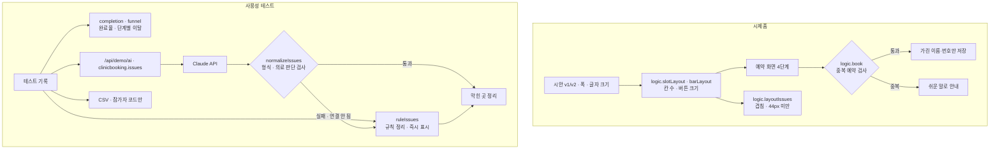

# 구조

## 버튼 겹침을 계산으로 막기

처음 시안은 데스크톱에서 만든 배치를 휴대폰에 줄여 넣었습니다. 시간 칸은 4칸 고정, 아래 버튼 세 개는 한 줄이었고, 문구(`전화로 예약하기`, `다음 단계로 이동`)가 버튼보다 길어 옆 버튼을 덮었습니다.

`layoutIssues(width, version, scale)`가 하는 일:

1. 글자 폭을 어림한다 (한글 1글자 ≈ 글자 크기, 숫자·기호 ≈ 0.6배).
2. 시간 칸: 칸 폭 = (안쪽 폭 − 간격) ÷ 칸 수. 글자 + 여백이 칸보다 넓으면 ‘겹침’.
3. 아래 버튼: 버튼마다 글자 + 좌우 여백이 버튼 폭보다 넓으면 ‘겹침’.
4. 폭이나 높이가 44px보다 작으면 ‘작은 버튼’.

고친 시안은 반대로 이 계산으로 칸 수를 정합니다(`slotLayout`: 2~4칸). 520px보다 좁으면 ‘다음 단계로’를 맨 위 한 줄로 따로 둡니다. 테스트가 320·360·375·390·430px × 보통·큰 글자 10가지 조합에서 겹침 0을 확인합니다.

## AI / 규칙 분기

| 단계 | 규칙 (즉시) | Claude (오면 덮어씀) |
|---|---|---|
| 메모 정리 | 멈춘 단계 + 낱말(글씨·겹·어디·인증 …)로 묶기 | 문맥으로 묶고 고칠 방법 제안 |
| 검사 | — | 단계 이름이 아니면 ‘전체’, 문제 글이 비면 버림, 진단·처방 같은 말이 있으면 버림 |

그 사이 다시 누르면 앞의 응답은 버립니다(`runToken`).

## 파일

| 파일 | 하는 일 | DOM |
|---|---|---|
| `logic.js` | 시간표, 본인 정보 검사, 중복 예약, 가리기, 배치 점검, 완료율·이탈, 메모 정리, 응답 검사, CSV | 없음 |
| `ai-client.js` | `/api/demo/ai` 호출, 실패하면 `null` | 없음 |
| `app.js` | 시제품 · 배치 점검 · 테스트 기록 화면 | 있음 |
| `tests/logic.test.js` | `node --test` 13개 | — |
