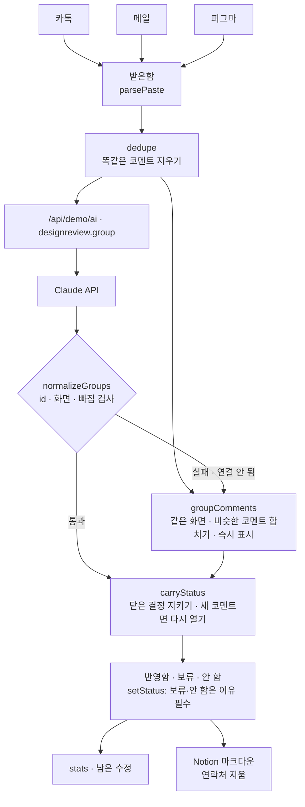

# 구조

## 같은 의견을 하나로 (`similarity` · `groupComments`)

처음 버전은 코멘트를 그대로 목록에 올려, “배너 글씨가 작아요”(카톡) · “메인 배너 텍스트 크기 키우면 좋겠어요”(피그마) · “배너 글자가 작아서 잘 안 읽힙니다”(메일)가 세 개의 수정으로 따로 잡혔습니다.

1. **똑같은 코멘트** — 같은 사람이 같은 화면에 같은 말을 다른 채널로 보냈으면 하나만 남기고 `alsoIn`에 채널을 적습니다.
2. **말 맞추기** — 같은 뜻 낱말을 하나로(`글씨·텍스트·폰트 → 글자`, `메인 → 홈`, `색상·컬러 → 색`), 끝말(`~요`, `좋겠어요`, 조사)을 뺍니다.
3. **두 글자 조각 겹침** — Dice 계수 0.33 이상이면 비슷함. 다른 화면끼리는 비교하지 않습니다.
4. **이어 묶기** — A~B, B~C가 비슷하면 A·B·C를 한 항목으로(union-find). 그래서 코멘트 하나는 정확히 한 항목에만 들어갑니다.

규칙으로 못 잡는 표현(예: “결제가 몇 단계인지 진행 표시 필요” ↔ “진행 단계 표시가 있으면 좋겠어요”)은 Claude가 묶습니다. 잘못 합쳤으면 ‘합친 것 나누기’.

## 닫기를 지키는 규칙

- 보류·안 함은 이유가 비면 닫히지 않습니다(`setStatus`).
- 다시 정리해도 코멘트가 절반 이상 겹치는 예전 항목의 상태를 옮겨 붙입니다(`carryStatus`).
- 단, 처음 보는 코멘트가 끼어 있으면 새 의견이므로 ‘남음’으로 다시 엽니다 → 놓친 수정 0건.
- Claude 응답에서 빠진 코멘트는 혼자 한 항목으로 붙입니다(`normalizeGroups`).

## 파일

| 파일 | 하는 일 | DOM |
|---|---|---|
| `logic.js` | 붙여 넣기 읽기, 비슷한 정도, 중복 지우기, 합치기, 응답 검사, 닫기, 통계, Notion 마크다운, 연락처 지우기 | 없음 |
| `ai-client.js` | `/api/demo/ai` 호출, 실패하면 `null` | 없음 |
| `app.js` | 받은함 · 수정 항목 · 현황 화면 | 있음 |
| `tests/logic.test.js` | `node --test` 11개 | — |
