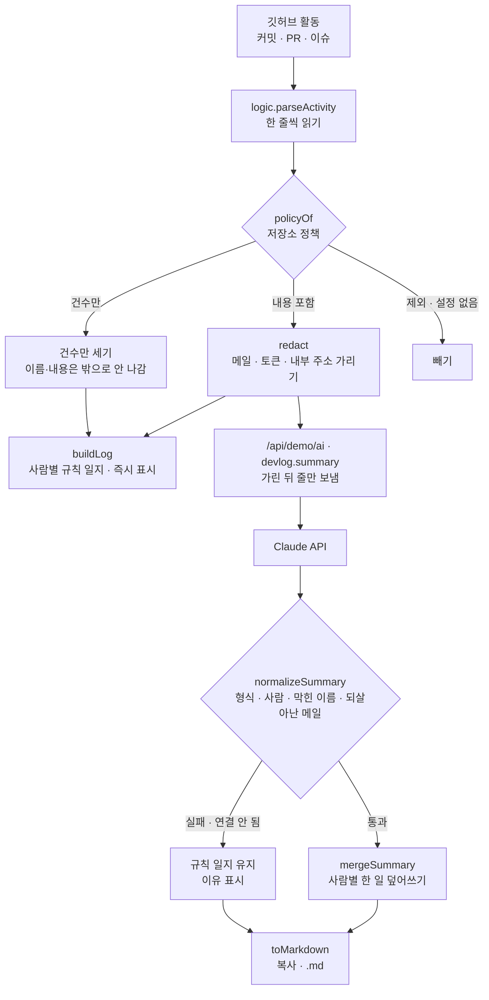

# 구조

## 내보내지 않는 장치 세 겹

| 겹 | 함수 | 하는 일 |
|---|---|---|
| 1. 고르기 | `policyOf` | 저장소마다 `full · count · off`. 비공개는 `full`이 될 수 없고, 설정에 없으면 `off` |
| 2. 가리기 | `redact` | `full` 저장소의 줄에서도 메일·토큰·내부 주소·IP·전화번호를 가린다 |
| 3. 돌아온 것 검사 | `normalizeSummary` + `leaks` | 응답에 `full`이 아닌 저장소 이름, 입력에 없는 사람, 가렸던 패턴이 있으면 버린다 |

화면의 노란 안내는 이번 주에 뺀 것·가린 것을 보여 주고, 내보낼 마크다운을 `leaks()`로 한 번 더 검사해 결과(“비공개 저장소 이름 0곳”)를 표시합니다. 이 안내 자체는 복사·내려받기에 들어가지 않습니다.

## 기다리지 않게

주를 바꾸거나 설정을 바꾸면 규칙 일지가 바로 나오고 Claude 결과가 오면 덮어씁니다. 그 사이 다시 바꾸면 앞의 응답은 버리고(`token`), 같은 주·같은 설정의 결과는 다시 부르지 않습니다(`cache`).

## 파일

| 파일 | 하는 일 | DOM |
|---|---|---|
| `logic.js` | 주 계산, 활동 읽기, 저장소 정책, 가리기, 규칙 일지, 응답 검사, 마크다운 | 없음 |
| `ai-client.js` | `/api/demo/ai` 호출, 실패하면 `null` | 없음 |
| `app.js` | 저장소 설정, 쌓인 일지 8주, 일지(미리보기·마크다운), 원본 활동 기록 | 있음 |
| `tests/logic.test.js` | `node --test` 11개 | — |
