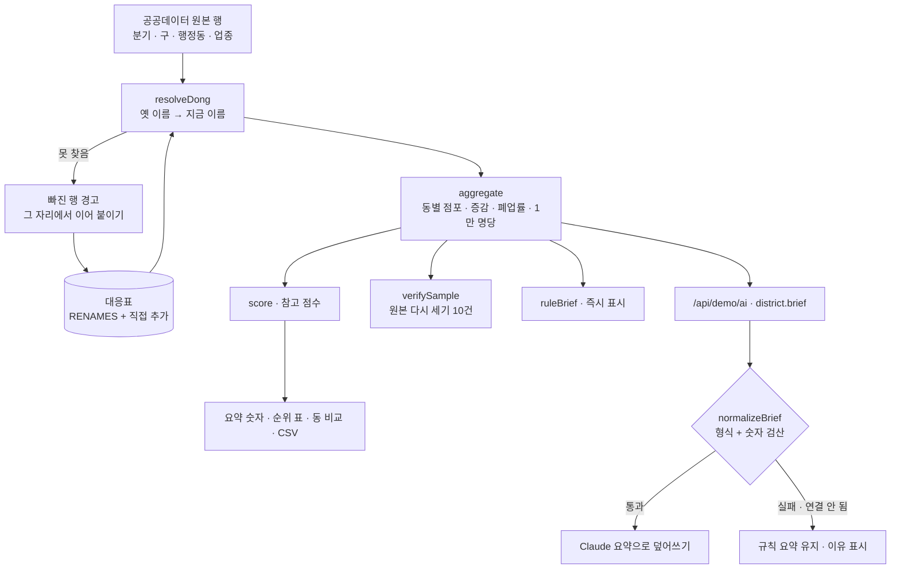

# 구조

## 이름 맞추기

2026년 2분기부터 이름이 바뀐 동이 있어 1분기 행은 옛 이름으로 들어옵니다. 대응표 없이 이름으로만 묶으면 그 동의 1분기가 0이 되어 ‘점포 +21곳’처럼 부풀려 보입니다.

1. 지금 이름 목록에 있으면 그대로 쓴다.
2. 대응표에 있고, 바꾼 이름이 지금 목록에 있으면 바꾼다. (두 동이 하나로 합쳐진 경우 둘 다 같은 이름으로)
3. 그래도 못 찾으면 버리지 않고 **이름별로 몇 행이 빠졌는지** 모아 경고로 보여 준다.

## 검산 (`verifySample`)

집계 함수와 다른 길로 셉니다. 동 이름과 ‘알려진 모든 옛 이름’을 펼쳐 놓고 원본 행을 하나씩 비교해 더합니다. 무작위로 고른 동 10곳의 1·2분기 점포 수가 집계와 같으면 일치. 대응표가 빠져 있으면 그 동이 불일치로 드러납니다.

## AI / 규칙 분기

| 단계 | 규칙 | Claude |
|---|---|---|
| 시점 | 조건을 바꾸는 즉시 | 같은 조건으로 한 번 (정렬·비교 담기는 다시 부르지 않음) |
| 입력 | 집계 결과 | `aiInput()` — 동별 숫자, 합계, 동 개수 |
| 검사 | — | `normalizeBrief()` — headline + 2문장 이상, 문장 속 숫자가 입력 숫자(반올림 포함)에 있어야 통과 |
| 경합 | — | 기다리는 사이 조건이 바뀌면 앞 응답은 버림(`token`) |

## 파일

| 파일 | 하는 일 | DOM |
|---|---|---|
| `logic.js` | 샘플 데이터, 이름 맞추기, 집계, 점수, 정렬, 검산, 규칙 요약, 응답 검사, CSV | 없음 |
| `ai-client.js` | `/api/demo/ai` 호출, 실패하면 `null` | 없음 |
| `app.js` | 조건 · 경고 · 요약 · 순위 표 · 비교 · 검산 · 대응표 화면 | 있음 |
| `tests/logic.test.js` | `node --test` 13개 | — |
