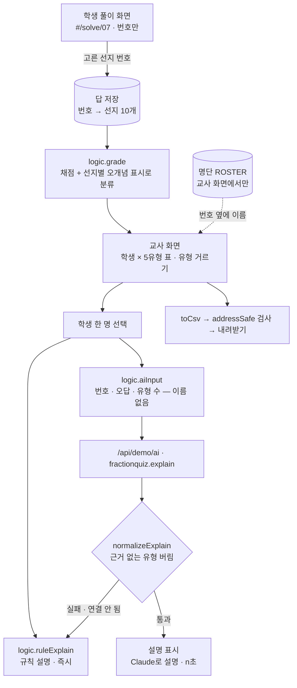

# 구조

## 오개념을 어떻게 아나

문항을 만들 때 오답 선지마다 “이 오개념이면 이걸 고른다”를 붙여 둡니다(`QUESTIONS[].t`). 예: `1/2 + 1/3`의 선지 `2/5`는 `add`(분자·분모 따로 더하기). 그래서 아이가 고른 번호만으로 채점과 분류가 동시에 끝납니다.

- 같은 유형 오답 2번 이상 → **확실(●)**, 1번 → **의심(○)**
- 단순 계산 실수(`etc`)와 안 푼 문항은 오개념으로 세지 않음
- 유형마다 드러낼 수 있는 문항이 2개 이상 있도록 문항을 짰음(테스트로 확인)

## 아이 정보 지키기

| 어디 | 무엇이 들어가나 | 장치 |
|---|---|---|
| 화면 주소 | `#/solve/07` (번호) | `studentLink`, 주소에 이름이 있으면 `#/teacher`로 바꿈 |
| CSV | 번호·점수·문항별 답·유형 | `toCsv`에는 이름 칸이 없고, 내려받기 전 `addressSafe` 검사 |
| Claude 입력 | 번호·틀린 문항·유형 수 | `aiInput`에 이름 필드 없음(테스트) |
| 저장소(localStorage) | 번호별 답 | 명단은 저장하지 않음 |
| 교사 화면 | 번호 + 이름 | ‘이름 가리기’로 화면 공유 때 ○○○ |

## AI / 규칙 분기

학생을 고르면 규칙 설명이 바로 나오고, 같은 순간 Claude에 요청합니다. 응답에서 규칙이 근거(오답)를 찾지 못한 유형은 버리고, 남는 게 없으면 규칙 설명을 그대로 둡니다. 그 사이 다른 학생을 고르면 앞 응답은 버립니다(`token`).

## 파일

| 파일 | 하는 일 | DOM |
|---|---|---|
| `logic.js` | 문항·유형, 채점·분류, 반 요약, 주소·CSV·AI 입력, 응답 검사, 규칙 설명 | 없음 |
| `ai-client.js` | `/api/demo/ai` 호출, 실패하면 `null` | 없음 |
| `app.js` | 교사 화면 · 학생 풀이 화면 · 주소 전환 | 있음 |
| `tests/logic.test.js` | `node --test` 12개 | — |
