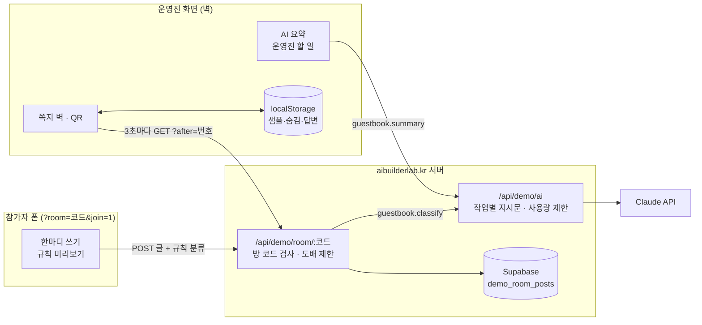

# 구조

## 한눈에

## 분류가 정해지는 순서

1. **키를 칠 때**: `logic.js`의 규칙(`classify`)이 즉시 색과 분류를 보여 준다.
2. **남길 때**: 서버가 Claude(`guestbook.classify`)로 다시 분류해 저장한다.
3. **Claude가 안 될 때**: 키 없음 · 한도 초과 · 시간 초과 · 이상한 응답이면 화면이 보낸 규칙 분류를 저장한다.
4. **사람이 고칠 때**: 쪽지의 분류를 바꾸면 ‘사람이 고침’으로 표시되고, 그것이 가장 우선이다.

쪽지에는 어떤 길로 분류됐는지(`Claude` 표시)가 남고, 머리글의 AI 상태 표시는 서버가 Claude를 쓸 수 있는지 그대로 보여 준다.

## 파일

| 파일 | 하는 일 | DOM |
|---|---|---|
| `logic.js` | 규칙 분류, 요약 계산, 응답 검사, 방 코드, 실시간 글 합치기 | 없음 (Node 테스트 가능) |
| `ai-client.js` | `/api/demo/ai` 호출, 실패하면 `null` | 없음 |
| `app.js` | 운영진 화면 · 참가자 화면 · 진행 모드 | 있음 |
| `tests/logic.test.js` | `node --test` 18개 | — |

## 안전장치

| 위험 | 막는 방법 |
|---|---|
| 남의 방 글 보기 | 무작위 방 코드(8자)를 아는 사람만 읽고 쓴다 |
| 도배 | 같은 기기 10분 20건까지 |
| AI 비용 폭주 | 방문자 시간당 · 전체 하루 호출 수 제한, 요약은 버튼을 눌러야만 |
| 오래된 글 | 2일 지난 방 글은 서버가 지운다 |
| AI가 이상한 값 | 화면에서 검사 후 규칙으로 대체 |
