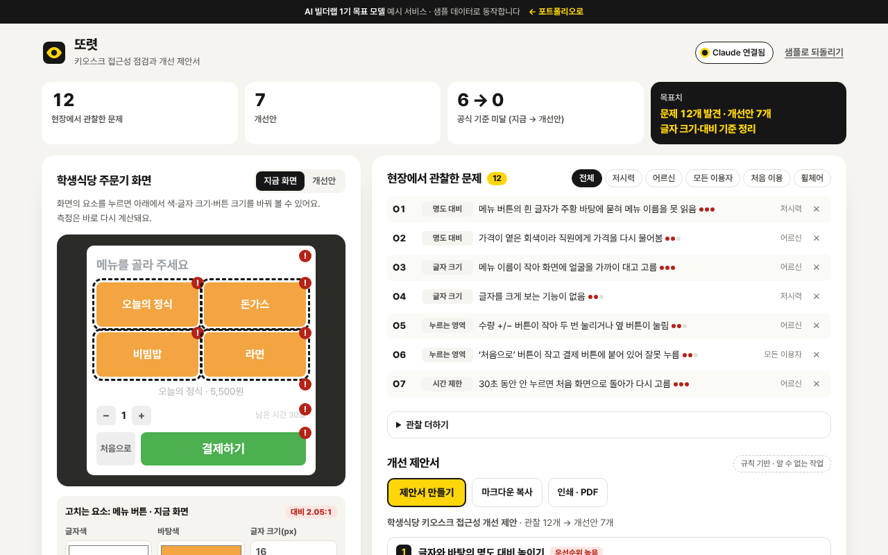

# 또렷

> 학교 식당 키오스크를 현장에서 관찰하고, 명도 대비·버튼 크기·시간 제한을 **공식 지침과 대조해** 개선 제안서를 만드는 도구

   



**데모** · https://aibuilderlab.kr/demo/career-kiosk-a11y/index.html

> **알림** AI 빌더랩 커리어 트랙 **1기 목표 모델(가상의 수강생 ‘픽셀산책’)** 의 예시 프로젝트입니다. 학교 식당과 키오스크 화면, 관찰 내용은 가상이며, 결과 숫자는 1기 목표치입니다.

## 문제 → 해결

| 문제 | 해결 |
|---|---|
| 학교 식당 키오스크에서 어르신·저시력 이용자가 주문을 어려워했다 | 현장 관찰 12개를 분류·이용자·심각도·빈도로 기록 |
| 무엇이 기준에 못 미치는지 감으로만 말했다 | 화면 요소마다 명도 대비·누르는 영역·글자 크기·시간 제한을 계산해 미달을 표시 |
| AI가 알려 준 접근성 기준이 예전 버전 내용이었다 | 공식 지침표(WCAG 2.2)와 하나씩 대조해 **일치 · 다름 · 사람이 확인**으로 표시 |
| 결과 (1기 목표치) | 문제 **12개** 발견, 개선안 **7개** · 글자 크기·대비 기준 정리 |

## 주요 기능

- **지금 화면 / 개선안** — 요소를 누르면 글자색·바탕색·글자 크기·버튼 크기·시간 제한을 바꿀 수 있고, 측정표와 미달 표시(!)가 바로 다시 계산됩니다. 샘플은 지금 화면 미달 6곳 → 개선안 0곳.
- **현장 관찰** — 저시력·어르신·휠체어·처음 이용자별로 거르기, 관찰 더하기·지우기(되돌리기).
- **개선 제안서** — 분류별로 묶고 심각도×빈도로 우선순위. 개선안마다 근거 기준(WCAG 성공 기준 번호·등급·내용)과 관련 문제 번호가 붙고, 번호를 누르면 관찰 목록에서 밝혀집니다.
- **기준 대조표** — AI가 처음 준 기준 8개를 공식 지침표와 비교. 예: “누르는 영역 최소 44px(AA)” → 다름(AA 최소 기준은 2.5.8의 24px, 44px은 2.5.5 AAA).
- **사람에게 넘기기** — 설치 높이·소리 안내처럼 공식 수치가 없는 항목과 법적 의무 여부는 판단하지 않고 ‘담당 부서 확인’으로 표시합니다.
- **마크다운 복사 · 인쇄** — 인쇄하면 제안서만 나옵니다(PDF 저장 가능).

## AI는 이렇게 동작합니다

| 상황 | 동작 | 화면 표시 |
|---|---|---|
| Claude 연결됨 | `kioska11y.proposal` → 형식 검사(`normalizeProposal`) | `Claude로 정리 · 2.1초` |
| AI 키 없음 · 한도 초과 · 네트워크 오류 · 아직 없는 작업 | 분류별 템플릿 + 심각도×빈도 규칙(`ruleProposal`) | `규칙 기반 · (이유)` |
| 응답 형식이 틀림 | 버리고 규칙 결과 유지. 없는 문제 번호·기준은 버리고, 공식과 다른 수치는 ‘다름’ 표시 후 공식값 사용, 법적 판단 문장은 지움, 빠진 문제는 규칙으로 채움 | `규칙 기반 · 응답 형식이 맞지 않음` |

명도 대비·버튼 크기 측정과 기준 대조는 AI를 쓰지 않고 공식 계산식과 지침표로만 합니다. 자세한 흐름은 [docs/ARCHITECTURE.md](docs/ARCHITECTURE.md), 지시문 원문은 [docs/PROMPTS.md](docs/PROMPTS.md).

## 기술 스택

| 구분 | 사용 |
|---|---|
| 화면 | HTML · CSS · JavaScript (프레임워크·빌드 없음) |
| 기준 | W3C WCAG 2.2 — 1.4.3 · 1.4.6 · 1.4.11 · 2.5.8 · 2.5.5 · 2.2.1 · 1.4.4 · 1.4.1 |
| 방법 | 현장 관찰 · 접근성 체크리스트 |
| AI | Claude API — 서버 `aibuilderlab.kr/api/demo/ai`가 호출 |
| 테스트 | Node 내장 `node:test` |

## 폴더 구조

```
career-kiosk-a11y/
├── index.html
├── style.css
├── logic.js          공식 지침표 · 명도 대비 · 화면 측정 · 기준 대조 · 제안 규칙 · 응답 검사 · 제안서 마크다운 (DOM 없음)
├── ai-client.js      /api/demo/ai 호출, 실패하면 null
├── app.js            키오스크 미리보기 · 측정표 · 관찰 · 제안서 · 대조표 화면
├── tests/logic.test.js
├── docs/ (DEVLOG · PROMPTS · ARCHITECTURE · ai-task.json)
├── CHANGELOG.md
└── package.json
```

## 실행 · 테스트

```bash
python3 -m http.server 8000   # http://localhost:8000
npm test                      # = node --test, 12개
```

## AI 활용 기록 (COVI 기록 요약)

| 프롬프트 | 디버깅 | 걸린 시간 |
|---|---|---|
| 22회 | 0회 | 5시간 |

- **막혔던 문제** — AI가 준 접근성 기준이 오래된 내용 → 공식 지침 문서와 대조해 고침
- **결과 (1기 목표치)** — 문제 12개 발견, 개선안 7개 · 글자 크기·대비 기준 정리
- 주차별 기록: [docs/DEVLOG.md](docs/DEVLOG.md)
