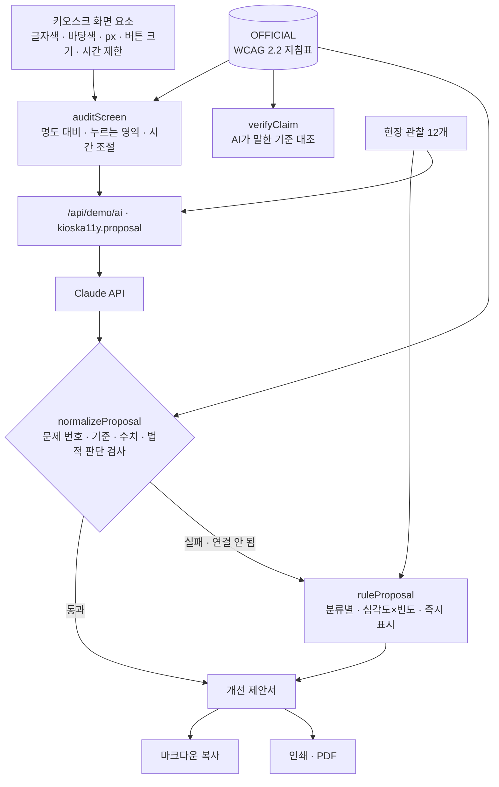

# 구조

## 명도 대비 계산 (`contrast`)

WCAG의 상대 휘도 공식을 그대로 씁니다.

1. sRGB 0~255 → 0~1, `c ≤ 0.04045`면 `c/12.92`, 아니면 `((c+0.055)/1.055)^2.4`
2. 휘도 `L = 0.2126R + 0.7152G + 0.0722B`
3. 대비 `(밝은 L + 0.05) / (어두운 L + 0.05)`

소수 둘째 자리에서 **버립니다**. 4.47:1이 반올림으로 4.5가 되어 통과하는 일을 막기 위해서입니다. 큰 글자(24px 이상, 또는 굵게 18.66px 이상)는 3:1, 나머지는 4.5:1과 비교합니다.

## 기준 대조 (`verifyClaim`)

AI가 말한 기준을 `{id, value, large, version, level}`로 적고 지침표와 비교합니다.

| 결과 | 조건 |
|---|---|
| 일치 | 수치·등급·버전이 지침표와 같음 |
| 다름 | 하나라도 다름 → 무엇이 다른지와 공식값을 보여 줌 |
| 사람이 확인 | 지침표에 없는 기준(설치 높이 등) → 원문을 찾아 사람이 판단 |

제안서의 Claude 응답도 같은 함수로 거릅니다(`claimValue`가 공식과 다르면 ‘AI 수치와 달라 공식값으로’).

## 사람에게 넘기는 곳

- 공식 수치가 없는 분류(소리 안내 · 단계·구성 · 높이·위치)는 기준란에 ‘공식 수치 없음 · 담당 부서 확인’.
- AI 응답에 ‘법적 의무 · 위반 · 과태료’ 같은 판단이 있으면 그 문장을 지우고 ‘담당 부서 확인’ 표시.
- 제안서 끝에 “법적 의무 여부를 판단하지 않습니다”를 늘 붙입니다.

## 파일

| 파일 | 하는 일 | DOM |
|---|---|---|
| `logic.js` | 지침표, 명도 대비, 화면 측정, 기준 대조, 제안 규칙, 응답 검사, 관찰 추가, 제안서 마크다운 | 없음 |
| `ai-client.js` | `/api/demo/ai` 호출, 실패하면 `null` | 없음 |
| `app.js` | 키오스크 미리보기 · 측정표 · 관찰 · 제안서 · 대조표 화면 | 있음 |
| `tests/logic.test.js` | `node --test` 12개 | — |
