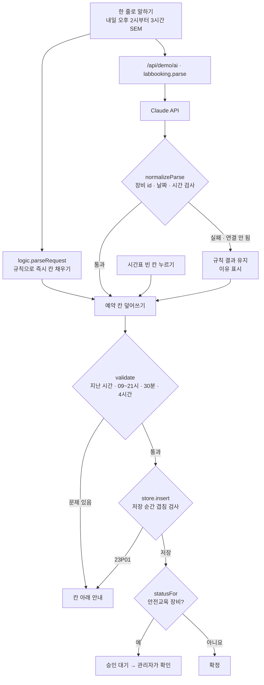

# 구조

## 겹침은 두 번 막는다

| 단계 | 어디서 | 막는 것 |
|---|---|---|
| 1. 화면 검사 `validate` | 저장 버튼을 누를 때 | 시간 형식, 운영 시간, 지난 시간 |
| 2. 저장 순간 `insert` (DB 제약) | 데이터를 쓰는 바로 그때 | 같은 장비·겹치는 시간 — 화면 확인 뒤에 다른 사람이 먼저 저장한 경우까지 |

화면에서 ‘비어 있나’만 확인하면 확인과 저장 사이에 틈이 생깁니다. `simulateRace()`는 두 사람이 같은 사본으로 확인하고 둘 다 저장하는 순서를 그대로 재현하며, `constraint:false`이면 충돌 1건, `true`이면 0건입니다. 실제 버전에서는 Postgres의 `exclude using gist (equipment_id with =, tstzrange(starts_at, ends_at, '[)') with &&)` 제약이 2단계를 맡습니다.

## AI와 규칙의 경계

- AI는 **문장 → 예약 칸** 변환만 합니다. 결과는 사람이 확인한 뒤 ‘예약하기’를 눌러야 저장됩니다.
- 저장, 겹침 검사, 안전교육 승인은 AI를 거치지 않습니다. 안전교육 장비는 늘 ‘승인 대기’로 들어가고 관리자가 승인합니다.
- 규칙 결과가 먼저 나오고, 그 사이 다시 누르면 앞의 AI 응답은 버립니다(`parseToken`).

## 개인정보

- 예약자 이름은 이 브라우저의 localStorage(`career-lab-booking-v1`)에만 둡니다. 주소창·콘솔 로그에 남기지 않습니다.
- CSV로 내보낼 때는 `maskName()`으로 가립니다 (김민준 → 김*준).

## 파일

| 파일 | 하는 일 | DOM |
|---|---|---|
| `logic.js` | 시간 계산, 겹침, 검사, 저장소(DB 제약 흉내), 동시 예약 재현, 문장 해석, 응답 검사, CSV | 없음 |
| `ai-client.js` | `/api/demo/ai` 호출, 실패하면 `null` | 없음 |
| `app.js` | 예약 폼, 시간표, 예약 자세히, 승인 대기, 동시 예약 재현 | 있음 |
| `tests/logic.test.js` | `node --test` 13개 | — |
