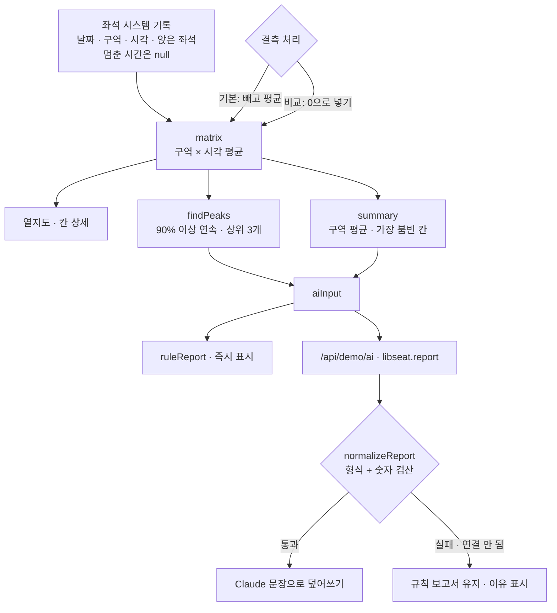

# 구조

## 결측 처리 (`meanOf`)

좌석 시스템이 멈춘 시간은 원본에 빈칸으로 남습니다. 처음에는 빈칸을 0으로 읽어서, 가장 붐비던 시험 기간 2층 열람실 B 10–13시 평균이 90% 아래로 내려가 혼잡 시간대에서 빠졌습니다.

- 기본: 빈칸은 ‘모름’이므로 빼고, 남은 날로 평균. 칸마다 몇 날이 빠졌는지(`missing`)를 함께 둔다.
- 비교: 스위치를 켜면 이전 방식(0으로 넣기)으로 다시 계산해 차이를 보여 준다.
- 모든 날이 빈칸이면 평균은 `null` (0이 아니다).

## 혼잡 시간대 (`findPeaks`)

구역마다 시각 순서로 보며 평균 이용률이 90% 이상인 칸이 이어지는 구간을 묶습니다. 기록이 없는 칸(`null`)은 구간을 끊습니다. 구간 평균이 높은 순, 같으면 긴 순으로 상위 3개.

## AI / 규칙 분기

| 단계 | 규칙 | Claude |
|---|---|---|
| 계산 | 평균 · 혼잡 시간대 · 요약 모두 `logic.js` | 계산하지 않음 (문장만) |
| 시점 | 기간 · 결측 처리를 바꾸는 즉시 | 같은 조건으로 한 번 (칸 선택은 다시 부르지 않음) |
| 검사 | — | `normalizeReport()` — headline · unknowns · findings · proposal이 다 있어야 하고, 문장 속 숫자가 입력에 있어야 통과 |
| 경합 | — | 기다리는 사이 조건이 바뀌면 앞 응답은 버림(`token`) |

## 파일

| 파일 | 하는 일 | DOM |
|---|---|---|
| `logic.js` | 샘플 기록, 평균, 열지도 행렬, 혼잡 찾기, 요약, 규칙 보고서, 응답 검사, CSV | 없음 |
| `ai-client.js` | `/api/demo/ai` 호출, 실패하면 `null` | 없음 |
| `app.js` | 조건 · 요약 숫자 · 열지도 · 칸 상세 · 혼잡 시간대 · 보고서 화면 | 있음 |
| `tests/logic.test.js` | `node --test` 12개 | — |
