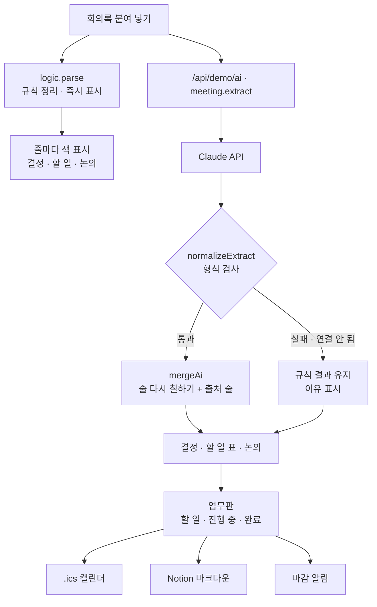

# 구조

## 기다리지 않게

‘정리하기’를 누르면 규칙 결과가 **바로** 나오고, 그 위로 빛이 지나가는 동안 Claude를 기다립니다. Claude 결과가 오면 줄 색이 다시 칠해집니다. 그 사이 다시 누르면 앞의 결과는 버립니다(`runToken`).

## 출처 줄 찾기 (`matchLine`)

Claude는 “학생회관 대관 신청서 제출”처럼 말을 다듬어 돌려줍니다. 회의록에는 “대관 신청서는 서연이가 … 내 주기로 했고”라고 적혀 있습니다.

1. 띄어쓰기·기호를 지우고 두 글자씩 자른다 → `대관`, `관신`, `신청`, …
2. 줄마다 겹치는 조각 비율을 잰다.
3. 담당자 이름이 그 줄에 있으면 +0.2.
4. 0.3 미만이면 ‘문맥’(출처 줄 없음)으로 둔다.

## 파일

| 파일 | 하는 일 | DOM |
|---|---|---|
| `logic.js` | 날짜, 규칙 정리, 응답 검사, 출처 줄, 마감 알림, .ics, Notion 마크다운 | 없음 |
| `ai-client.js` | `/api/demo/ai` 호출, 실패하면 `null` | 없음 |
| `app.js` | 회의록 · 결과 · 업무판 화면 | 있음 |
| `tests/logic.test.js` | `node --test` 17개 | — |
