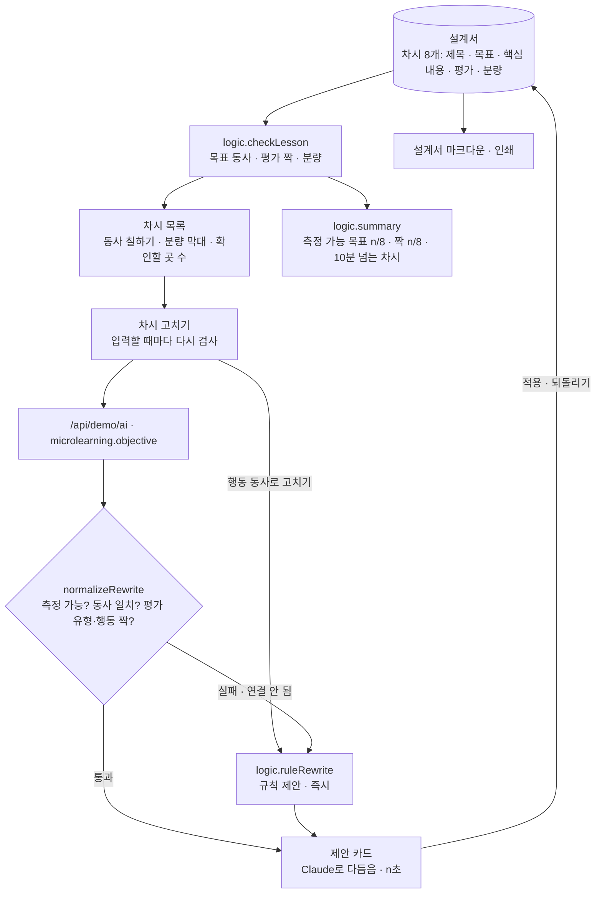

# 구조

## 목표와 평가를 한 줄로 잇는 기준

| 행동 동사 | 단계 | 짝이 되는 평가 | 평가 문항에 들어가야 할 행동 |
|---|---|---|---|
| 고른다 | 기억 | 선택형 | 고르 |
| 구분한다 | 이해 | 선택형 · 사례 판단 | 구분 |
| 설명한다 | 이해 | 서술형 | 설명 |
| 작성한다 | 적용 | 실습 과제 · 서술형 | 작성 |
| 적용한다 | 적용 | 사례 판단 · 실습 과제 | 적용 |
| 시연한다 | 적용 | 실습 과제 | 시연 |
| 분석한다 | 분석 | 사례 판단 · 서술형 | 분석 |
| 세운다 | 창안 | 실습 과제 | 세우·계획 |

관찰할 수 없는 동사: 이해한다, 안다, 알 수 있다, 익힌다, 인식한다, 느낀다, 깨닫는다, 함양한다, 기른다 등. 이 목록은 서비스가 쓰는 기준이고, 기관 지침이 있으면 `VERBS`·`VAGUE`를 바꿔 씁니다.

## 규칙 제안 (`ruleRewrite`)

1. 목표가 이미 측정 가능하면 동사는 두고, 평가가 짝이 안 맞을 때만 동사에 맞는 평가 틀로 바꿉니다.
2. 아니면 목표에서 동사를 걷어내 ‘무엇을’ 부분을 남깁니다. 행동이 둘이면(“…인식하고 …익힌다”) 동사 단서가 있는 쪽을 고릅니다.
3. ‘무엇을’과 제목·핵심 내용의 낱말로 동사를 고릅니다(중요성·목적 → 설명한다, 기록·양식 → 작성한다, 구분·차이 → 구분한다 …).
4. 동사에 맞는 평가 틀을 붙입니다(설명한다 → “○○을 2~3문장으로 설명하시오.”).

분량(10분 초과)은 제안이 고치지 않습니다. 무엇을 줄일지는 설계자가 정합니다.

## AI / 규칙 분기

‘행동 동사로 고치기’를 누르면 규칙 제안이 바로 보이고 Claude를 기다립니다. Claude 제안은 `normalizeRewrite` 검사(측정 가능한 목표인지, 말한 동사와 목표 문장이 같은지, 평가 유형과 문항의 행동이 짝인지)를 통과해야 덮어씁니다. 그 사이 다른 차시를 고르면 앞 응답은 버립니다(`token`). 적용은 항상 사람이 누릅니다.

## 파일

| 파일 | 하는 일 | DOM |
|---|---|---|
| `logic.js` | 동사 기준, 목표 읽기, 차시 검사, 요약, 규칙 제안, 응답 검사, 마크다운 | 없음 |
| `ai-client.js` | `/api/demo/ai` 호출, 실패하면 `null` | 없음 |
| `app.js` | 과정 요약 · 차시 목록 · 고치기 화면 | 있음 |
| `tests/logic.test.js` | `node --test` 12개 | — |
