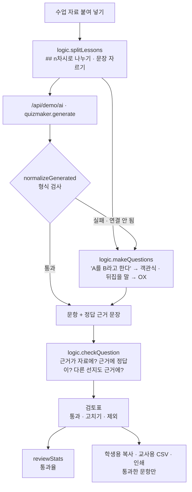

# 구조

## 정답이 틀린 문항을 어떻게 거르나

AI가 만든 문항에 정답이 틀린 것이 섞였던 문제에서 출발했습니다. 그래서 문항마다 **정답 근거 문장**을 함께 내게 하고, 화면이 세 가지를 자동으로 확인한 뒤 사람이 근거를 읽고 정합니다.

| 확인 | 방법 | 잡는 것 |
|---|---|---|
| 근거가 자료에 있나 (`noEvidence`) | 띄어쓰기·기호를 지우고 자료의 문장과 비교, 두 글자 조각 90% 이상 겹치면 같은 문장 | 지어낸 근거 |
| 근거에 정답이 있나 (`answerMissing`) | 객관식: 정답 선지가 근거 안에 있는지 / OX: 문항이 근거와 같으면 O, 다르면 X | 정답 표시가 틀린 문항 |
| 다른 선지도 근거에 나오나 (`multi`) | 정답 글자를 뺀 근거에 오답 선지가 있는지 | 정답이 둘로 읽힐 수 있는 문항 |
| 형식 (`shape`) | 선지 수·중복·정답 번호 범위 | 깨진 응답 |

경고가 없는 문항도 사람이 ‘통과’를 눌러야 내보내집니다. 경고는 “어디를 먼저 볼지”만 알려 줍니다.

## 통과율

`통과율 = 손대지 않고 통과한 문항 / 검토한 문항(통과 + 고쳐서 통과 + 제외)`. 고친 문항은 내보내지만 통과율에는 넣지 않아, 생성 품질을 그대로 봅니다.

## AI / 규칙 분기

‘퀴즈 만들기’를 누르면 규칙 문항이 바로 나오고 Claude를 기다립니다. Claude 문항이 형식 검사를 통과하면 덮어쓰고, 아니면 규칙 문항을 그대로 둡니다. 그 사이 다시 누르면 앞 결과는 버립니다(`runToken`).

## 파일

| 파일 | 하는 일 | DOM |
|---|---|---|
| `logic.js` | 차시 나누기, 용어 찾기, 문항 만들기, 자동 확인, 응답 검사, 통과율, 내보내기 | 없음 |
| `ai-client.js` | `/api/demo/ai` 호출, 실패하면 `null` | 없음 |
| `app.js` | 수업 자료 · 검토표 · 내보내기 화면 | 있음 |
| `tests/logic.test.js` | `node --test` 12개 | — |
