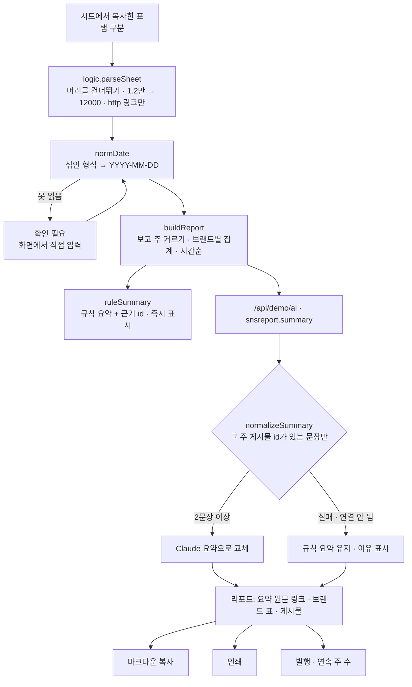

# 구조

## 날짜 맞추기 (`normDate`)

위에서부터 처음 맞는 규칙을 씁니다. 결과는 `{date, kind}`이고 `date`가 비면 ‘확인 필요’입니다.

| 형식 | 예 | 메모 |
|---|---|---|
| ISO · 빗금 · 점 구분 | `2026-10-21`, `2026/10/21`, `2026. 10. 21.` | 없는 날짜(2/30)는 버림 |
| 한글 | `2026년 10월 21일 오후 3:12`, `10월 21일` | 시각은 버림 |
| 월/일 | `10/21`, `10.21` | 연도 없음 → 오늘보다 7일 넘게 뒤면 작년 |
| 영문 | `21 Oct 2026`, `Oct 21, 2026` | |
| 상대 표현 | `어제`, `3일 전`, `5시간 전` | ‘오늘’ 인자 기준 |
| 시트 숫자 | `46316` | 1899-12-30부터 센 일수 |

못 읽은 행은 지우지 않습니다. 조용히 빠지면 그 주 게시물 수가 틀려도 아무도 모르기 때문입니다.

## 원문 링크 규칙

- 요약 문장은 `{text, refs}`이고 `refs`는 그 주 게시물 id입니다. 화면은 id로 원문 링크를 찾아 붙입니다.
- `normalizeSummary()`는 그 주에 없는 id(지어낸 id, 다른 주 게시물)를 지우고, 남은 근거가 없는 문장은 버립니다.

## 파일

| 파일 | 하는 일 | DOM |
|---|---|---|
| `logic.js` | 날짜 맞추기, 표 읽기, 주간 집계, 규칙 요약, 응답 검사, 발행, 마크다운, 샘플 시트 | 없음 |
| `ai-client.js` | `/api/demo/ai` 호출, 실패하면 `null` | 없음 |
| `app.js` | 단계 · 시트 · 리포트 · 발행 기록 화면, localStorage(`career-sns-report-v1`) | 있음 |
| `tests/logic.test.js` | `node --test` 12개 | — |
