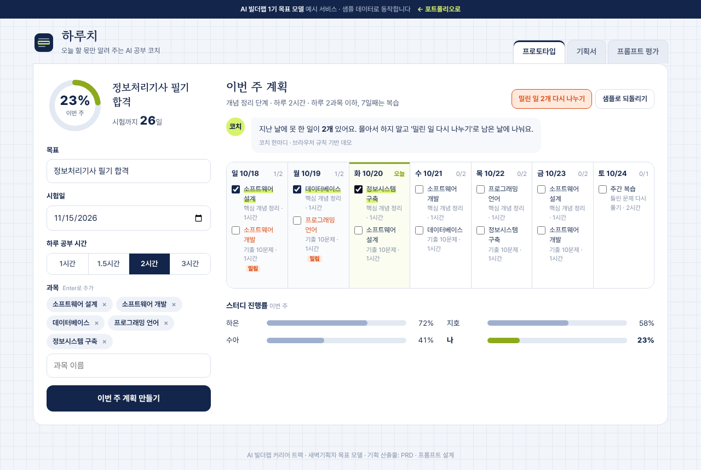

# 하루치

> 시험일과 하루 공부 시간을 넣으면 오늘 할 몫만 보여 주고, 밀리면 다시 나눠 주는 AI 공부 코치 — 기획서 · 프로토타입 · 프롬프트 평가표



**데모** · https://aibuilderlab.kr/demo/career-study-prd/

> **알림** 이 저장소의 서비스는 AI 빌더랩 커리어 트랙 **1기 목표 모델(가상의 수강생 ‘새벽기획자’)** 의 예시 프로젝트입니다. 샘플 데이터로 동작하며, 계획 생성과 코치 문구는 기획서의 v3 프롬프트를 브라우저 규칙으로 옮겨 흉내 냅니다. 스터디원 진행률의 다른 사람 값은 샘플입니다.

## 문제 → 해결

| 문제 | 해결 |
|---|---|
| 스터디원마다 계획이 따로라 누가 어디까지 했는지 몰랐다 | 스터디 진행률을 한 화면에 |
| 계획 짜는 데만 한 시간 | 목표·시험일·하루 시간·과목 → 7일 계획 |
| 하루 밀리면 계획 전체가 무너져 포기 | ‘밀린 일 다시 나누기’로 남은 날에 고르게 옮김 |
| 기능 아이디어가 12개로 불어남 | 필수 5개만 남기고 나머지는 2차로 (PRD의 핵심 결정) |

## 이 프로젝트에 들어 있는 것

1. **기획서 (PRD)** — 문제, 대상, 1차 기능 5개, 2차로 미룬 것, 화면 흐름 7개(와이어프레임), 성공 지표
2. **프로토타입** — 기획서의 1차 기능 5개가 실제로 동작
3. **프롬프트 평가표** — 같은 입력에 대한 프롬프트 3개 버전을 5개 기준으로 비교 (v1 11점 → v2 17점 → v3 24점)

## 프로토타입 기능

- **계획 만들기** — 남은 기간에 따라 ‘개념 정리 → 문제 풀이 → 마무리’ 단계를 정하고, 하루 2과목 이하, 7일째는 복습으로 나눕니다.
- **형광펜 체크** — 할 일을 체크하면 형광펜이 그어지고 진행률 고리와 코치 한마디가 바로 바뀝니다.
- **밀린 일 다시 나누기** — 지난 날의 못 한 일을 오늘부터 남은 날에 하나씩 돌려 담고 ‘옮김’ 표시를 남깁니다. 되돌리기 가능.
- **스터디 진행률** — 이번 주 내 진행률을 스터디원과 나란히 봅니다.
- **입력 검사** — 목표 빈칸, 지난 시험일, 과목 없음 등을 그 자리에서 알려 줍니다.

## 기술 스택

| 구분 | 이 데모 | 실제 버전 계획 |
|---|---|---|
| 화면 | HTML · CSS · JavaScript (프레임워크 없음) | Next.js |
| 계획 생성 | 규칙 (`app.js`의 `makePlan`) | 프롬프트 v3 + LLM |
| 저장 | 브라우저 localStorage | 스터디 공유를 위한 DB |

## 폴더 구조

```
career-study-prd/
├── index.html     프로토타입 · 기획서 · 프롬프트 평가 세 탭
├── style.css      디자인 (모눈 공책, 형광펜, 반응형)
├── app.js         계획 생성 · 체크 · 다시 나누기 · 평가표
└── screenshot.png
```

## 실행 방법

```bash
python3 -m http.server 8000
# http://localhost:8000 을 엽니다
```

## AI 활용 기록 (COVI 기록 요약)

| 프롬프트 | 디버깅 | 걸린 시간 |
|---|---|---|
| 31회 | 2회 | 4시간 |

- **막혔던 문제** — 요구사항이 섞여 범위가 계속 커짐 → 필수 기능 5개만 남기고 나머지는 2차로 분리
- **결과** — 기능 5개 정의, 화면 7개 설계 (1기 목표치)
