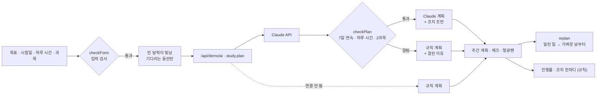

# 구조

## 왜 검사하나

서비스의 약속은 “오늘 몫만 하면 된다”입니다. AI가 그럴듯하지만 지킬 수 없는 계획(하루 시간 초과, 하루 3과목)을 내면 그 약속이 깨집니다. 그래서 Claude 답은 **검사를 통과한 것만** 보여 주고, 걸리면 같은 규칙으로 만든 계획과 이유를 보여 줍니다. 프롬프트 평가 탭에서 v3을 실행하면 이 검사 결과를 그대로 볼 수 있습니다.

## 파일

| 파일 | 하는 일 | DOM |
|---|---|---|
| `logic.js` | 날짜, 규칙 계획, Claude 계획 검사, 진행 통계, 밀린 일 다시 나누기, 코치 한마디, 입력 검사 | 없음 |
| `ai-client.js` | `/api/demo/ai` 호출, 실패하면 `null` | 없음 |
| `app.js` | 프로토타입 · 기획서 · 프롬프트 평가 탭 | 있음 |
| `tests/logic.test.js` | `node --test` 16개 | — |
