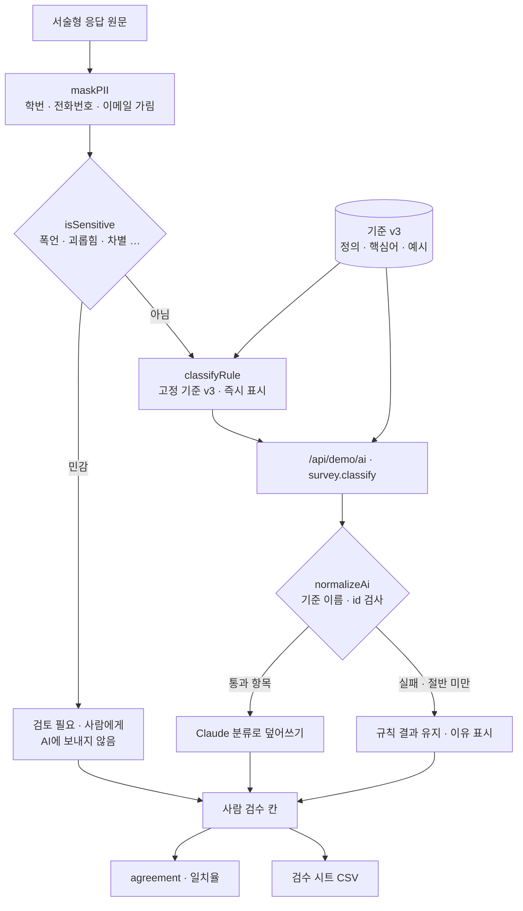

# 구조

## 같은 결과가 나오게

1. **기준을 고정한다.** 기준 이름 · 정의 · 예시를 `CRITERIA`(v3) 한 곳에 두고, 규칙 분류와 Claude 지시문이 같은 것을 쓴다.
2. **동점 순서를 고정한다.** 핵심어 점수(강 2점 · 약 1점)가 같으면 기준 순서가 앞선 쪽. 무작위로 갈리는 곳이 없다.
3. **확인할 수 있게 한다.** ‘같은 결과인지 확인’은 순서를 섞어 3번 다시 분류해 비교한다(`consistency`).

## AI / 규칙 분기

| 단계 | 규칙 | Claude |
|---|---|---|
| 시점 | 즉시 | 전체 다시 분류할 때, 응답을 추가할 때(그 1건) |
| 입력 | 가린 글 | `aiInput()` — 기준 5개 + 가린 글(민감 응답 제외, 300자까지) |
| 검사 | — | `normalizeAi()` — id가 입력에 있고, category가 기준 이름 중 하나. 중복 버림. 쓸 만한 항목이 절반 미만이면 통째로 버림 |
| 우선 | — | 민감 응답은 Claude 결과가 붙어도 ‘검토 필요’ (`autoCat`) |

## 파일

| 파일 | 하는 일 | DOM |
|---|---|---|
| `logic.js` | 기준, 샘플, 가리기, 민감 판정, 규칙 분류, 응답 검사, 분포 · 일치율 · 일관성, CSV | 없음 |
| `ai-client.js` | `/api/demo/ai` 호출, 실패하면 `null` | 없음 |
| `app.js` | 현황 · 거르기 · 목록 · 검수 · 기준 · 분포 화면 | 있음 |
| `tests/logic.test.js` | `node --test` 12개 | — |
