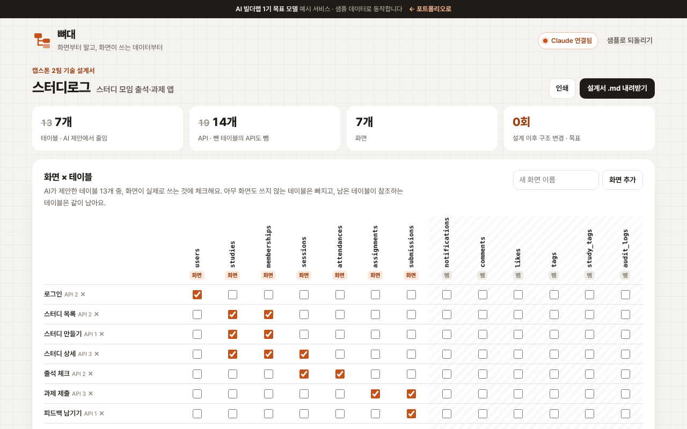

# 뼈대

> AI가 제안한 테이블을 **화면이 실제로 쓰는 데이터 기준으로 줄이고**, ERD · API 명세 · 리뷰 체크리스트와 그 판단 근거를 한 장의 설계서로 만드는 도구

   



**데모** · https://aibuilderlab.kr/demo/career-tech-spec/index.html

> **알림** AI 빌더랩 커리어 트랙 **1기 목표 모델(가상의 수강생 ‘커밋하는곰’)** 의 예시 프로젝트입니다. 캡스톤 팀과 ‘스터디로그’ 앱은 가상이며, 결과 숫자는 1기 목표치입니다.

## 문제 → 해결

| 문제 | 해결 |
|---|---|
| 캡스톤 팀이 화면부터 만들다가 데이터 구조를 세 번 갈아엎었다 | 화면 목록과 화면이 쓰는 데이터를 먼저 정하고, 테이블은 거기서 나오게 → **이후 구조 변경 0회 (목표)** |
| AI가 제안한 테이블이 13개로 과했다 (알림·댓글·좋아요·태그·변경 이력) | 화면 × 테이블 표에서 아무 화면도 쓰지 않는 테이블을 뺀다. 참조되는 테이블은 같이 남긴다 → **테이블 7개** |
| 테이블을 빼도 API 목록에는 그대로 남았다 | 뺀 테이블을 쓰는 API를 함께 뺀다 → **API 14개** |
| 왜 뺐는지 기록이 없어 다음 회의에서 또 같은 얘기를 했다 | 테이블마다 남김·뺌 **판단 기록**을 설계서에 남긴다. 그래도 남기려면 이유를 적어야 한다 |

## 주요 기능

- **화면 × 테이블** — 체크를 바꾸면 남는 테이블·판단 기록·체크리스트·ERD·API가 바로 다시 계산됩니다. 화면 추가·지우기, 되돌리기.
- **판단 기록** — 남김(화면이 씀 / 참조해서 남김 / 사람이 남김)과 뺌을 근거와 함께. 뺀 테이블은 ‘그래도 남기기’에 이유를 적어야 살아납니다.
- **리뷰 체크리스트** — 자동 4개(화면 사용, FK 대상, 화면마다 API, 이름 규칙) + 사람이 체크하는 2개(개인정보 컬럼 접근, 팀원 확인).
- **ERD · API 명세** — 남긴 테이블의 컬럼(PK·FK·개인정보 표시)과 메서드·경로·화면·테이블.
- **내보내기** — 설계서 마크다운(.md) 내려받기, 인쇄.

## AI는 이렇게 동작합니다

| 상황 | 동작 | 화면 표시 |
|---|---|---|
| Claude 연결됨 | 이미 정해진 결정과 함께 `techspec.reasons` → 근거 문장·위험 요소만 받아 덮어쓰기 | `Claude로 정리 · 2.4초` |
| AI 키 없음 · 한도 초과 · 네트워크 오류 · 서버에 작업 없음 | “스터디 상세, 출석 체크 화면이 씀”처럼 규칙 근거 | `규칙 기반 · (이유)` |
| 응답 형식이 틀림, 결정과 어긋남(뺀 테이블을 남기자고 함), 없는 테이블 | 그 문장은 버리고 규칙 근거 유지 | `규칙 기반 · 응답 형식이 맞지 않음` |
| Claude 근거를 받은 뒤 표를 바꿈 | 결정이 달라졌으므로 규칙 근거로 돌아감 | `규칙 기반 · 구성이 바뀜 · 근거 다시 쓰기` |

**남기고 빼는 결정은 AI가 하지 않습니다.** 결정은 화면 기준 규칙(`prune`)과 사람이 적은 이유로 정해지고, AI는 근거 문장만 씁니다. 개인정보 컬럼 접근은 사람이 체크해야 통과합니다. 지시문 원문은 [docs/PROMPTS.md](docs/PROMPTS.md), 서버에 합칠 정의는 [docs/ai-task.json](docs/ai-task.json).

## 기술 스택

| 구분 | 사용 |
|---|---|
| 화면 | HTML · CSS · JavaScript (프레임워크·빌드 없음) |
| 설계 | 화면 × 테이블 표 → ERD · API 명세 · 리뷰 체크리스트 |
| AI | Claude API — 서버 `aibuilderlab.kr/api/demo/ai`가 호출 |
| 결과 | 설계서 마크다운(.md), 인쇄 · 설정은 localStorage |
| 테스트 | Node 내장 `node:test` |

## 폴더 구조

```
career-tech-spec/
├── index.html
├── style.css
├── logic.js          샘플 설계 · 줄이기(prune) · API 걸러내기 · 체크리스트 · 근거 · 응답 검사 · 마크다운 (DOM 없음)
├── ai-client.js      /api/demo/ai 호출, 실패하면 null
├── app.js            화면 × 테이블 · 판단 기록 · 체크리스트 · ERD · API 화면
├── tests/logic.test.js
├── docs/ (ARCHITECTURE · DEVLOG · PROMPTS · ai-task.json)
├── CHANGELOG.md
└── package.json
```

## 실행 · 테스트

```bash
python3 -m http.server 8000   # http://localhost:8000
npm test                      # = node --test, 11개
```

## AI 활용 기록 (COVI 기록 요약)

| 프롬프트 | 디버깅 | 걸린 시간 |
|---|---|---|
| 23회 | 2회 | 4시간 |

- **막혔던 문제** — AI가 제안한 테이블이 과하게 많음 → 화면별 필요한 데이터만 남겨 7개로 축소
- **결과 (1기 목표치)** — 테이블 7개 · API 14개 정의, 이후 구조 변경 0회
- **리드 빌더 코멘트 (배포요정)** — “AI 제안을 줄이는 판단을 근거와 함께 남긴 설계서라 면접관이 좋아할 겁니다.”
- 주차별 기록: [docs/DEVLOG.md](docs/DEVLOG.md)
