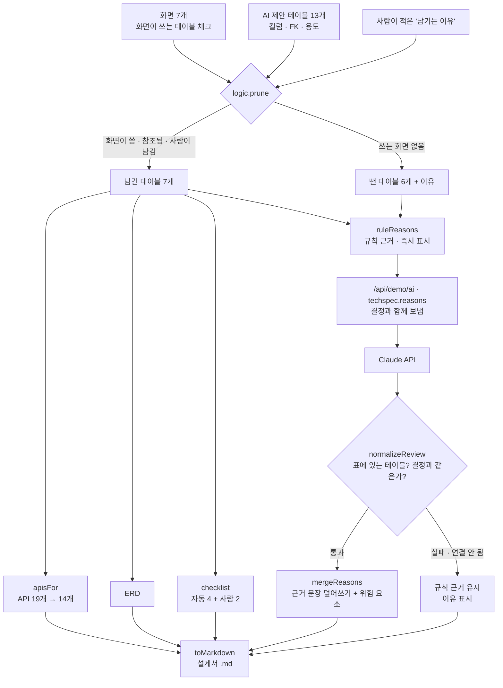

# 구조

## 줄이기 규칙 (`prune`)

1. 화면이 하나라도 쓰는 테이블은 남긴다 (`why: screen`).
2. 사람이 이유를 적은 테이블은 남긴다 (`why: manual`). 빈 이유는 무시한다.
3. 남은 테이블이 FK로 참조하는 테이블을 끝까지 따라가 남긴다 (`why: fk`, `by`에 누가 참조했는지).
4. 나머지는 뺀다. 빠진 테이블을 참조하던 테이블이면 그 사실도 이유에 붙인다.

API는 쓰는 테이블이 모두 남아 있을 때만 남습니다(`apisFor`).

## AI와 규칙의 경계

- 남김·뺌 결정은 규칙과 사람이 합니다. Claude에게는 결정을 함께 보내고 근거 문장만 받습니다.
- 응답의 `keep`이 결정과 다르면 그 문장은 버립니다. 기다리는 사이 표가 바뀌어 결정 서명(`signature`)이 달라지면 응답 전체를 버립니다.
- 표를 바꾸면 Claude 근거는 더 이상 맞지 않으므로 규칙 근거로 돌아가고 `구성이 바뀜`을 표시합니다.
- 개인정보 컬럼 접근은 체크리스트에서 사람이 체크해야 통과합니다.

## 파일

| 파일 | 하는 일 | DOM |
|---|---|---|
| `logic.js` | 샘플 설계(테이블 13 · 화면 7 · API 19), 줄이기, API 걸러내기, 체크리스트, 근거, 응답 검사, 마크다운 | 없음 |
| `ai-client.js` | `/api/demo/ai` 호출, 실패하면 `null` | 없음 |
| `app.js` | 화면 × 테이블 표, 판단 기록, 체크리스트, ERD, API 명세 | 있음 |
| `tests/logic.test.js` | `node --test` 11개 | — |
