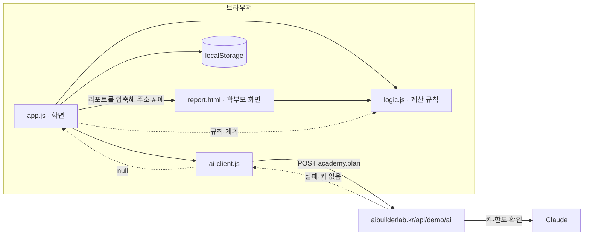
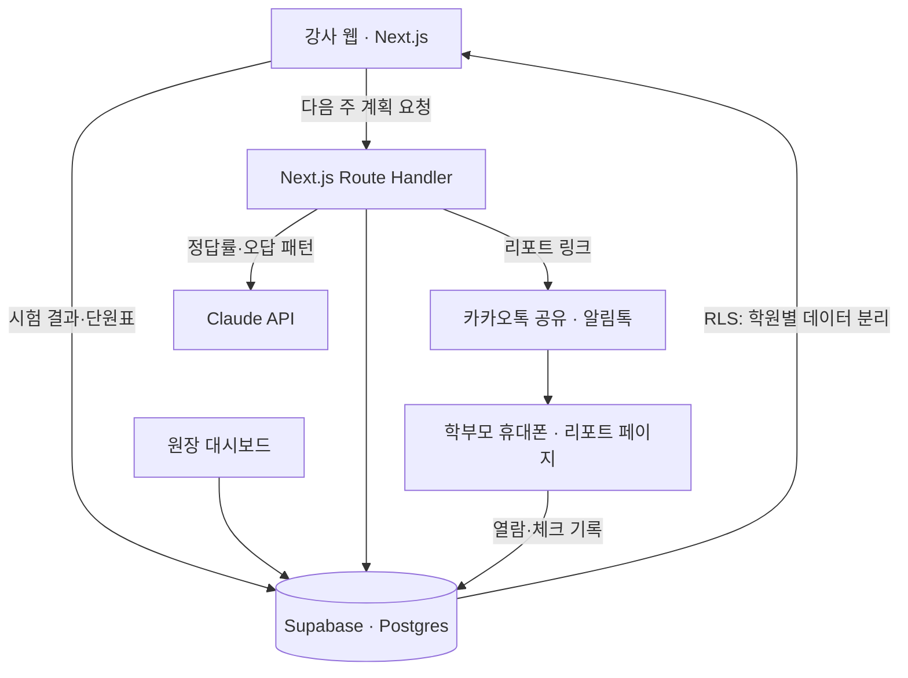

# 다음주 · 구조

## 이 데모 (정적 사이트)



- **logic.js** — DOM을 만지지 않는 순수 함수. 정답률, 보완 단원, 규칙 계획, CSV 읽기, 링크 압축·풀기, 요금 계산. `npm test`로 전부 검사.
- **app.js** — 화면 5개(시작하기·작업대·대시보드·단원표·요금제)를 그린다. 계산은 모두 logic.js에 맡긴다.
- **ai-client.js** — 서버에 작업 이름과 입력만 보낸다. 실패하면 `null` → 화면은 규칙으로 처리. 그래서 AI가 없어도 서비스는 멈추지 않는다.
- **report.html** — 학부모가 받는 화면. 서버 요청 없이 주소의 `#` 뒤만 읽는다. `#` 뒤는 서버로 전송되지 않으므로 학생 정보가 서버 기록에 남지 않는다.

### 학부모 링크 형식

```
report.html#z<base64url(deflate-raw(JSON))>     ← 압축 (기본)
report.html#j<base64url(JSON)>                  ← 압축을 못 하는 브라우저
```

## 실제 버전 (수료 프로젝트 계획)



| | 이 데모 | 실제 버전 |
|---|---|---|
| 화면 | HTML · CSS · JavaScript (빌드 없음) | Next.js |
| 데이터 | localStorage | Supabase (학원별 RLS) |
| 계획 작성 | Claude(서버 경유) / 규칙 | Claude API + 학생별 오답 패턴 |
| 전달 | 링크·QR·카톡 문구 복사 | 카카오톡 공유 · 알림톡 자동 발송 |
| 결제 | 요금제 화면(예시 가격) | 학원 정기 결제 |
