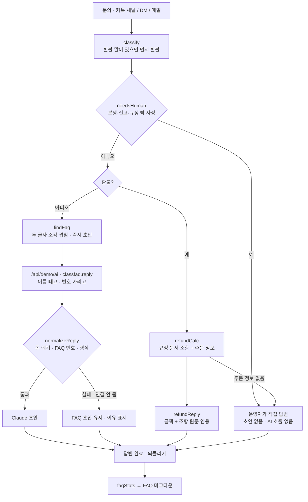

# 구조

## 환불을 AI에서 뺀 세 겹

1. **분류**: 환불·환급·취소·돌려받·그만두 중 하나라도 있으면 다른 범주보다 먼저 환불.
2. **호출하지 않음**: `aiAllowed()`가 환불·규정·사람 갈래는 false. 화면이 `AI.ask`를 부르지 않는다.
3. **응답 검사**: FAQ 갈래 답에도 환불·환급·보상 같은 말이 있으면 버린다.

## 환불 계산 순서 (`refundCalc`)

수강 기간이 끝났나(4항) → 결제 7일 이내 · 2강 이하인가(1항) → 아니면 남은 강의 비율, 1,000원 미만 버림(2항) → 키트가 발송됐고 반송하지 않았으면 재료비 빼기(3항). 주문 정보가 없으면 5항으로 사람에게.

## 파일

| 파일 | 하는 일 | DOM |
|---|---|---|
| `logic.js` | 샘플 FAQ, 분류, 사람에게 넘기기, 환불 규정·계산·답변, FAQ 찾기, 갈래, 응답 검사, 가리기, 정리 | 없음 |
| `ai-client.js` | `/api/demo/ai` 호출, 실패하면 `null` | 없음 |
| `app.js` | 샘플 문의, 문의함 · 답변 · 주문 정보 · FAQ 정리 화면, localStorage | 있음 |
| `tests/logic.test.js` | `node --test` 14개 | — |
| `docs/ai-task.json` | 서버 TASKS에 합칠 작업 정의 | — |
