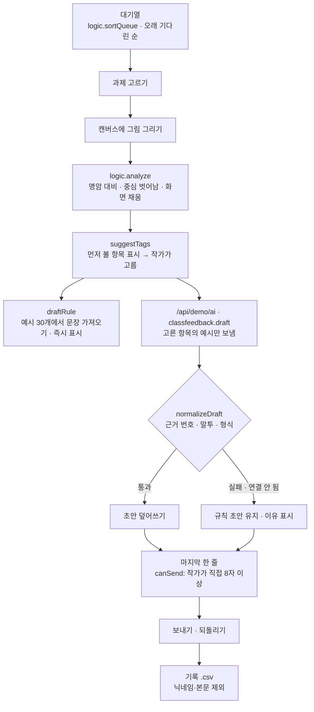

# 구조

## 그림 분석 (`analyze`)

1. 네 귀퉁이 8×8 밝기의 중앙값을 바탕 밝기로 본다 (누런 종이도 바탕으로 잡힌다).
2. 바탕과 24 넘게 다른 점을 ‘그림’으로 센다 → 그림의 무게중심, 둘러싼 상자.
3. 명암 대비 = 상위 2% 밝기 − 하위 2% 밝기 (연필 자국 몇 점에 흔들리지 않게).
4. 대비 50% 미만 → 명암, 중심이 30% 넘게 벗어남 · 채움 20% 미만 또는 82% 초과 → 구도·여백.

## AI / 규칙 분기

- 규칙 초안이 먼저 나오고, Claude 응답이 검사를 통과하면 덮어쓴다. 다른 과제를 고르면 앞 응답은 버린다(`runToken`).
- 기다리는 사이 작가가 초안을 고쳤으면 Claude 응답이 와도 덮어쓰지 않는다.
- 어느 쪽으로 썼든 마지막 한 줄은 작가가 쓴다. AI는 보내기 버튼을 열 수 없다.

## 파일

| 파일 | 하는 일 | DOM |
|---|---|---|
| `logic.js` | 예시 30개, 말투 검사, 그림 분석, 대기열, 규칙 초안, 응답 검사, 보낼 글, CSV | 없음 |
| `ai-client.js` | `/api/demo/ai` 호출, 실패하면 `null` | 없음 |
| `app.js` | 샘플 그림 그리기(캔버스), 대기열 · 과제 · 초안 · 보낸 기록 화면, localStorage | 있음 |
| `tests/logic.test.js` | `node --test` 14개 | — |
| `docs/ai-task.json` | 서버 TASKS에 합칠 작업 정의 | — |
