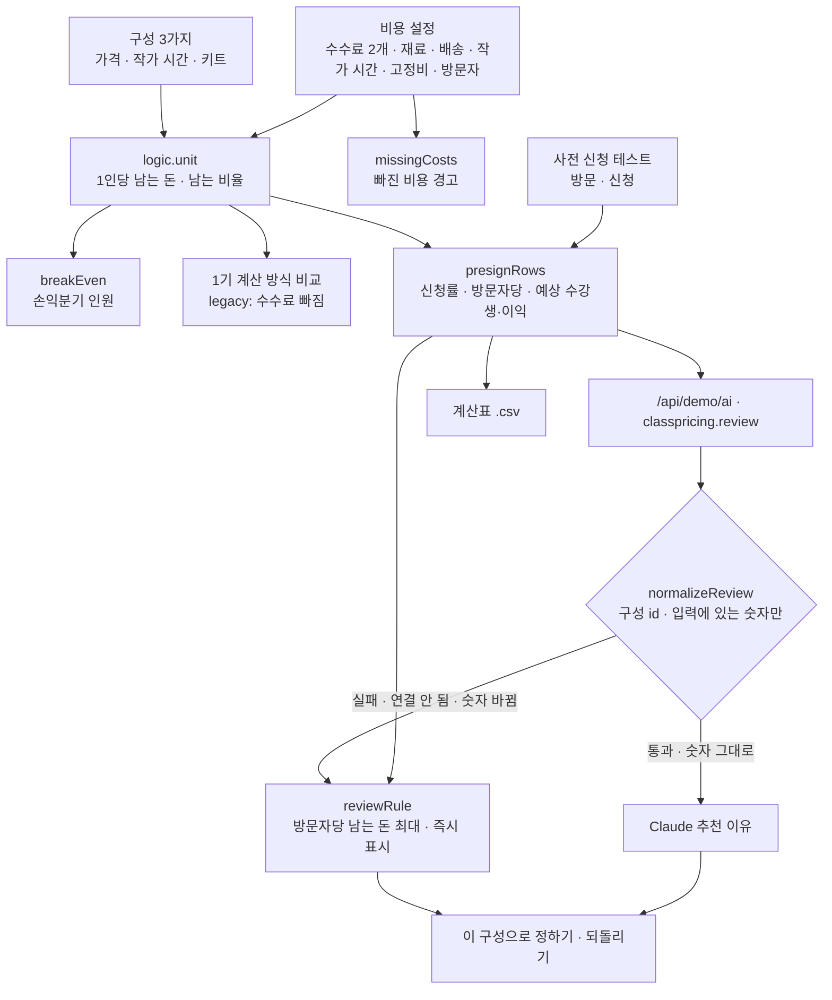

# 구조



## 계산 (`unit`)

```
1인당 남는 돈 = 가격 − 가격×플랫폼 수수료율 − 가격×결제 수수료율 − (키트면 재료비 + 배송비) − 작가 시간(분)/60 × 시간당 값
기수 이익     = 1인당 남는 돈 × 수강생 − 고정비
손익분기      = ⌈고정비 ÷ 1인당 남는 돈⌉ (남는 돈 ≤ 0 이면 불가)
방문자당      = 신청률 × 1인당 남는 돈
```
`{legacy:true}`는 수수료 두 줄을 0으로 두는 1기 방식이다. 테스트가 “두 방식의 차이 = 수수료 두 줄”을 확인한다.

## AI / 규칙 분기

- 계산은 늘 규칙(`logic.js`)이 한다. AI는 추천 구성과 이유 문장만 낸다.
- 숫자를 고치면 규칙 추천이 바로 다시 계산된다. 그 전에 받은 Claude 추천은 입력 키(`keyOf`)가 달라지면 버린다.
- `numbersGrounded`: 글 속 숫자(쉼표 제거)가 입력 숫자, 그 반올림, 천·만 단위 표기(9.9만), 백분율(12.5%) 중 하나와 맞아야 한다. 10 이하 작은 수는 허용.

## 파일

| 파일 | 하는 일 | DOM |
|---|---|---|
| `logic.js` | 샘플 숫자, 1인당 계산, 손익분기, 빠진 비용, 사전 신청, 규칙 추천, 숫자 검사, CSV | 없음 |
| `ai-client.js` | `/api/demo/ai` 호출, 실패하면 `null` | 없음 |
| `app.js` | 돌아보기 · 비용 · 구성 카드 · 테스트 표 · 추천 화면, localStorage | 있음 |
| `tests/logic.test.js` | `node --test` 12개 | — |
| `docs/ai-task.json` | 서버 TASKS에 합칠 작업 정의 | — |
