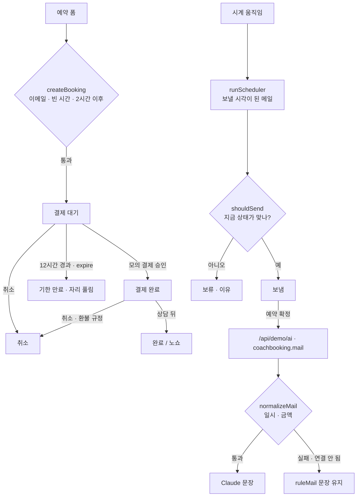

# 구조

## 발송 직전 상태 확인

메일은 예약 때 계획(`planMails`)되지만, **보내는 순간** `shouldSend(type, booking)`이 그때 상태를 봅니다.

| 메일 | 보내는 상태 | 그 밖의 상태 |
|---|---|---|
| 결제 요청 · 결제 리마인드 | 결제 대기 | 보류 (이미 결제됨 · 취소된 예약 · 기한 만료된 예약) |
| 예약 확정 · 하루 전 · 2시간 전 | 결제 완료 | 보류 (결제 전 · 취소된 예약 · 기한 만료된 예약) |

처리한 메일은 `예약 id + 종류`로 기록해 다시 보내지 않습니다. 샘플의 지난 기록은 `replay()`가 예약의 상태 변화(대기 → 완료 → 취소)를 시간 순서로 다시 돌려 만듭니다.

## AI / 규칙 분기

| 단계 | 담당 |
|---|---|
| 예약 검사 · 결제 · 만료 · 환불 · 발송 여부 | 항상 규칙 |
| 예약 확정 메일 문장 | 규칙 문장이 먼저, Claude 문장이 검사를 통과하면 교체 |

## 파일

| 파일 | 하는 일 | DOM |
|---|---|---|
| `logic.js` | 예약 · 결제 · 만료 · 환불 · 메일 계획/판단 · 메일 검사 · 숫자 | 없음 |
| `ai-client.js` | `/api/demo/ai` 호출, 실패하면 `null` | 없음 |
| `app.js` | 예약 폼 · 예약 현황 · 메일함 · 결제 창 · 시계, localStorage(`startup-coach-booking-v1`) | 있음 |
| `tests/logic.test.js` | `node --test` 13개 | — |
