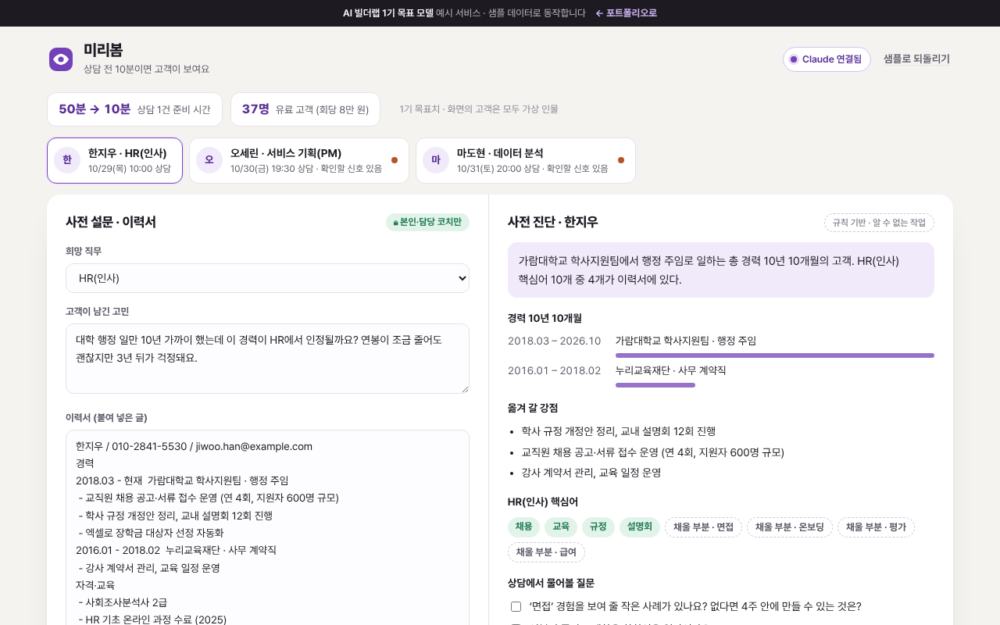

# 미리봄

> 상담 전에 받은 설문과 이력서로 Claude가 **사전 진단**(경력 요약 · 옮겨 갈 강점 · 채울 부분 · 물어볼 질문)을 만들고, 상담 메모는 고객에게 보낼 **요약 리포트**로 바꾸는 커리어 코치용 도구. 이력서는 **본인과 담당 코치만** 열 수 있습니다.

   



**데모** · https://aibuilderlab.kr/demo/startup-coach-brief/index.html

> **알림** AI 빌더랩 창업 트랙 **1기 목표 모델(가상의 수강생 ‘이직나침반’)** 의 예시 프로젝트입니다. 고객 3명과 이력서는 모두 가상이며, 결과 숫자는 1기 목표치입니다.

## 문제 → 해결

| 문제 | 해결 |
|---|---|
| 상담마다 이력서와 고민을 미리 읽고 정리하느라 50분 | 진단을 누르면 경력 기간 · 강점 · 채울 부분 · 질문이 바로 → **준비 50분 → 10분** |
| 상담 뒤 고객에게 보낼 정리를 또 따로 썼다 | 메모에 `→`만 붙이면 ‘다음 할 일’이 되는 요약 리포트, 복사 · 인쇄 |
| 이력서 파일이 누구나 열리는 주소로 저장돼 있었다 | **본인 · 담당 코치만** 열고, 주소는 10분 뒤 만료. 이름이 주소에 들어가지 않음 |
| 고민 글에 마음 건강·해고 같은 이야기가 섞여 온다 | AI가 판단하지 않고 ‘코치가 직접 확인’ 신호로 띄운다 |

## 주요 기능

- **사전 진단** — 이력서의 `2018.03 - 현재 회사 · 직무` 줄로 총 경력을 계산(겹치는 기간은 한 번만), 희망 직무 핵심어와 겹치는 업무 줄을 강점으로, 빠진 핵심어를 채울 부분으로 보여 줍니다.
- **질문 체크리스트** — 상담 중 물어본 질문을 체크해 둡니다.
- **주의 신호** — ‘잠을 못 자’, ‘권고사직’, ‘위로금’ 같은 표현이 있으면 마음 건강 · 노무·법률 신호를 띄웁니다. Claude 결과로 지워지지 않습니다.
- **요약 리포트** — `→` 줄은 할 일, `#` 줄은 코치 전용(리포트에서 빠짐). 연락처는 자동으로 가려지고 이름은 `한○○`로 표시됩니다.
- **파일 권한 시험** — 담당 코치 · 본인 · 다른 코치 · 로그인 안 한 방문자로 열어 보고, 11분 뒤 같은 주소가 막히는지 확인합니다. 열람 기록에는 역할만 남습니다.

## AI는 이렇게 동작합니다

| 상황 | 동작 | 화면 표시 |
|---|---|---|
| Claude 연결됨 | 이름·연락처를 가린 설문·이력서로 `coachbrief.diagnose` → 형식 검사 → 문장만 교체 (경력 계산·주의 신호는 규칙 유지) | `Claude로 정리 · 2.1초` |
| AI 키 없음 · 한도 초과 · 알 수 없는 작업 · 네트워크 오류 | 핵심어 점검표로 진단 | `규칙 기반 · (이유)` |
| 응답 형식이 틀림 (요약·질문 없음) | 버리고 규칙 결과 유지 | `규칙 기반 · 응답 형식이 맞지 않음` |

작업 정의는 [docs/ai-task.json](docs/ai-task.json), 흐름은 [docs/ARCHITECTURE.md](docs/ARCHITECTURE.md), 지시문은 [docs/PROMPTS.md](docs/PROMPTS.md).

## 기술 스택

| 구분 | 데모 | 실제 버전 |
|---|---|---|
| 화면 | HTML · CSS · JavaScript (빌드 없음) | Next.js |
| 파일 · 권한 | `canOpen` · `issueLink` 로 흉내 | Supabase Storage 비공개 버킷 + RLS + 서명 주소 |
| AI | Claude API — 서버 `aibuilderlab.kr/api/demo/ai` | Claude API |
| 테스트 | Node 내장 `node:test` | |

## 폴더 구조

```
startup-coach-brief/
├── index.html
├── style.css
├── logic.js          경력 계산 · 진단 · 주의 신호 · 응답 검사 · 파일 권한 · 리포트 (DOM 없음)
├── ai-client.js      /api/demo/ai 호출, 실패하면 null
├── app.js            고객 · 진단 · 메모 · 권한 화면
├── tests/logic.test.js
├── docs/ (ARCHITECTURE · DEVLOG · PROMPTS · ai-task.json)
├── CHANGELOG.md
└── package.json
```

## 실행 · 테스트

```bash
python3 -m http.server 8000   # http://localhost:8000
npm test                      # = node --test, 12개
```

## AI 활용 기록 (COVI 기록 요약)

| 프롬프트 | 디버깅 | 걸린 시간 |
|---|---|---|
| 48회 | 8회 | 9시간 |

- **막혔던 문제** — 이력서 파일이 누구나 열리는 주소로 저장됨 → 비공개로 바꾸고 본인·담당 코치만 10분짜리 주소로 열게 수정
- **결과 (1기 목표치)** — 유료 고객 37명(회당 8만 원), 상담 준비 50분 → 10분
- 주차별 기록: [docs/DEVLOG.md](docs/DEVLOG.md)
