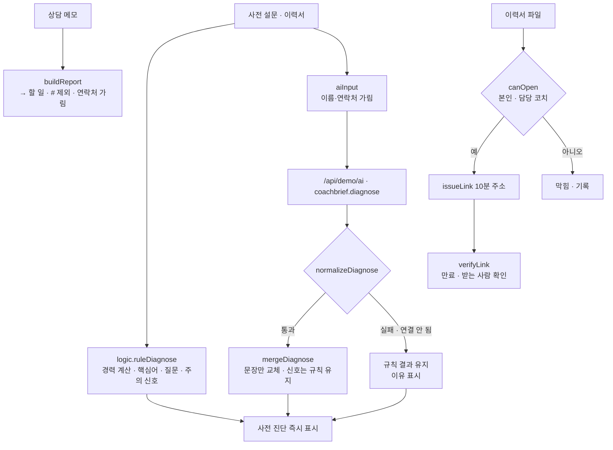

# 구조

## AI / 규칙 분기

| 단계 | 규칙 | Claude |
|---|---|---|
| 경력 기간 | 항상 규칙 (`parseCareer`, `totalMonths`) | 쓰지 않음 |
| 요약 · 강점 · 채울 부분 · 질문 | 핵심어 점검표 | 응답이 검사를 통과하면 교체 |
| 주의 신호 | 항상 규칙 (`safetyFlags`) | 지울 수 없음 |
| 리포트 | 항상 규칙 | 쓰지 않음 |

‘사전 진단 만들기’를 누르면 규칙 결과가 바로 나오고 Claude를 기다립니다. 그 사이 다시 누르면 앞의 응답은 버립니다(`runToken`).

## 개인정보

- Claude에는 `aiInput()`으로 이름을 ‘고객’으로, 전화·이메일·주민번호를 가린 뒤 보냅니다.
- 리포트도 `maskPii()`를 거치고 이름은 `한○○`로만 씁니다.
- 열람 주소에는 파일 번호만 있고, 열람 기록에는 역할만 남습니다. 열람 주소는 localStorage에 저장하지 않습니다.

## 파일

| 파일 | 하는 일 | DOM |
|---|---|---|
| `logic.js` | 경력 계산, 진단, 주의 신호, 응답 검사, 파일 권한, 리포트 | 없음 |
| `ai-client.js` | `/api/demo/ai` 호출, 실패하면 `null` | 없음 |
| `app.js` | 고객 · 진단 · 메모 · 권한 화면, localStorage(`startup-coach-brief-v1`) | 있음 |
| `tests/logic.test.js` | `node --test` 12개 | — |
