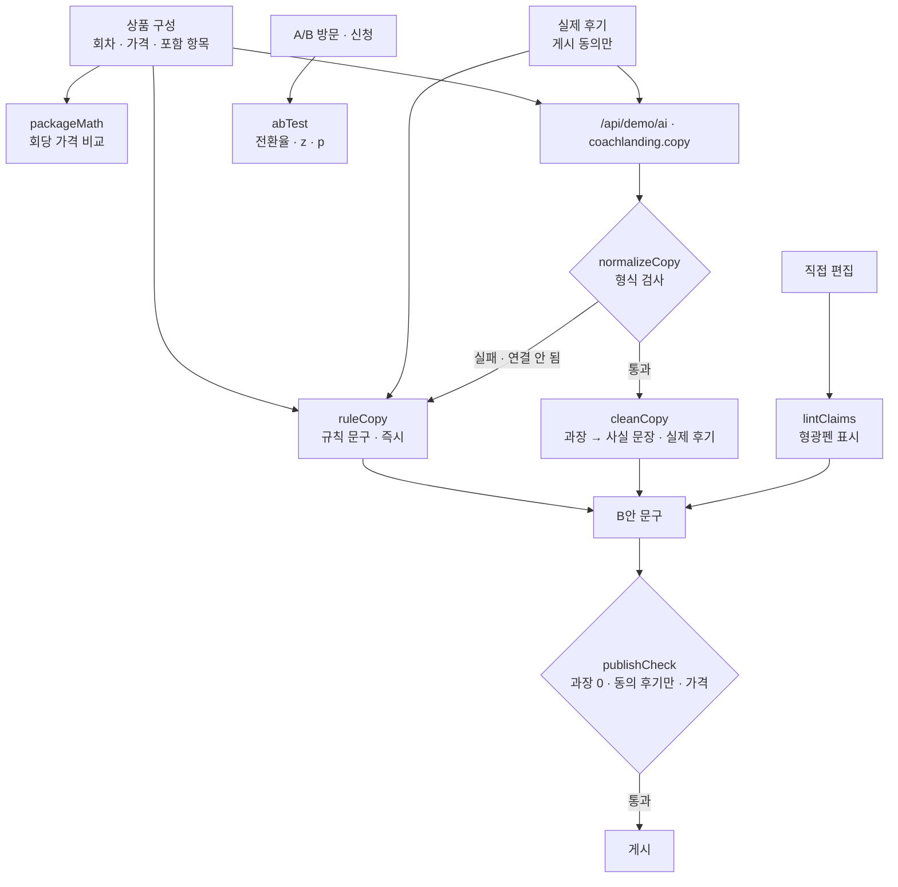

# 구조

## AI / 규칙 분기

| 단계 | 담당 |
|---|---|
| 회당 가격, 실험 판단 | 항상 규칙 |
| B안 문구 초안 | 규칙 문구가 먼저, Claude 문구가 형식 검사를 통과하면 교체 |
| 과장 검사 · 교체, 게시 전 확인 | **항상 규칙** — Claude 문구도 예외 없음 |

‘새 문구 만들기’를 누르면 규칙 문구가 바로 들어가고 Claude를 기다립니다. 그 사이 다시 누르면 앞의 응답은 버립니다(`runToken`).

## 과장 표현 규칙 (`CLAIMS`)

| 유형 | 예 | 이유 |
|---|---|---|
| 결과 보장 | 합격 보장, 취업 보장 | 결과를 보장할 수 없음 |
| 확인할 수 없는 수치 | 100% | 근거 없음 |
| 모두에게 같은 결과 | 누구나, 무조건, 반드시 합격 | 개인차 무시 |
| 최상급 | 업계 최고, 국내 1위 | 비교 근거 없음 |
| 연봉 숫자 | 연봉 2배 | 근거 없음 |
| 기간 약속 | 4주 만에 합격 | 결과 약속 |
| 버튼 | 합격하기 | 결과 약속 |

## 파일

| 파일 | 하는 일 | DOM |
|---|---|---|
| `logic.js` | 패키지 계산, 과장 검사·교체, 규칙 문구, 응답 검사, 게시 전 확인, A/B 판단 | 없음 |
| `ai-client.js` | `/api/demo/ai` 호출, 실패하면 `null` | 없음 |
| `app.js` | 상품 · 문구 · 미리보기 · 실험 · 후기 화면, localStorage(`startup-coach-landing-v1`) | 있음 |
| `tests/logic.test.js` | `node --test` 11개 | — |
