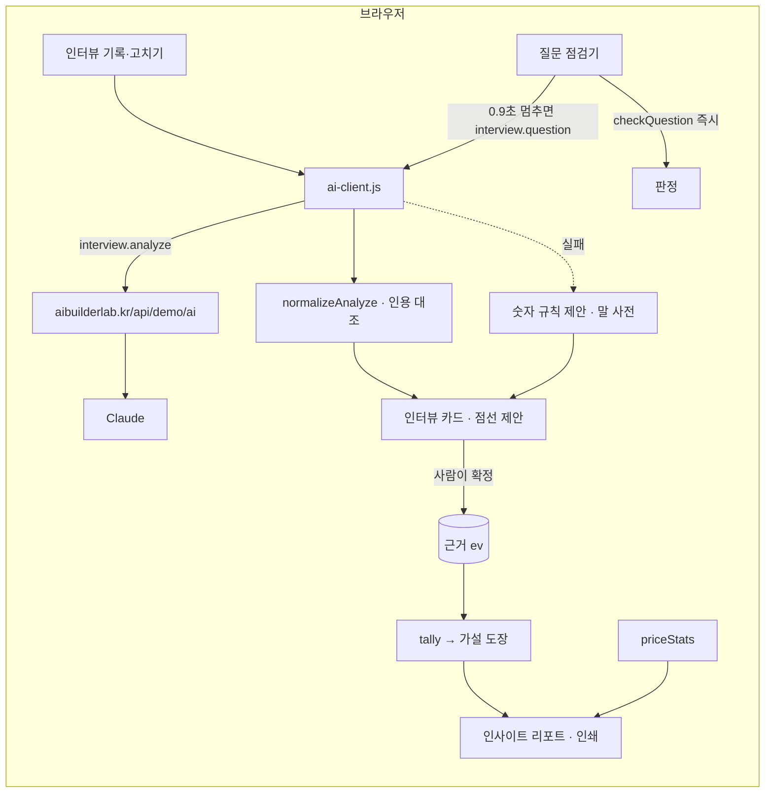

# 들어보니 · 구조

- **logic.js** — 가설 판정(`tally`), 태그 순환, 말 사전·인용, Claude 응답 검사, 유도 질문 판정·규칙 고쳐 쓰기, 가격 통계. `npm test`로 12개 검사.
- **app.js** — 보드·인사이트·질문 설계·가격 응답 탭, 기록 창, 리포트 미리보기·인쇄.
- 같은 질문은 다시 묻지 않도록 고쳐 쓴 결과를 기억합니다(사용량 절약).

## 실제 버전 (수료 프로젝트 계획)

| | 이 데모 | 실제 버전 |
|---|---|---|
| 저장 | localStorage | Supabase (프로젝트·인터뷰·근거 테이블) |
| 입력 | 직접 적기 | 녹음 → 받아쓰기 → 메모 초안 |
| 분석 | Claude(서버 경유) / 규칙 | Claude API |
| 공유 | 인쇄·PDF | 링크 공유 · 팀 코멘트 |
